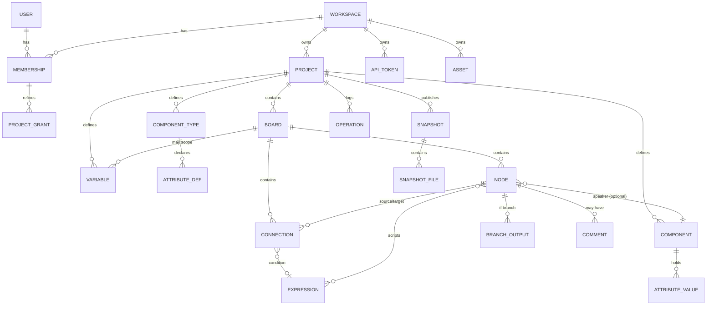
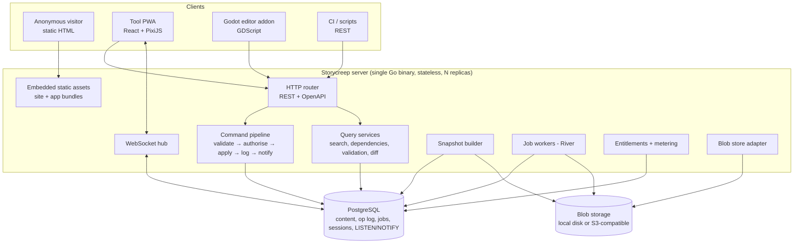

# Storycreep — Product Requirements Document

| Field | Value |
| --- | --- |
| Document version | 1.14 |
| Date | 2026-10-17 |
| Status | Approved for implementation |
| Product | Storycreep — branching narrative design tool for games |
| License | AGPL-3.0-only (see ADR-011) |
| Primary audience of this document | AI coding agents implementing the system; the maintainer reviewing their output |

**How to read this document.** Section 4 is the contract: every functional requirement has a stable ID, a MoSCoW priority, a target phase, explicit dependencies, and acceptance criteria written so they can be turned into automated tests. Sections 5–10 define the models and architecture that the requirements assume. Section 11 records the decisions that are expensive to reverse. When this document and an implementation disagree, this document wins until it is amended.

**Originality.** Storycreep is designed from the problem statement in §1.1, not from any existing product. Its data model, JSON format, expression language, UI, and documentation are its own. No code, asset, UI design, copy, or schema from any third-party tool may be copied into this project, and no feature is specified here by reference to a competitor. Migration from other tools is served by the documented import format (FR-DATA-01), which any third party can target; Storycreep ships no importer for a specific commercial product.

---

## 1. Summary, goals, and non-goals

### 1.1 Summary

Storycreep is a web application for designing branching game narratives — dialogue trees, quests, and the logic connecting them — plus a Godot 4 addon that pulls the authored narrative into a game as deterministic JSON and executes it at runtime.

The problem it exists to solve is **cross-conversation dependency**. In a game of any size, a conversation with character B only becomes available because of something the player did in a conversation with character A; an individual dialogue option appears because a quest flag was set in a third place entirely. Authors currently track this in spreadsheets, comments, or their own memory, and the game code drifts away from the design. Storycreep makes those dependencies first-class: every variable knows where it is written and where it is read, every board knows which other boards it depends on, and the game consumes exactly the data the author designed — never a hand-maintained copy of it.

Storycreep ships as an open-source, self-hostable application (one container image plus PostgreSQL) and is architected so that a multi-tenant hosted service with real-time collaboration can be added later without rewriting storage, permissions, or sync.

### 1.2 Goals

| ID | Goal | How it is measured |
| --- | --- | --- |
| G1 | An author can design a complete branching narrative — conversations, quests, conditions, variables — in one place. | A 2,000-node, 30-board project can be authored, validated, and published without external tooling. |
| G2 | Cross-conversation dependencies are visible and maintainable, not discovered by playtesting. | For any variable, the author can see every write and read in ≤2 interactions; publishing is blocked on dangling references. |
| G3 | The game runs exactly the data the author designed. | The Godot runtime and the web play mode pass the same shared conformance test suite (§8.6). |
| G4 | The game is never changed by accident. | Every change to game data requires an explicit human action in the Godot editor, preceded by a diff. |
| G5 | Self-hosting is genuinely easy. | `docker compose up` on a clean host yields a usable instance in under 5 minutes with no email, Redis, or object-storage configuration. |
| G6 | The tool is usable on an Android tablet, including offline. | Reference-device performance targets in §9.1 are met; a pinned project can be edited with no network and reconciled on reconnect. |
| G7 | The MVP does not foreclose the hosted, collaborative future. | Every decision in §11 is implemented in the MVP codebase, including the ones the MVP UI does not expose. |
| G8 | The data is open. | Versioned JSON Schema, documented migrations, full export/import, and a documented REST API — all usable without the web UI. |

### 1.3 Non-goals

| ID | Non-goal | Note |
| --- | --- | --- |
| NG1 | Being a general-purpose flowchart, mind-map, or diagramming tool. | The canvas is specialised for narrative flow. Generic diagram features are rejected by default. |
| NG2 | Being a game engine, scripting language, or behaviour-tree editor. | The expression language is deliberately small and total (§5.8). Game logic beyond narrative state belongs in the engine. |
| NG3 | Shipping engine integrations beyond Godot in the MVP. | Unity/Unreal/web runtimes are possible later; the JSON format and REST API are the integration contract, so third parties can build their own. |
| NG4 | Voice/audio production, localisation vendor workflows, or asset pipelines. | Text export (FR-TEXT-05) is the seam to those tools. |
| NG5 | Real-time co-editing in the MVP. | Architecture supports it (ADR-004, ADR-005); UI arrives in the Collaboration phase. |
| NG6 | Supporting any database other than PostgreSQL. | ADR-001. No SQLite, no MySQL, including for self-hosting. |
| NG7 | A visual scripting system for gameplay. | Conditions and assignments only. |
| NG8 | Telemetry or phone-home of any kind. | ADR-026. Adoption is measured through public, non-invasive signals (§14). |

### 1.4 Product pillars (traceability)

| Pillar | Primary requirements | Primary ADRs |
| --- | --- | --- |
| One codebase, two deployment modes | FR-ADMIN-01…06, FR-ENT-01…03, FR-PUB-04 | ADR-019, ADR-010 |
| Public presentation + the tool | FR-PUB-01…09, FR-OFF-01 | ADR-012 |
| Narrative model with logic | FR-EDIT-*, FR-COMP-*, FR-VAR-*, FR-EXPR-* | ADR-014, ADR-020 |
| Dependency visibility | FR-DEP-01…06 | ADR-004 |
| Play mode / simulator | FR-PLAY-01…07 | ADR-014 |
| Godot integration | FR-GODOT-01…11 | ADR-022 |
| Safe, versioned sync | FR-SNAP-*, FR-SYNC-* | ADR-015, ADR-016, ADR-025 |
| Open data | FR-DATA-01…05, FR-API-01…05 | ADR-016, ADR-017 |

---

## 2. Target users and personas

### 2.1 P1 — Solo indie developer ("Tomáš")

Builds a narrative-heavy RPG in Godot 4 alone or with one artist. Comfortable with git, docker-compose, and GDScript. Currently keeps dialogue in a mix of JSON files and a spreadsheet of quest flags, and loses an afternoon every time a flag is renamed.

- **Needs:** authoring and the game in one loop; no silent changes to the game; data in git; no vendor lock-in; works offline on a train.
- **Success:** a conversation is designed, published, pulled, and running in the game within one session; renaming a flag updates every reference and the game picks it up on the next pull.
- **Blockers if unaddressed:** having to run Redis and object storage; a proprietary binary format; an editor that cannot handle 2,000 nodes.

### 2.2 P2 — Writer without coding skills ("Hana")

Writes dialogue and quest text for a small studio. Does not read code and will not open a terminal. Works on a Windows laptop and an Android tablet, often in a café with bad Wi-Fi.

- **Needs:** writing-first surfaces (script/outline view), plain-language conditions, immediate playthrough of her own scene, a way to see *why* an option is hidden, and comments to discuss lines with the designer.
- **Success:** writes and playtests a gated conversation without asking a developer what a variable is; understands "this option needs `met_elara` to be true, which is set in *Elara — First Meeting*".
- **Blockers if unaddressed:** an expression box with raw syntax errors and no help; a canvas that requires a mouse; any workflow that requires publishing to see her own text.

### 2.3 P3 — Small team (2–8 people: designer, writer, developer)

One instance, one workspace, several projects. Roles matter: the writer should not be able to publish a release; a contractor should see exactly one project.

- **Needs:** invites, roles, comments, visible history of who changed what, confidence that two people editing the same board will not lose work, and a single place the build pulls from.
- **Success:** the developer pins a release for the current milestone while the writer continues on the draft; the build is reproducible.
- **Blockers if unaddressed:** last-write-wins overwrites; no audit trail; no way to stop a draft reaching the game.

### 2.4 P4 — Studio on the hosted service (later phase)

10–60 people, several concurrent projects, EU-based, needs SSO, auditability, guaranteed backups, and a DPA. Pays per seat.

- **Needs:** real-time co-editing with presence, SSO/OIDC, workspace-level audit and retention policy, uptime and support, usage limits that are clear before they are hit.
- **Success:** procurement passes on the DPA and sub-processor list; two writers edit the same board at once without coordination.
- **Blockers if unaddressed:** tenancy that cannot be audited; no data-export story; a collaboration model bolted on after launch.

### 2.5 Secondary: self-hosting admin

Often the same person as P1 or the P3 developer. Cares about upgrade safety, backup/restore, and not being surprised by outbound network calls.

---

## 3. Key end-to-end user journeys

Each journey lists the requirements it exercises; a journey is "done" for a phase when all of its MVP-phase requirements pass their acceptance criteria.

### J1 — Visitor discovers Storycreep, signs up, lands in the tool

1. A visitor arrives at `/` from a search result or a forum link. The page is server-rendered static HTML: what Storycreep is, the dependency problem it solves, three annotated screenshots, a short demo video or interactive sample, links to GitHub and docs, and "Try the hosted service" / "Self-host it" paths. No tool JavaScript is downloaded. (FR-PUB-01, FR-PUB-02)
2. They open `/docs/self-hosting`, copy the docker-compose snippet, and keep reading. (FR-PUB-06)
3. They click **Sign up** (hosted mode), enter email + password, and verify the email. (FR-AUTH-01, FR-AUTH-03)
4. First login creates a personal workspace named after them and offers: create a blank project, or open the sample project *The Lighthouse Keeper*. (FR-TEN-01, FR-PROJ-05)
5. They pick the sample; the tool shell loads and the board canvas opens. (FR-PROJ-04, FR-EDIT-01)
6. On the next visit, `/` detects the session and redirects straight to the last opened project. Marketing pages are never shown to an authenticated user unless explicitly navigated to. (FR-PUB-05)

*Self-hosted variant:* `/` is a login screen; step 1–2 do not exist unless the admin enabled the presentation. (FR-PUB-04)

### J2 — Designing a conversation gated by an event

1. Hana opens project *Harbour*, creates board **Elara — First Meeting**, and adds four elements with dialogue text, speaker `Elara`. (FR-PROJ-02, FR-EDIT-02, FR-TEXT-01)
2. She connects them and labels two outgoing connections "Ask about the lighthouse" and "Say nothing" — connection labels are the player's choices. (FR-EDIT-03)
3. On the last element she adds an on-exit assignment `met_elara = true`. The variable does not exist yet; the editor offers "create global bool `met_elara`" inline. (FR-VAR-01, FR-EXPR-01)
4. She opens play mode from the first node, walks the conversation, and watches `met_elara` flip to true in the variable inspector. (FR-PLAY-01, FR-PLAY-02)
5. She leaves a comment on the second node: "@tomas does the lighthouse exist yet?" (FR-COMMENT-01, FR-COMMENT-02)

### J3 — Adding an option that depends on another conversation

1. On board **Harbourmaster**, Hana adds a connection labelled "The keeper sent me." (FR-EDIT-03)
2. She sets a condition on that connection: `met_elara == true`. Autocomplete lists the variable with its description and the note "written in *Elara — First Meeting*". (FR-EXPR-01, FR-DEP-01)
3. The board header now shows "depends on 1 other board"; the dependency view draws **Harbourmaster → requires → Elara — First Meeting**. (FR-DEP-02)
4. She runs play mode on **Harbourmaster** with a clean state: the option is hidden, and in author view it is listed as hidden with the reason "`met_elara == true` is false". She toggles `met_elara` in the inspector and the option appears. (FR-PLAY-03)
5. Validation reports no warnings. Had she misspelled the variable, publishing would be blocked with an error pointing at the connection. (FR-DEP-03, FR-DEP-04)

### J4 — Publishing a snapshot

1. Tomáš opens **Releases**, clicks **Publish**, and sees the validation report: 0 errors, 2 warnings (one variable written but never read). (FR-SNAP-01, FR-DEP-04)
2. He writes a changelog note "Harbour intro + keeper gate", changes the proposed patch version `1.3.1` to `1.4.0` because the release adds a conversation, and publishes. (FR-SNAP-01)
3. The snapshot is built asynchronously, becomes immutable, and appears in the list with author, timestamp, note, entity counts, and a download link. (FR-SNAP-01, FR-SNAP-02, FR-SNAP-03)
4. He compares `1.4.0` with `1.3.0` in the web diff: 12 nodes added, 3 modified, 1 variable added. (FR-SNAP-04)

### J5 — Pulling into Godot and reviewing the diff

1. In Godot, Tomáš opens the **Storycreep** dock. The instance URL and project are already in `res://storycreep/connection.json`; his token lives in his personal editor settings, not in the project. (FR-GODOT-01)
2. He clicks **Check for updates**. The dock shows "Release 1.4.0 available — currently pinned to 1.3.0". Nothing has been downloaded into the project. (FR-SYNC-03, FR-GODOT-02)
3. He clicks **Review changes**. The addon downloads 1.4.0 into its cache outside the project and computes the diff locally. The diff panel lists, grouped by board: added/removed/modified nodes, changed choice labels and conditions, added/removed/retyped variables, and a prominent section "3 files in res://storycreep/ were modified locally and will be overwritten". (FR-SYNC-04, FR-SYNC-08, FR-GODOT-03)
4. He clicks **Apply**. Files are written atomically, the pin moves to `1.4.0`, the previous snapshot stays in the local cache, and Godot re-imports. (FR-SYNC-05, FR-GODOT-03)
5. He runs the game; the new conversation is live. (FR-GODOT-05, FR-GODOT-06)

### J6 — Rolling back

1. A bug appears in `1.4.0` the evening before a demo. In the dock, Tomáš selects `1.3.0` from version history and clicks **Roll back**. (FR-SYNC-05)
2. The same diff screen appears, now describing the reverse change. He confirms; `1.3.0` is restored from the local cache without network access, and the pin moves back. (FR-SYNC-05, FR-SYNC-08)
3. A saved game created against `1.4.0` is loaded: the runtime reports that two variables no longer exist, drops them, applies defaults for anything new, and continues. (FR-GODOT-07)

### J7 — Offline editing on a tablet

*Precondition:* the instance is served over HTTPS (always true when hosted; on a self-hosted instance, via a TLS-terminating proxy), because browsers only allow service workers and persistent storage in a secure context (FR-OFF-01).

1. Before a flight, Hana marks project *Harbour* **Available offline**; the PWA caches it. (FR-OFF-02)
2. Offline, she edits text, adds nodes, and runs play mode locally. Edits queue as commands. (FR-OFF-03, FR-OFF-05)
3. On reconnect, queued commands replay. Edits that do not collide are applied silently; one node whose text the designer also changed lands in a review queue showing both versions side by side. She keeps hers. Nothing is discarded without a decision. (FR-OFF-04)

### J8 — Inviting a collaborator and co-editing a board (Collaboration phase)

1. Tomáš invites `hana@example.com` as **Editor** on the workspace and **Commenter** on one project. (FR-TEN-02, FR-TEN-03, FR-TEN-04)
2. Both open the same board. Presence avatars and live cursors appear; selections are shown per user. (FR-RT-03)
3. They type in the same node's text at the same time; the text merges character-by-character with no conflict dialog. Structural edits (moving nodes, rewiring connections) remain serialised through the command pipeline. (FR-RT-04)
4. The activity feed records every change with author and time; the audit log is exportable. (FR-TEN-08, FR-TEN-09)

---

## 4. Functional requirements

### 4.0 Conventions

**Priority (MoSCoW):** `Must` — the target phase is not shippable without it. `Should` — important, may slip one phase. `Could` — included if cheap. `Won't (now)` — explicitly out of the named phase, recorded so it is not re-litigated.

**Phase:** `MVP` · `v1` · `Collab` (collaboration phase) · `SaaS` (hosted service phase) · `Later` (no committed phase). Full phase scope is in §12.

**Dependencies:** requirement IDs that must be implemented first. `—` means none. Dependencies define the implementation order; a topological sort of this graph is a valid work plan. The graph must stay acyclic. A documentation check extracts every "Depends on" field and fails on a cycle or on a reference to an unknown ID. When two requirements describe the same flow from different angles, the one that owns the mechanism comes first, and the other depends on it.

**Acceptance criteria** are numbered `AC1…ACn` and written to be directly convertible into automated tests. "The API rejects X" means HTTP 4xx with a documented error code (§10.5), not a UI-level block. Unless stated otherwise, every criterion applies in both self-hosted and hosted mode.

**Standing criteria** (apply to every requirement, not repeated below):
- SC1 — Every mutating operation goes through the command pipeline (§10.4) and is authorised against the actor's effective role (§5.6).
- SC2 — Every tenant-owned read and write is scoped to a workspace and is additionally protected by row-level security (ADR-002).
- SC3 — Every user-facing string is externalised through the i18n layer (FR-I18N-01).
- SC4 — Every new API endpoint appears in the OpenAPI document and has at least one integration test against a real PostgreSQL instance.
- SC5 — No feature introduces an outbound network call from a self-hosted instance (ADR-026).

---

### 4.1 Public presentation (FR-PUB)

#### FR-PUB-01 — Static marketing site
- **Priority:** Must · **Phase:** MVP · **Depends on:** —
- **Requirement:** A statically generated site serves `/` (what Storycreep is, the cross-conversation problem, feature overview with annotated screenshots), `/features`, `/self-hosting`, `/changelog` (generated at build time from the release-note files in the repository), and legal pages. It is built from the same design tokens as the tool but shares no runtime code with it.
- **Acceptance criteria:**
  - AC1 — Every marketing route returns complete, readable HTML with JavaScript disabled.
  - AC2 — The tool's JavaScript bundle is not referenced by any marketing page (asserted in a build test over the emitted HTML).
  - AC3 — Marketing pages are served by the Go binary from embedded assets; no Node process exists at runtime.
  - AC4 — All outbound links to GitHub, docs, and the hosted service are configurable at build time, not hardcoded in templates.
  - AC5 — `/changelog` is generated at build time from the release-note files: a build test asserts that every release-note file in the repository appears on the page, and adding a file needs no template change.

#### FR-PUB-02 — SEO fundamentals
- **Priority:** Must · **Phase:** MVP · **Depends on:** FR-PUB-01
- **Requirement:** Each marketing and docs page has a unique title and meta description, canonical URL, Open Graph and Twitter card metadata, and JSON-LD (`SoftwareApplication` on `/`, `Article` on docs pages). A `sitemap.xml` and `robots.txt` are generated at build time. Tool routes (`/app/*`) are `noindex` and disallowed in `robots.txt`.
- **Acceptance criteria:**
  - AC1 — A build-time test asserts unique non-empty `<title>` and `<meta name="description">` on every emitted page.
  - AC2 — `sitemap.xml` lists exactly the public pages and no `/app/*` route.
  - AC3 — Lighthouse (mobile, throttled) scores ≥95 for Performance, SEO, and Best Practices on `/` and on a representative docs page, enforced in CI.
  - AC4 — `/app/*` responses carry `X-Robots-Tag: noindex`.

#### FR-PUB-03 — Interactive demo (editable local-only sandbox)
- **Priority:** Should · **Phase:** v1 · **Depends on:** FR-PUB-01, FR-PROJ-05, FR-OFF-03
- **Requirement:** `/demo` loads the real editor against the sample project held entirely in the browser's local store, with server synchronisation disabled. Visitors can edit nodes and text, create connections and conditions, run play mode, and open the dependency view — the full authoring experience, with nothing persisted beyond the browser session. A persistent banner states that nothing is saved and offers sign-up / self-host. Actions that inherently require a server (publishing, invites, uploads, exports to the server) are disabled with a reason. The sandbox reuses the offline store and command queue (FR-OFF-02/03) with the sync transport replaced by a no-op, so it is the same editor, not a mock.
- **Acceptance criteria:**
  - AC1 — `/demo` performs no authenticated API calls and works against a server that has zero projects, and against a static host with the API unreachable.
  - AC2 — Editing, play mode, validation, and the dependency view all work; a page reload offers "resume where you left off" from the local store or "start over".
  - AC3 — Server-only actions are visibly disabled with an explanation rather than failing.
  - AC4 — The demo bundle is lazy-loaded; `/` does not download it, and the landing page remains static HTML.
  - AC5 — Clearing the demo removes all its local data; demo data can never be confused with a real project (separate store namespace, asserted by test).

#### FR-PUB-04 — Presentation toggle for self-hosted instances
- **Priority:** Must · **Phase:** MVP · **Depends on:** FR-PUB-01, FR-ADMIN-01
- **Requirement:** Config key `STORYCREEP_PUBLIC_SITE` (`on` | `off`, default `off` when `STORYCREEP_MODE=self-hosted`, default `on` in hosted mode). When `off`, `/` serves the login screen, marketing routes return 404, and `robots.txt` disallows everything.
- **Acceptance criteria:**
  - AC1 — With the default self-hosted config, `GET /` returns the login page and `GET /features` returns 404.
  - AC2 — Setting the key to `on` serves the marketing site without a rebuild or a different image.
  - AC3 — The toggle is covered by tests in both states.

#### FR-PUB-05 — Authenticated landing
- **Priority:** Must · **Phase:** MVP · **Depends on:** FR-AUTH-02, FR-PROJ-04
- **Requirement:** An authenticated request to `/` or `/login` redirects to the last opened project, or to the project list when there is none, or to the workspace-creation screen when the user has no workspace. Marketing pages remain reachable by direct URL.
- **Acceptance criteria:**
  - AC1 — Authenticated `GET /` returns 302 to `/app/projects/{id}/boards/{boardId}` when a last-opened project exists.
  - AC2 — Authenticated `GET /` returns 302 to `/app/projects` when it does not.
  - AC3 — Anonymous `GET /` is unaffected.
  - AC4 — The redirect adds at most one round trip (no client-side flash of marketing content).

#### FR-PUB-06 — Documentation site
- **Priority:** Must · **Phase:** MVP · **Depends on:** FR-PUB-01
- **Requirement:** `/docs` contains, at minimum: getting started, self-hosting with docker-compose, backup and restore, the narrative model, the expression language reference, the JSON schema reference (generated from the schema), the Godot addon guide, and the REST API reference (generated from OpenAPI). Docs are versioned per release.
- **Acceptance criteria:**
  - AC1 — The expression reference and JSON schema reference are generated from the implementation's source of truth in CI; a drift between them and the code fails the build.
  - AC2 — Docs are searchable client-side without a third-party service.
  - AC3 — Docs render and are navigable at 360 px width.

#### FR-PUB-07 — Pricing and plan comparison
- **Priority:** Must · **Phase:** SaaS · **Depends on:** FR-PUB-01, FR-ENT-01
- **Requirement:** `/pricing` renders plans, limits, and features from the same entitlement definitions the server enforces.
- **Acceptance criteria:**
  - AC1 — Plan limits shown on the page are generated from the entitlement definition file; a test asserts page content matches server-enforced limits.
  - AC2 — The page states explicitly that self-hosting is free and unlimited.

#### FR-PUB-08 — Localised marketing routes
- **Priority:** Should · **Phase:** v1 · **Depends on:** FR-PUB-02, FR-I18N-03
- **Requirement:** Czech versions of marketing and key docs pages under `/cs/*`, with `hreflang` alternates and a language switcher that preserves the current path.
- **Acceptance criteria:**
  - AC1 — Every localised page emits reciprocal `hreflang` links including `x-default`.
  - AC2 — Missing Czech translations fall back to English with the correct `hreflang` and no empty page.

#### FR-PUB-09 — Changelog and release feed
- **Priority:** Could · **Phase:** v1 · **Depends on:** FR-PUB-01
- **Requirement:** An RSS/Atom feed of the release notes that `/changelog` is built from (FR-PUB-01), with each tagged release published automatically on the next site build.
- **Acceptance criteria:** AC1 — Feed validates against the Atom schema. AC2 — A new tagged release appears in the feed after a site rebuild with no manual editing.

---

### 4.2 Identity and authentication (FR-AUTH)

#### FR-AUTH-01 — Account creation
- **Priority:** Must · **Phase:** MVP · **Depends on:** FR-ADMIN-01
- **Requirement:** Local accounts with email and password. In hosted mode, open self-service signup. In self-hosted mode, signup is controlled by the policy (`closed`, `invite`, or `open`) that first-run setup chooses and stores with the instance, `closed` if it chooses none, which `STORYCREEP_SIGNUP` overrides for as long as it is set; the first owner account is created by the first-run flow, and registration is refused until that flow completes (FR-ADMIN-02). Under `invite`, only an invitation's link registers an account, which accepts the invitation in the same step (FR-TEN-02); under `closed`, no one registers, with an invitation or without, so only an account that exists already accepts an invitation. Passwords are hashed with argon2id (documented parameters), minimum 12 characters, checked against a bundled list of the 10k most common passwords.
- **Acceptance criteria:**
  - AC1 — Creating an account with an existing email returns the same generic response as a successful signup in hosted mode (no account enumeration) while sending no second account.
  - AC2 — Passwords shorter than 12 characters or present in the common list are rejected with a field-level error.
  - AC3 — With `STORYCREEP_SIGNUP=closed`, `POST /api/v1/auth/register` returns 403 regardless of payload.
  - AC4 — Password hashes are argon2id; a test asserts no endpoint ever returns a hash.

#### FR-AUTH-02 — Sessions
- **Priority:** Must · **Phase:** MVP · **Depends on:** FR-AUTH-01
- **Requirement:** Login creates an opaque server-side session stored in PostgreSQL, delivered as an `HttpOnly; SameSite=Lax` cookie. Whether the cookie is `Secure` depends on the configured public base URL (`STORYCREEP_PUBLIC_URL`), not on the scheme of the incoming request, because a TLS-terminating proxy forwards plain HTTP:
  - With an `https://` base URL, the cookie is `__Host-sc_session; Secure; Path=/`. This is always the case in hosted mode.
  - With an `http://` base URL, which self-hosted mode allows, the cookie is `sc_session` without `Secure`. The instance shows the NFR-SEC-15 plain-HTTP warning, and offline features are unavailable (FR-OFF-01).

  Users can list active sessions (device, IP, last seen, created) and revoke any or all. Idle timeout 30 days, absolute lifetime 90 days, both configurable.
- **Acceptance criteria:**
  - AC1 — Revoking a session invalidates it for all app servers on the next request. Session validity is read from PostgreSQL on every authenticated request (one indexed lookup by hash); no process caches whether a session is valid. A test revokes a session through one app server and asserts that the very next request through a second server is rejected.
  - AC2 — Logout deletes the session row and clears the cookie.
  - AC3 — Session identifiers are ≥128 bits from a CSPRNG and stored hashed.
  - AC4 — Changing a password revokes all other sessions of that user.
  - AC5 — Non-GET cookie-authenticated requests require a matching CSRF token; a cross-origin POST without it returns 403.
  - AC6 — An end-to-end test completes first-run setup and login on a self-hosted instance configured with `http://<LAN IP>:8080` and keeps the session across requests. A second run behind a TLS-terminating proxy with an `https://` base URL gets the `__Host-`/`Secure` cookie.
  - AC7 — Hosted mode refuses to start with an `http://` base URL.

#### FR-AUTH-03 — Email verification, password reset, and the no-SMTP path
- **Priority:** Must · **Phase:** MVP · **Depends on:** FR-AUTH-01
- **Requirement:** Single-use, expiring tokens (24 h verification, 1 h reset). When SMTP is configured, links are emailed. When it is not, a banner states that email is not configured, and links are surfaced as copyable text to someone who already holds the matching authority:
  - **Invite links** go to the workspace admin who created the invite, or who resends it, which gives it a new link (FR-TEN-02). An invite grants only access to that workspace, which the admin controls anyway. A link invitation, which has no address to email, gives its link to that admin whether or not the instance sends email.
  - **Password-reset and verification links** go only to instance admins (instance admin screens, FR-ADMIN-03) or are printed by `storycreep reset-password` (FR-ADMIN-06). A workspace `owner` or `admin` never sees another user's reset link, because an account spans every workspace the user belongs to, and a reset would hand over access to workspaces that admin does not control.

  A link's token is stored only as a hash, so an instance admin takes a new link for an account when it is needed rather than reading one that a request left, and a request for an emailed link on an instance without SMTP is refused, the same for every address. The SMTP server is the one that first-run setup chose (FR-ADMIN-02), or the one that the configuration sets, which overrides it.

  Hosted mode always has SMTP (`EmailRequired`, §10.3), so in hosted mode no instance admin takes a link as text, and the only copyable link is the one that the operator's `storycreep reset-password` prints, which it prints in either mode, whether or not the instance sends email, because the operator can change any account in the database anyway (FR-ADMIN-06). Hosted mode requires verification before a workspace can be created; self-hosted mode does not by default.
- **Acceptance criteria:**
  - AC1 — With no SMTP configured, an invite can be completed through the inviting admin's copyable link, and a password reset through an instance admin's copyable link or the CLI; no email code path is reached.
  - AC2 — Tokens are single-use; replay returns 400 with code `token_used`.
  - AC3 — Reset requests for unknown emails return the same response and timing class as known ones.
  - AC4 — Reset tokens are invalidated when the password changes by any other route.
  - AC5 — With no SMTP configured, a user who is `admin` of workspace W2 but not an instance admin triggers a reset for a member of W2 who owns workspace W1. No API response or screen available to that admin contains the reset link or token.

#### FR-AUTH-04 — API tokens
- **Priority:** Must · **Phase:** MVP · **Depends on:** FR-AUTH-02, FR-TEN-03
- **Requirement:** Users create tokens scoped to a workspace, optionally narrowed to a single project, with a scope set (`project:read`, `project:write`, `snapshot:read`, `snapshot:write`, `export:read`) and an optional expiry. The secret is shown once, prefixed `scp_` for secret scanners, and stored only as a SHA-256 hash. Each token records `last_used_at` and creator. Tokens can be revoked. A token never exceeds the permissions of its owner at the time of use.

  Scopes are defined as follows. A scope grants exactly what its row says. The only implications are the ones listed:

  | Scope | Grants | Implies |
  | --- | --- | --- |
  | `snapshot:read` | List snapshots and their metadata, export `ready` snapshots (FR-SYNC-01), diff two snapshots (FR-SYNC-02). Grants no read of the draft. | — |
  | `project:read` | Everything in `snapshot:read`, plus reading draft content, draft export, diffs against the draft, and text export (FR-TEXT-05). | `snapshot:read` |
  | `project:write` | Commands on the draft (FR-API-03). | `project:read` |
  | `snapshot:write` | Publishing snapshots. | `snapshot:read` |
  | `export:read` | The authoring-data export of FR-DATA-01, which can contain comments and personal data. Not implied by any other scope. | — |

  A token that must not see unreleased work, such as a CI token that only pulls releases, holds `snapshot:read` alone.

  Tokens are for content and release automation only. **Account and credential endpoints are session-only** and reject any API token with 403 `session_required`, whatever its scopes: password change, session listing and revocation, 2FA enrolment, API token creation and revocation, account deletion, personal-data export, and membership, invite, and role management. A leaked token therefore cannot mint further tokens, change credentials, or change who has access. Tokens for CI are created in the UI or with `storycreep create-token` (FR-ADMIN-06).
- **Acceptance criteria:**
  - AC1 — The token secret appears in exactly one API response, at creation.
  - AC2 — A `project:read` token is rejected (403, `insufficient_scope`) on any write endpoint.
  - AC3 — A token scoped to project A cannot read project B in the same workspace (404, not 403, to avoid leaking existence).
  - AC4 — Revoking the owner's membership makes the token fail within one request.
  - AC5 — `last_used_at` updates at most once per minute per token (no write amplification).
  - AC6 — A token holding every scope receives 403 `session_required` on each session-only endpoint. A route-enumeration test asserts that every route is classified as token-capable (with its required scope) or session-only.
  - AC7 — A token holding only `snapshot:read` exports a `ready` snapshot and receives 403 `insufficient_scope` on the draft export, on every draft read, and on the authoring-data export. A table-driven test covers every (scope × token-capable route) pair, including the implications in the scope table.

#### FR-AUTH-05 — Brute-force and abuse protection
- **Priority:** Must · **Phase:** MVP · **Depends on:** FR-AUTH-02
- **Requirement:** Per-IP and per-account rate limits on login, registration, reset, and token creation, with exponential backoff and a temporary account lock after 10 consecutive failures. Limits are enforced across app servers using PostgreSQL-backed counters.
- **Acceptance criteria:**
  - AC1 — The 11th consecutive failed login within the window returns 429 with `Retry-After`, even when the password is correct.
  - AC2 — Limits hold when requests are spread across two app server processes.
  - AC3 — Successful login resets the counter.

#### FR-AUTH-06 — Two-factor authentication (TOTP)
- **Priority:** Should · **Phase:** v1 · **Depends on:** FR-AUTH-02
- **Requirement:** Optional TOTP with recovery codes; workspace owners may require 2FA for all members.
- **Acceptance criteria:** AC1 — Enrolment requires proving one valid code. AC2 — Recovery codes are single-use and hashed. AC3 — When a workspace requires 2FA, members without it are forced into enrolment before any project access.

#### FR-AUTH-07 — OIDC / SSO
- **Priority:** Won't (MVP) · **Phase:** SaaS · **Depends on:** FR-AUTH-02, FR-TEN-03
- **Requirement:** OIDC login with optional just-in-time provisioning and group→role mapping, configurable per workspace (hosted) or per instance (self-hosted).
- **Acceptance criteria:** AC1 — A user can link an OIDC identity to an existing local account without losing membership. AC2 — Instance config can disable password login once OIDC is active.

---

### 4.3 Workspaces, membership, and permissions (FR-TEN)

#### FR-TEN-01 — Workspaces
- **Priority:** Must · **Phase:** MVP · **Depends on:** FR-AUTH-01
- **Requirement:** A workspace is the tenant boundary and owns projects, members, tokens, assets, and usage. Every user gets a personal workspace on first login. Users may belong to many workspaces and switch between them. Workspace settings: name, slug, default locale, retention settings, 2FA requirement (v1).
- **Acceptance criteria:**
  - AC1 — Every tenant-owned table has a non-null `workspace_id` with a foreign key; a schema test enumerates tables and fails on omissions. The single documented exception is `audit_entry`: its `workspace_id` is indexed and protected by RLS but has no foreign key, so audit history outlives a hard-deleted workspace (FR-TEN-05 AC2), and it is null for an event that belongs to no workspace (FR-TEN-07).
  - AC2 — Creating a workspace makes the creator its owner.
  - AC3 — Slugs are unique per instance and validated against a reserved-word list.

#### FR-TEN-02 — Invitations and membership
- **Priority:** Must · **Phase:** MVP · **Depends on:** FR-TEN-01, FR-AUTH-03
- **Requirement:** Admins invite by email with a role; invites expire in 14 days, can be revoked and resent, and work via emailed or copyable link. Accepting creates or links an account and adds a membership. Members can be removed; the last owner cannot be removed or demoted. Removing a member revokes the workspace's open invitations that the member made, those whose link the member was last given as text, as by resending one, and those to the member's address, so that no link that they hold lets them back in. Changing a member's role revokes the open invitations that the member made or was last given the link of as text whose role the new role may not give (§5.6): every one, for a role that does not manage members, and those as `owner`, for `admin`, so that no link that they hold gives what their role no longer may. The end of an account's instance-admin access (§5.5) revokes in the same way, in every workspace, the open invitations that it made or was last given the link of as text whose role its own role there may not give. Every member with a role in the workspace, which a guest's is not (§5.5), sees the workspace's members and their roles; only owners and admins see the members' email addresses and the invitations (§5.6). An address has one open invitation of a workspace at most, and resending an invitation gives it a new link, in place of the old one, and 14 days more. A workspace emails an address one invitation in 10 minutes at most, so the email of an invitation made or resent sooner after the last one to its address is sent once those 10 minutes have passed, with the latest link, and resending again and again cannot flood an inbox. The instance emails a mailbox 10 invitations at most in each clock hour (UTC), from all workspaces together, counting the addresses that differ only in a +tag, in how their domain is written, or, at Gmail, in dots, as one mailbox, so that an account that owns many workspaces, or invites many addresses of one mailbox, cannot flood one either: the email of an invitation over that limit is not sent, the invitation stays without a link, and its admins send it anew later. Nothing tells a workspace why. An email counts once, in the hour that the instance first tries to send it, so that one sent again after a failure, as while the SMTP server is down, counts nothing more. An emailed invitation names the instance and the role, but neither the workspace nor who invites, whose names their users chose; the page that its link opens shows the workspace. Accepting needs an account: a signed-in user accepts with the link, and someone without an account registers one with it, which accepts the invitation in the same step, under the `invite` and `open` signup policies (FR-AUTH-01), and answers the same whether or not the address has an account already.
- **Acceptance criteria:**
  - AC1 — Accepting an expired or revoked invite returns 410.
  - AC2 — Removing or demoting the last owner returns 409 with `last_owner`.
  - AC3 — An invite accepted by a different email than addressed is rejected unless the invite was created as a link invite.
  - AC4 — An invitation that an account made, or was last given the link of as text, answers 410 `invite_revoked` once the account is removed from the workspace, and once its role there, after a role change or the end of its instance-admin access (§5.5), may no longer give the invitation's role.

#### FR-TEN-03 — Workspace roles
- **Priority:** Must · **Phase:** MVP · **Depends on:** FR-TEN-02
- **Requirement:** Roles `owner`, `admin`, `editor`, `commenter`, `viewer`, `guest` exist in the data model and are enforced by the API from the MVP. The permission matrix is §5.6. The MVP UI exposes owner, admin, editor, commenter, viewer at workspace level; `guest` is assigned implicitly by project-level grants.
- **Acceptance criteria:**
  - AC1 — A table-driven test covers every (role × operation) pair in §5.6 with an explicit allow/deny expectation. An operation whose requirement belongs to a later phase (for example restoring a draft from a snapshot, FR-SNAP-05) joins the test in that phase.
  - AC2 — Permission checks happen in the service layer, not in handlers; a lint test asserts no handler writes to a repository directly.
  - AC3 — A `viewer` receives 403 on every mutating endpoint and 200 on reads.
  - AC4 — An `admin` who grants the `owner` role (by role change or by invite), demotes an owner, or removes an owner receives 403 `owner_required`. An `owner` can do all three, subject to the last-owner rule (FR-TEN-02 AC2).

#### FR-TEN-04 — Project-level role overrides
- **Priority:** Must · **Phase:** MVP · **Depends on:** FR-TEN-03, FR-PROJ-01
- **Requirement:** A membership can carry per-project grants that raise or lower the effective role for that project. Effective role = project grant if present, else workspace role. A `guest` has no workspace-wide access and sees only projects granted explicitly. A grant's role is one of `admin`, `editor`, `commenter`, `viewer`; `owner` cannot be granted per project. A project grant affects only operations on that project. Workspace-scoped operations (§5.6) are always authorised by the workspace role (§5.5), never by a project grant.
- **Acceptance criteria:**
  - AC1 — An `editor` downgraded to `viewer` on project X can still edit project Y.
  - AC2 — A `guest` listing projects sees only granted ones; a direct URL to another project returns 404.
  - AC3 — Effective-role resolution is a single pure function with unit tests over all combinations.
  - AC4 — A `guest` (or `viewer`) with an `admin` grant on project X receives 403 on every workspace-scoped operation: inviting or removing members, changing roles, managing grants, workspace settings, creating or importing projects, managing other members' tokens, and, from v1, the audit log (FR-TEN-08).
  - AC5 — Creating a grant with role `owner` returns 400.
  - AC6 — A signed-in user with no membership in the workspace receives 404 on every project and workspace route of that workspace, never 500. Unit tests cover the no-membership case in both resolution functions.

#### FR-TEN-05 — Workspace deletion
- **Priority:** Must · **Phase:** MVP · **Depends on:** FR-TEN-01, FR-JOBS-01
- **Requirement:** An owner can delete a workspace. Deletion is soft for 30 days (configurable), blocks all access immediately, and is then hard-deleted by a background job including assets. Owners can cancel during the grace period.
- **Acceptance criteria:**
  - AC1 — Immediately after request, all API access to the workspace returns 404 for all members.
  - AC2 — After the grace period, no row referencing the workspace remains in any table except `audit_entry`, and all blobs are deleted; verified by an integration test with a seeded workspace. Snapshots are deleted as whole rows; the immutability in FR-SNAP-01 forbids changing a snapshot, not removing it with its workspace. Audit entries are deliberately kept, because the record of who deleted a workspace must outlive it. They are removed only by the audit retention job when they reach the retention age (FR-TEN-07, FR-GDPR-03).
  - AC3 — Cancelling restores access with all content intact.

#### FR-TEN-06 — Ownership transfer
- **Priority:** Should · **Phase:** v1 · **Depends on:** FR-TEN-03
- **Requirement:** An owner can transfer ownership to another member; in hosted mode the new owner inherits billing responsibility.
- **Acceptance criteria:** AC1 — Transfer requires confirmation from the current owner and leaves at least one owner at all times.

#### FR-TEN-07 — Audit log (recording)
- **Priority:** Must · **Phase:** MVP · **Depends on:** FR-TEN-01
- **Requirement:** Security- and tenancy-relevant events are appended to an immutable audit log: login success/failure, session revoke, token create/revoke/use-denied, membership and role change, invite lifecycle, project/workspace create/delete, snapshot publish, export, import, data deletion. Each entry: actor, workspace, subject, action, result, IP, user agent, timestamp, request ID. An event that belongs to no workspace, such as a login, a session revocation, an account's deletion, or a maintenance run across workspaces (§5.4), is recorded without a workspace, and row-level security lets the application add such an entry only from a transaction that has no workspace.
- **Acceptance criteria:**
  - AC1 — The audit table rejects `UPDATE` and `DELETE` from the application role (enforced by grants); only the retention job may delete.
  - AC2 — Every event type listed is produced by at least one integration test.
  - AC3 — Audit writes occur in the same transaction as the audited change where that change is transactional.

#### FR-TEN-08 — Audit log UI and export
- **Priority:** Should · **Phase:** v1 · **Depends on:** FR-TEN-07
- **Requirement:** Admins browse, filter (actor, action, date range, project), and export the audit log as CSV/JSON-Lines.
- **Acceptance criteria:** AC1 — Filtering by actor and date range is correct and paginated. AC2 — Export streams without loading the whole range into memory.

#### FR-TEN-09 — Activity feed
- **Priority:** Should · **Phase:** Collab · **Depends on:** FR-TEN-07, FR-RT-01
- **Requirement:** A per-project, human-readable feed derived from the operation log: who changed what, grouped into sessions of related edits, with links to the affected entities.
- **Acceptance criteria:** AC1 — Consecutive edits by the same actor to the same entity within 5 minutes collapse into one feed item. AC2 — Feed items link to entities that still exist, and degrade gracefully when they do not.

---

### 4.4 Projects and boards (FR-PROJ)

#### FR-PROJ-01 — Project lifecycle
- **Priority:** Must · **Phase:** MVP · **Depends on:** FR-TEN-01
- **Requirement:** Create, rename, describe, archive, unarchive, duplicate, and soft-delete projects. Duplicating copies all content with new IDs and a recorded `duplicated_from`. Archived projects are read-only and excluded from limits-counting lists.
- **Acceptance criteria:**
  - AC1 — Duplicating a 1,000-entity project completes in <10 s and produces a project whose exported JSON differs from the source only in IDs, names, and timestamps.
  - AC2 — Writing to an archived project returns 409 `project_archived`.
  - AC3 — Soft-deleted projects are restorable for 30 days and then hard-deleted by a job.

#### FR-PROJ-02 — Boards
- **Priority:** Must · **Phase:** MVP · **Depends on:** FR-PROJ-01
- **Requirement:** Boards are named canvases inside a project, organised in a folder tree with drag-and-drop reordering. Each board has a slug (unique within the project, auto-derived, editable), description, colour, and an optional entry node marker.
- **Acceptance criteria:**
  - AC1 — Slug collisions are resolved deterministically and stably (`name`, `name-2`, …) and the slug never changes implicitly after creation.
  - AC4 — Slugs are file-name safe on every platform, because they become file names in the game project (§6.3). They match `[a-z0-9]+(-[a-z0-9]+)*` and are at most 64 characters. Windows reserved device names (`con`, `prn`, `aux`, `nul`, `com1`–`com9`, `lpt1`–`lpt9`) are rejected when typed, and auto-derivation turns them into `con-board` and so on. The API rejects any other slug with `slug_invalid`.
  - AC2 — Deleting a board that is targeted by jumpers warns with the list of referencing nodes and requires confirmation; references become dangling and are reported by validation, never silently dropped.
  - AC3 — A project supports at least 100 boards with folder nesting depth ≥5 (the documented supported scale, §9.1).

#### FR-PROJ-03 — Project search
- **Priority:** Must · **Phase:** MVP · **Depends on:** FR-PROJ-02, FR-EDIT-02
- **Requirement:** Full-text search across node titles and text, connection labels, variable keys and descriptions, component names and attributes, and comments, scoped to the current project, with type filters and jump-to-result. Implemented with PostgreSQL full-text search; results respect permissions.
- **Acceptance criteria:**
  - AC1 — Searching a 5,000-node project returns the first page in <300 ms server-side (p95).
  - AC2 — Results include the entity type, board, and a highlighted snippet.
  - AC3 — A `guest` without access to a project receives no results from it.
  - AC4 — Diacritics-insensitive matching works for Czech text (`unaccent`).

#### FR-PROJ-04 — Last-opened state
- **Priority:** Must · **Phase:** MVP · **Depends on:** FR-PROJ-02
- **Requirement:** Per user and device, the application remembers the last opened project, board, viewport (pan/zoom), and selection, restoring them on return.
- **Acceptance criteria:** AC1 — Reopening the app restores board and viewport within 1 board-frame of the stored position. AC2 — State is stored per device, not globally, and never blocks startup when stale.

#### FR-PROJ-05 — Sample project
- **Priority:** Must · **Phase:** MVP · **Depends on:** FR-PROJ-01, FR-DATA-01
- **Requirement:** A bundled sample project (*The Lighthouse Keeper*: 3 boards, ~40 nodes, 6 variables, 4 components, cross-board gating, one quest) importable in one click, used by docs, the demo, and end-to-end tests.
- **Acceptance criteria:** AC1 — Importing produces zero validation errors and ≥1 deliberate warning used to demonstrate the validation panel. AC2 — The sample is stored as an export archive in the repository and round-trips through import/export byte-identically after normalisation.

#### FR-PROJ-06 — Trash and restore
- **Priority:** Should · **Phase:** MVP · **Depends on:** FR-PROJ-01
- **Requirement:** Deleted boards, nodes, variables, and components go to a project trash for 30 days with restore-in-place (including reconnecting references where targets still exist).
- **Acceptance criteria:** AC1 — Restoring a node restores its connections when both endpoints exist, and reports which could not be restored. AC2 — Trash is excluded from search, exports, and snapshots.

---

### 4.5 Canvas and graph editing (FR-EDIT)

#### FR-EDIT-01 — Canvas navigation
- **Priority:** Must · **Phase:** MVP · **Depends on:** FR-PROJ-02
- **Requirement:** Pan and zoom via mouse drag/wheel, trackpad gestures, touch drag and pinch, keyboard, and a minimap. Zoom range 10%–400% with level-of-detail rendering. "Fit to content" and "zoom to selection" commands. Viewport state is persisted (FR-PROJ-04).
- **Acceptance criteria:**
  - AC1 — Pinch-zoom keeps the point between the fingers stationary within 2 px.
  - AC2 — No navigation action requires a mouse hover or a right-click-only affordance.
  - AC3 — Performance targets in §9.1 are met on the reference tablet with the 2,000-node fixture.
  - AC4 — Below 40% zoom, nodes render as simplified blocks without text layout.

#### FR-EDIT-02 — Elements (nodes)
- **Priority:** Must · **Phase:** MVP · **Depends on:** FR-EDIT-01
- **Requirement:** Create, select (single, additive, rubber-band), move, resize, delete, and duplicate elements. Multi-select supports move, align, distribute, colour, tag, and delete. Positions snap to an 8 px grid by default, toggleable.
- **Acceptance criteria:**
  - AC1 — Creating a node emits exactly one command and one operation-log entry.
  - AC2 — Moving 100 selected nodes emits one batched command, not 100.
  - AC3 — Deleting a node deletes its connections in the same transaction and both are restored together by undo.
  - AC4 — Node positions are persisted as numbers with 2-decimal precision; identical visual states serialise identically.

#### FR-EDIT-03 — Connections and choices
- **Priority:** Must · **Phase:** MVP · **Depends on:** FR-EDIT-02
- **Requirement:** Connections are created by dragging from a node's output port to another node, can be reconnected at either end, deleted, and reordered. A connection carries an optional rich-text label (the player-facing choice), an optional condition expression, and optional on-traverse assignments. Multiple connections from one node form an ordered choice list. Self-connections and duplicate parallel connections are allowed but flagged by validation.
- **Acceptance criteria:**
  - AC1 — The order of choices in play mode and in exported JSON matches the author-defined order exactly.
  - AC2 — Reordering choices emits one command and changes only the `order` field.
  - AC3 — Dropping a connection on empty canvas offers "create node here and connect"; cancelling leaves no partial entity.
  - AC4 — A connection whose condition fails to parse is saved but marked invalid and blocks publishing (FR-DEP-04).

#### FR-EDIT-04 — Branch nodes
- **Priority:** Must · **Phase:** MVP · **Depends on:** FR-EDIT-03, FR-EXPR-02
- **Requirement:** A branch node has an ordered list of outputs: one `if`, zero or more `elseif`, and at most one `else`, each with its own output port. Evaluation picks the first output whose condition is true, else the `else` branch, else the flow ends with a reported dead end. Outputs can be added, removed, and reordered.
- **Acceptance criteria:**
  - AC1 — A branch without an `else` and with all conditions false raises runtime event `dead_end` in both play mode and the Godot runtime.
  - AC2 — Reordering outputs changes evaluation order and is reflected in exported JSON.
  - AC3 — Removing an output with an attached connection requires confirmation and deletes the connection in the same command.

#### FR-EDIT-05 — Jumpers (cross-board references)
- **Priority:** Must · **Phase:** MVP · **Depends on:** FR-EDIT-02, FR-PROJ-02
- **Requirement:** A jumper node targets a node on another board (or the same board). The canvas shows the target board and node title and offers one-click navigation. Incoming jumpers are listed on the target node ("referenced by").
- **Acceptance criteria:**
  - AC1 — A jumper whose target was deleted renders as broken, is reported by validation as an error, and blocks publishing.
  - AC2 — "Referenced by" lists every jumper targeting the node, across all boards, within 200 ms for a 5,000-node project.
  - AC3 — Following a jumper in play mode continues the flow on the target board without resetting state.

#### FR-EDIT-06 — Node metadata
- **Priority:** Must · **Phase:** MVP · **Depends on:** FR-EDIT-02, FR-COMP-02
- **Requirement:** Each element has a title, an optional speaker (component reference), colour from a fixed accessible palette, free-form tags, and an optional cover image (uploaded asset). Tags are project-scoped with autocomplete and can filter the board view.
- **Acceptance criteria:** AC1 — Filtering by tag dims non-matching nodes without changing the graph. AC2 — Deleting a component used as a speaker is blocked with the list of using nodes (FR-COMP-04). AC3 — Cover images are stored via the asset abstraction (FR-ASSET-01) and included in exports when assets are included.

#### FR-EDIT-07 — Clipboard operations
- **Priority:** Must · **Phase:** MVP · **Depends on:** FR-EDIT-02, FR-EDIT-03
- **Requirement:** Copy, cut, paste, and duplicate selections of nodes and their internal connections, including across boards and across projects in the same workspace. Pasted entities get new IDs; references to entities outside the selection (variables, components, jumper targets) are preserved when they resolve in the destination, and reported when they do not.
- **Acceptance criteria:**
  - AC1 — Pasting into another project reports unresolved variables/components and offers to create them.
  - AC2 — Pasting preserves relative positions and connection order.
  - AC3 — The clipboard payload is a documented JSON structure, versioned alongside the project schema.

#### FR-EDIT-08 — Undo/redo
- **Priority:** Must · **Phase:** MVP · **Depends on:** FR-EDIT-02, FR-API-03
- **Requirement:** Undo/redo over the command history, per user and per project, at least 200 steps deep, surviving page reload within a session. Undo of a command whose target was since changed by another user is attempted as an inverse command and refused with an explanation if it would overwrite newer work.
- **Acceptance criteria:**
  - AC1 — Every command type has a defined inverse or is explicitly marked non-undoable (publishing, import, deletion past grace).
  - AC2 — A property-based test asserts: apply N random commands, undo N, and the project state equals the original (entity-level deep equality ignoring revisions).
  - AC3 — Undo after reload restores at least the last 50 steps.
  - AC4 — An undo that would conflict returns a clear message and performs no partial change.

#### FR-EDIT-09 — Touch interaction model
- **Priority:** Must · **Phase:** MVP · **Depends on:** FR-EDIT-01
- **Requirement:** All editing is reachable by touch: long-press (400 ms) opens the context menu for the element under the finger; drag handles are ≥44 px; connection creation uses an explicit port handle that enlarges on touch devices; no interaction depends on hover, right-click, or precise pointer positioning. The on-screen keyboard must never cover the field being edited.
- **Acceptance criteria:**
  - AC1 — An automated touch-emulation suite (Playwright, tablet viewport, touch enabled) performs: create node, edit text, create connection, set condition, delete node, undo — with no mouse events.
  - AC2 — A static check asserts no CSS `:hover` rule is the sole trigger for an interactive affordance.
  - AC3 — With the on-screen keyboard open (viewport height reduced to 45%), the focused editor remains fully visible.

#### FR-EDIT-10 — Keyboard shortcuts and command palette
- **Priority:** Must · **Phase:** MVP · **Depends on:** FR-EDIT-02, FR-PROJ-03
- **Requirement:** A command palette (`Ctrl/Cmd+K`) exposing every editor action by name, plus documented shortcuts for navigation, creation, connection, play mode, search, and undo/redo. Shortcuts are listed in a help overlay and are remappable in v1.
- **Acceptance criteria:** AC1 — Every palette entry is a command with an ID used by both the palette and the shortcut table. AC2 — No shortcut conflicts with browser-reserved combinations on Windows, macOS, or ChromeOS.

#### FR-EDIT-11 — Large-board rendering
- **Priority:** Must · **Phase:** MVP · **Depends on:** FR-EDIT-01
- **Requirement:** The renderer culls off-screen content, batches draw calls, and uses level-of-detail for text and connections so performance is bounded by visible content, not total content.
- **Acceptance criteria:**
  - AC1 — Frame time on the reference tablet is within 20% for a 200-node board and a 2,000-node board at the same zoom and viewport.
  - AC2 — Memory does not grow unbounded while panning a 5,000-node fixture for 5 minutes (<10% growth after warm-up).

#### FR-EDIT-12 — Group frames and sticky notes
- **Priority:** Should · **Phase:** v1 · **Depends on:** FR-EDIT-02
- **Requirement:** Non-narrative annotation objects: labelled frames that move their contents, and free-floating notes. They are excluded from published snapshots.
- **Acceptance criteria:** AC1 — Frames and notes never appear in exported game JSON. AC2 — Moving a frame moves contained nodes as one command. AC3 — Frames and notes are written to the `annotations` section of the authoring export and restored by import (FR-DATA-01 AC1, AC5).

#### FR-EDIT-13 — Auto-layout
- **Priority:** Could · **Phase:** v1 · **Depends on:** FR-EDIT-02
- **Requirement:** "Tidy selection" / "tidy board" applies a layered graph layout, preserving author intent where possible, as a single undoable command.
- **Acceptance criteria:** AC1 — Layout is deterministic for the same input. AC2 — A single undo restores all previous positions.

---

### 4.6 Text and writing surfaces (FR-TEXT)

#### FR-TEXT-01 — Rich text editing
- **Priority:** Must · **Phase:** MVP · **Depends on:** FR-EDIT-02
- **Requirement:** Node bodies and connection labels are rich text supporting bold, italic, strikethrough, inline code, links, bullet and numbered lists, and line breaks. The document model is a constrained ProseMirror schema (ADR-020) stored as JSON. Pasting from Word/Google Docs is sanitised to the supported subset.
- **Acceptance criteria:**
  - AC1 — The stored document validates against the published rich-text JSON Schema; unknown marks or nodes are rejected at the API boundary.
  - AC2 — Pasting HTML with unsupported structure yields supported marks or plain text, never raw HTML.
  - AC3 — Editing text on a touch device with the on-screen keyboard keeps the caret visible.

#### FR-TEXT-02 — Variable interpolation in text
- **Priority:** Must · **Phase:** MVP · **Depends on:** FR-TEXT-01, FR-VAR-01
- **Requirement:** Text may embed read-only value references as inline atoms (rendered as chips in the editor, serialised as reference nodes with entity IDs). Insertion is via `{` autocomplete. References survive variable renames because they store IDs. Optional format specifier per reference (e.g. integer, 2-decimal).
- **Acceptance criteria:**
  - AC1 — Renaming a variable updates its display in all text without rewriting the stored documents' references.
  - AC2 — Deleting a referenced variable is blocked (FR-VAR-04); a dangling reference, if it ever occurs, is a validation error.
  - AC3 — The runtime resolves references identically in play mode and in Godot (shared conformance suite).

#### FR-TEXT-03 — Component mentions
- **Priority:** Should · **Phase:** MVP · **Depends on:** FR-TEXT-01, FR-COMP-02
- **Requirement:** `@` inserts a component mention that renders as the component's display name and counts as a usage (FR-COMP-04).
- **Acceptance criteria:** AC1 — Mentions appear in the component's usage list. AC2 — Export resolves a mention to the component's name at publish time plus a machine-readable reference.

#### FR-TEXT-04 — Script / outline view
- **Priority:** Must · **Phase:** MVP · **Depends on:** FR-EDIT-03, FR-TEXT-01
- **Requirement:** A linear, keyboard-driven view of a board rendering nodes in a stable traversal order as a screenplay-like document: speaker, text, choices as indented lines, conditions shown as readable annotations. Editing text, titles, and choice labels in this view writes through the same commands as the canvas. Structural edits (creating nodes and connections) are supported in a constrained form: "add node after", "add choice".
- **Acceptance criteria:**
  - AC1 — An edit in script view appears on the canvas without reload and produces the same command type as the canvas edit.
  - AC2 — Traversal order is deterministic: breadth-first from the board entry node, then unreachable nodes in creation order, with the rule documented in the UI.
  - AC3 — The view is fully operable with keyboard only and is the accessible alternative to the canvas (§9.3).
  - AC4 — A 500-node board renders in script view in <1 s on the reference tablet.

#### FR-TEXT-05 — Text export for review and voice-over
- **Priority:** Must · **Phase:** MVP · **Depends on:** FR-TEXT-04
- **Requirement:** Export all narrative text of a project or board as CSV and JSON with columns: node ID, board, node title, speaker, text type (body/choice), plain text, condition (human-readable), word count, and a stable hash of the text. Scoped to a snapshot or the draft.
- **Acceptance criteria:**
  - AC1 — CSV is RFC 4180 compliant, UTF-8 with BOM for Excel compatibility, and round-trips text containing commas, quotes, and newlines.
  - AC2 — The export of an unchanged project is byte-identical across runs.
  - AC3 — Word count totals match the project statistics shown in the UI.
  - AC4 — **Formula-injection guard:** in the CSV, any text cell whose first character is `=`, `+`, `-`, `@`, a tab, or a carriage return is prefixed with a single quote (`'`), so a spreadsheet shows it as text and never evaluates it. The JSON export is not altered and stays the lossless format. The text hash is always computed over the original text. A fixture containing `=HYPERLINK("http://example.invalid","x")`, `=cmd|' /C calc'!A0`, `+1`, `-1`, and `@SUM(A1)` produces cells that all start with `'`.

#### FR-TEXT-06 — Writing statistics
- **Priority:** Could · **Phase:** MVP · **Depends on:** FR-TEXT-01
- **Requirement:** Word and character counts per node, board, and project, plus counts of nodes, choices, and conditions.
- **Acceptance criteria:** AC1 — Counts update within 1 s of an edit without a full project rescan.

#### FR-TEXT-07 — Narrative localisation (multi-language content)
- **Priority:** Won't (MVP) · **Phase:** Later · **Depends on:** FR-TEXT-05, FR-DATA-03
- **Requirement:** Each text field gains per-locale variants with a source locale, translation status, and export/import round-trip (XLIFF or CSV); published JSON carries all locales and the runtime selects one.
- **Acceptance criteria:** AC1 — Adding locales is a schema migration that leaves single-locale projects semantically unchanged. AC2 — The runtime falls back to the source locale per field, not per project.

---

### 4.7 Components (FR-COMP)

#### FR-COMP-01 — Component types
- **Priority:** Must · **Phase:** MVP · **Depends on:** FR-PROJ-01
- **Requirement:** A project defines component types (defaults: Character, Item, Location, Faction, Custom) with an attribute template: ordered attribute definitions with key, display name, type (`bool`, `int`, `float`, `string`, `text`, `enum`), default value, enum options, and a `runtime` flag indicating whether the attribute is part of game state.
- **Acceptance criteria:**
  - AC1 — Adding an attribute to a type adds it to all components of that type with the default value, as one command.
  - AC2 — Changing an attribute's type is allowed only with an explicit conversion choice and reports values that cannot be converted before applying.
  - AC3 — Attribute keys are unique per type and valid identifiers (§5.8).

#### FR-COMP-02 — Components
- **Priority:** Must · **Phase:** MVP · **Depends on:** FR-COMP-01
- **Requirement:** Create, edit, delete, and organise components in folders. A component has a name, a project-unique identifier key (auto-derived from the name, editable), a type, an image, a description (rich text), and attribute values.
- **Acceptance criteria:** AC1 — Identifier keys are unique per project and validated. AC2 — Renaming the display name does not change the key; changing the key is a refactor (FR-VAR-03 semantics apply). AC3 — Components are listed, searchable, and filterable by type.

#### FR-COMP-03 — Runtime attributes
- **Priority:** Must · **Phase:** MVP · **Depends on:** FR-COMP-02, FR-EXPR-02
- **Requirement:** Attributes flagged `runtime` are readable and writable from expressions as `component_key.attribute_key`, are included in published JSON with their defaults, are part of saved game state, and appear in the play-mode inspector and dependency views exactly like variables.
- **Acceptance criteria:**
  - AC1 — `elara.trust += 1` in an on-exit script changes the value in play mode and in the Godot runtime identically.
  - AC2 — Non-`runtime` attributes are rejected by the expression type checker with a clear error.
  - AC3 — Saved state records runtime attributes by component ID and attribute-definition ID (`atr_…`, §8.5), never by key, so a save survives display-name changes and changes to component or attribute keys.

#### FR-COMP-04 — Usage view
- **Priority:** Must · **Phase:** MVP · **Depends on:** FR-COMP-02, FR-DEP-01
- **Requirement:** For each component: every node using it as speaker, every text mention, and every expression reading or writing its attributes, with jump-to links. Deletion is blocked while usages exist, with an option to open the list.
- **Acceptance criteria:** AC1 — Deleting a used component returns 409 with the usage count. AC2 — The usage query for a 5,000-node project completes in <300 ms (p95).

---

### 4.8 Variables (FR-VAR)

#### FR-VAR-01 — Global variables
- **Priority:** Must · **Phase:** MVP · **Depends on:** FR-PROJ-01
- **Requirement:** Project-level variables with key (identifier, unique per scope), type (`bool`, `int`, `float`, `string`), default value, description, and optional folder. Created from the variables panel or inline from the expression editor.
- **Acceptance criteria:**
  - AC1 — Keys are validated against the identifier grammar (§5.8) and reserved words.
  - AC2 — Defaults are type-checked at creation; a string default on an int variable is rejected.
  - AC3 — The variable list for a project with 1,000 variables renders and filters in <300 ms on the reference tablet.

#### FR-VAR-02 — Board-scoped variables
- **Priority:** Must · **Phase:** MVP · **Depends on:** FR-VAR-01, FR-PROJ-02
- **Requirement:** Variables may be scoped to a board. Inside that board they are referenced by bare key; `board.key` and `global.key` disambiguate explicitly. Board-scoped variables are not readable from other boards; a reference from elsewhere is a compile error. **Board scope controls visibility, not lifetime:** a board-scoped variable persists in save state exactly like a global, so re-entering a conversation remembers what happened last time. `reset_on_enter` is an opt-in per-variable flag, defaulting to `false`, for genuine scratch state.
- **Acceptance criteria:**
  - AC1 — A bare key that exists in both scopes resolves to the board-scoped one, and the editor shows which was chosen.
  - AC2 — Referencing a board-scoped variable from another board fails the type check with a specific error code.
  - AC3 — A board-scoped variable without `reset_on_enter` retains its value across repeated entries to its board, in play mode and in the Godot runtime.
  - AC4 — `reset_on_enter` variables are reset to defaults when the flow enters the board, in both play mode and the Godot runtime.
  - AC5 — The variable editor shows the persistence behaviour in plain language next to the flag.

#### FR-VAR-03 — Safe rename and refactor
- **Priority:** Must · **Phase:** MVP · **Depends on:** FR-VAR-01, FR-EXPR-03
- **Requirement:** Renaming a variable key updates every expression's stored source text and every text reference, as a single atomic command, with a preview of affected sites. Because expressions store entity IDs in their AST, semantics never depend on the rename succeeding textually.

  Name resolution (§5.8.3) depends on scope, so a key that is free in one scope may be shadowed or shadow something in another. The rename rewrites source from the stored AST. At every site, each identifier is written in the shortest form that re-resolves to the same ID from that site: the bare key when that is unambiguous, otherwise `global.<key>`, `board.<key>`, or `cmp.<component_key>.<attribute_key>`. This applies to references to the renamed entity and also to references to *other* entities that the new key would now shadow. For example, renaming board B's variable to the key of a global rewrites board B's bare references to that global as `global.<key>`. The preview lists these qualified rewrites separately.
- **Acceptance criteria:**
  - AC1 — Rename across 500 usages is one command, one operation-log entry, and fully undoable.
  - AC2 — After rename, re-parsing every expression source yields an AST identical to the stored one (ID-level equality).
  - AC3 — A rename to a key that already exists *in the same scope* is rejected before any change is written. A key used in another scope is allowed, and AC2 still holds.
  - AC4 — Fixture: global `rep` is renamed to `trust` while board B has a board-scoped `trust`. Board B's source `rep >= 3` becomes `global.trust >= 3`, references on other boards become `trust >= 3`, and board B's existing references to its own `trust` are unchanged. The reverse case also holds: renaming board B's variable to the key of an existing global rewrites board B's bare references to that global as `global.<key>`.

#### FR-VAR-04 — Guarded deletion
- **Priority:** Must · **Phase:** MVP · **Depends on:** FR-DEP-01
- **Requirement:** Deleting a variable with usages is blocked; the UI lists usages and offers "delete anyway" only to roles that can publish, which converts affected expressions to invalid and raises validation errors (never silently deletes logic).
- **Acceptance criteria:** AC1 — Default deletion of a used variable returns 409 with usage details. AC2 — Forced deletion marks every affected expression invalid and produces one validation error per site.

#### FR-VAR-05 — Variable organisation
- **Priority:** Should · **Phase:** v1 · **Depends on:** FR-VAR-01
- **Requirement:** Folders/namespaces for variables, bulk edit of descriptions, and sorting by usage count.
- **Acceptance criteria:** AC1 — Moving a variable between folders does not change its key or ID.

---

### 4.9 Expression language (FR-EXPR)

#### FR-EXPR-01 — Expression editor
- **Priority:** Must · **Phase:** MVP · **Depends on:** FR-VAR-01, FR-COMP-03
- **Requirement:** A single-line (conditions) and multi-line (scripts) editor with syntax highlighting, autocomplete for variables, component attributes, and built-in functions (showing type and description), inline error markers with positions, and a plain-language rendering of the expression below the field ("`met_elara` is true and `elara.trust` is at least 3"). Writers can also build simple conditions with a guided picker (variable → operator → value) that produces the same expression.
- **Acceptance criteria:**
  - AC1 — Errors show the exact character range from the parser.
  - AC2 — Autocomplete lists only identifiers valid in the current scope (board scope respected).
  - AC3 — The guided picker and the text editor are two views of one stored expression; switching does not change the AST.
  - AC4 — The plain-language rendering is generated from the AST and localised.

#### FR-EXPR-02 — Server-side parsing and type checking
- **Priority:** Must · **Phase:** MVP · **Depends on:** FR-VAR-01
- **Requirement:** The server is the authority: it parses expression source, resolves identifiers to entity IDs, type-checks, enforces purity rules (conditions may not assign or emit signals), enforces sandbox limits (§5.8.6), and stores both source and AST. The same parser compiled to WebAssembly, or a TypeScript port validated against a shared test corpus, powers instant client-side feedback; the server result is authoritative.
- **Acceptance criteria:**
  - AC1 — A shared corpus of ≥200 expressions (valid and invalid, with expected AST or error code) passes identically in the Go implementation and the client implementation; the corpus lives in `/schema/expr-corpus` and runs in both test suites.
  - AC2 — An expression exceeding sandbox limits is rejected at save time with a specific error code.
  - AC3 — Assignments in a condition field are rejected with `condition_must_be_pure`.
  - AC4 — Type errors name the offending operand and its inferred type.

#### FR-EXPR-03 — AST persistence and publication
- **Priority:** Must · **Phase:** MVP · **Depends on:** FR-EXPR-02
- **Requirement:** Every stored expression carries `source` (author text), `ast` (normalised, ID-referencing), and `ast_version`. Published snapshots include the AST (and the source for debugging). Runtimes evaluate the AST and never parse.
- **Acceptance criteria:**
  - AC1 — Published JSON contains no expression that failed to compile.
  - AC2 — The AST references variables and components by ID; renaming has no effect on published AST bytes other than the debug `name` fields.
  - AC3 — AST serialisation is deterministic (stable key order, canonical number formatting).

#### FR-EXPR-04 — Built-in function library
- **Priority:** Must · **Phase:** MVP · **Depends on:** FR-EXPR-02
- **Requirement:** The documented built-in set in §5.8.4 — arithmetic/string/conversion helpers plus narrative state functions (`visited`, `visits`) and the side-effecting `signal(name[, value])` usable only in scripts. The set is versioned with `ast_version`, not with `schemaVersion`. Each built-in, AST node kind, and semantic rule records the `ast_version` that introduced or last changed it. Adding a function, or changing the pinned Unicode tables (§5.8.9), increments `ast_version`. A snapshot's manifest declares `astVersion`: the highest version among the constructs that snapshot actually uses. A project that does not call a new built-in therefore stays loadable by older runtimes. Runtimes and the addon declare the highest `ast_version` they support and refuse newer data at pull and at load (§6.4, §7.9), never mid-evaluation.
- **Acceptance criteria:**
  - AC1 — Every built-in has: a Go implementation, a client implementation, a GDScript implementation, a doc entry, and conformance cases.
  - AC2 — Calling an unknown function is a compile error listing near matches.
  - AC3 — `signal()` in a condition is rejected.
  - AC4 — A fixture snapshot that calls a built-in introduced in a newer `ast_version` than the runtime supports is refused by the addon before any write ("update the addon"). Loaded directly, it fails in `load_project()` with `runtime_error(ast_unsupported)` and loads nothing. The same project without that call publishes with the old `astVersion` and loads normally.

#### FR-EXPR-05 — Host functions declared by the game
- **Priority:** Should · **Phase:** v1 · **Depends on:** FR-EXPR-04, FR-GODOT-06
- **Requirement:** A project may declare external function signatures (name, parameter types, return type, purity). The editor type-checks against them; play mode evaluates them with author-supplied stub values; the Godot runtime dispatches them to callables registered by the game, raising a runtime error if unregistered.
- **Acceptance criteria:** AC1 — An unregistered host function in Godot emits `runtime_error` and evaluates to the declared type's zero value without crashing. AC2 — Play mode lets the author set a stub return value per host function and persists it with the play state.

---

### 4.10 Dependency visibility and validation (FR-DEP)

#### FR-DEP-01 — Variable usage index
- **Priority:** Must · **Phase:** MVP · **Depends on:** FR-EXPR-03
- **Requirement:** The server maintains a queryable index of expression references: for each variable or component attribute, every site that reads it and every site that writes it, with site type (node on-enter/on-exit script, connection condition, connection on-traverse, branch output condition, text reference), board, and node. The index is updated in the same transaction as the command that changed the expression.
- **Acceptance criteria:**
  - AC1 — After any command, the index matches a full recomputation from scratch (property test over random command sequences).
  - AC2 — `GET /api/v1/projects/{id}/variables/{vid}/usages` returns reads and writes separately, with board and node context, in <200 ms (p95) for a 5,000-node project.
  - AC3 — The UI panel is reachable in at most two interactions from any expression referencing the variable.
  - AC4 — Fixture: `elara.trust` is written on board A and `mira.trust` is read on board B. The dependency view shows no A→B edge, Elara's usage list (FR-COMP-04) has no site from board B, and a write to `elara.mood` is not listed as a usage of `elara.trust`.

#### FR-DEP-02 — Cross-board dependency view
- **Priority:** Must · **Phase:** MVP · **Depends on:** FR-DEP-01, FR-EDIT-05
- **Requirement:** A project-level view showing boards as nodes and dependencies as directed edges, derived from (a) variables written on board A and read on board B, (b) jumpers from A to B, (c) component attribute writes on board A and reads on board B, and (d) visit references: an expression on board B that calls `visited()` or `visits()` on a node of board A gives an edge A→B of kind `visit`, because playing board A changes what board B allows. Kind (d) is how "has this conversation happened" (§5.8.4) shows up as a dependency. It is derived from `expression_ref` rows with `target_kind = node`. Edges are inspectable: clicking shows the specific variables, attributes, or nodes and their sites. Filters: by variable, by board, by dependency kind. A board-level badge shows inbound/outbound dependency counts.
- **Acceptance criteria:**
  - AC1 — For the sample project, the view reproduces a fixture graph exactly.
  - AC2 — Clicking an edge lists every contributing (variable or attribute, write site, read site) triple, every contributing jumper, and every contributing (visited node, read site) pair.
  - AC3 — The view renders a 50-board project in <1 s on the reference tablet.
  - AC4 — Cycles are displayed without breaking layout and are not reported as errors.
  - AC5 — Fixture: a choice on board Harbourmaster is gated on `visited(node("<Elara entry node>"))` and nothing else connects the two boards. The view shows an Elara→Harbourmaster edge of kind `visit`, and both board badges count it.

#### FR-DEP-03 — Validation rules
- **Priority:** Must · **Phase:** MVP · **Depends on:** FR-DEP-01, FR-EDIT-05
- **Requirement:** A validation engine producing errors and warnings, each with a stable code, severity, message, and a link to the offending entity. Minimum rule set:

  | Code | Severity | Rule |
  | --- | --- | --- |
  | `expr_invalid` | error | Expression fails to parse or type-check |
  | `ref_dangling` | error | Reference to a deleted variable, component, attribute, node, or board |
  | `jumper_broken` | error | Jumper target missing |
  | `jumper_invalid` | error | Jumper targets another jumper, or has outgoing connections (§5.8.5) |
  | `branch_no_outputs` | error | Branch node with zero outputs |
  | `port_unconnected` | warning | Branch output or choice with no outgoing connection |
  | `var_read_never_written` | warning | Variable read somewhere but never assigned (and default is not the only intent) |
  | `var_written_never_read` | warning | Variable assigned but never read |
  | `node_unreachable` | warning | Node unreachable from any board entry node, ignoring conditions |
  | `node_empty` | warning | Element with no text and no outgoing connections |
  | `choice_duplicate_label` | warning | Two choices from one node with identical labels and overlapping conditions |
  | `dead_end` | warning | Element node with no outgoing connections that is not marked as an ending. Jumpers are never dead ends, because the flow continues at their target (§5.8.5). |
  | `speaker_missing` | info | Dialogue element without a speaker |
  | `board_entry_missing` | warning | Board with no entry node marked and more than one root |

- **Acceptance criteria:**
  - AC1 — Each rule has at least one positive and one negative fixture test.
  - AC2 — Validation of a 5,000-node project completes in <3 s server-side.
  - AC3 — Results are addressable: each finding carries entity type and ID and opens the right editor on click.
  - AC4 — Warnings can be muted per entity with a recorded reason; muted findings are listed separately and are not silently hidden.

#### FR-DEP-04 — Publish gate
- **Priority:** Must · **Phase:** MVP · **Depends on:** FR-DEP-03, FR-SNAP-01
- **Requirement:** Publishing a snapshot runs validation. Errors block publishing. Warnings are shown and require an explicit acknowledgement checkbox. Validation runs twice: as a pre-check when publishing is requested, and again in the build job against the exact consistent view of the draft it serialises (§7.3). Only the build job's result is authoritative and stored with the snapshot.
- **Acceptance criteria:**
  - AC1 — A project with ≥1 error cannot be published through API or UI (409 `validation_failed` with findings).
  - AC2 — The stored validation report is retrievable for any snapshot.
  - AC3 — Race test: the pre-check passes, then a command that introduces a dangling reference commits before the build job starts. The snapshot ends `failed` with `validation_failed`, and no `ready` snapshot contains the invalid reference.
  - AC4 — The stored report and the published files are computed from the same `source_seq`, which is recorded on the snapshot.

#### FR-DEP-05 — "Why is this gated?" explanation
- **Priority:** Should · **Phase:** v1 · **Depends on:** FR-DEP-01, FR-PLAY-03
- **Requirement:** For any node or choice, a panel explaining in plain language every condition that must hold for it to be reachable from the board entry, and where each referenced variable is written.
- **Acceptance criteria:** AC1 — The explanation lists conditions along at least one path and names the write sites for each variable. AC2 — For an unreachable node, it states which condition cannot be satisfied on any path, or that no path exists.

#### FR-DEP-06 — Static reachability analysis
- **Priority:** Could · **Phase:** Later · **Depends on:** FR-DEP-05
- **Requirement:** Abstract interpretation over the variable domains (booleans and small integer ranges) to report nodes and choices that can never be reached regardless of player behaviour, with the contradicting constraint.
- **Acceptance criteria:** AC1 — No false positives on the sample project. AC2 — Analysis is bounded (time and state budget) and degrades to "unknown" rather than running long.

---

### 4.11 Play mode / simulator (FR-PLAY)

#### FR-PLAY-01 — Start and walk the narrative
- **Priority:** Must · **Phase:** MVP · **Depends on:** FR-EXPR-03, FR-EDIT-03
- **Requirement:** Play mode starts from any selected node or a board entry node, shows the current node's resolved text and speaker, lists available choices, advances on selection, follows jumpers across boards, evaluates branches, and applies scripts. The canvas highlights the current node and the traversed path.
- **Acceptance criteria:**
  - AC1 — Play mode runs entirely client-side against the loaded project; no server round trip per step.
  - AC2 — Starting from an arbitrary node does not require a path from an entry node.
  - AC3 — Following a jumper switches the displayed board and preserves state.

#### FR-PLAY-02 — Variable inspector
- **Priority:** Must · **Phase:** MVP · **Depends on:** FR-PLAY-01
- **Requirement:** A panel listing all variables and runtime component attributes with current values, type-appropriate editors for live modification, a filter, and a highlight on values changed by the last step.
- **Acceptance criteria:** AC1 — Editing a value takes effect on the next evaluation without restarting. AC2 — Values changed by the last step are visually marked. AC3 — Invalid values for a type cannot be entered.

#### FR-PLAY-03 — Author view of hidden choices
- **Priority:** Must · **Phase:** MVP · **Depends on:** FR-PLAY-01, FR-DEP-01
- **Requirement:** A toggle reveals choices hidden by failing conditions, each with the condition text, its evaluated result, and the sub-expression that failed.
- **Acceptance criteria:** AC1 — For a failing `a == true && b > 2`, the panel identifies which operand failed. AC2 — With the toggle off, hidden choices are absent from the list, matching runtime behaviour exactly.

#### FR-PLAY-04 — History, step-back, and reset
- **Priority:** Must · **Phase:** MVP · **Depends on:** FR-PLAY-01
- **Requirement:** A visible history of visited nodes and chosen options; step back restores the exact prior state (including variables); reset returns to defaults.
- **Acceptance criteria:** AC1 — Step-back restores variable values exactly, including values the author edited manually. AC2 — History is exportable as text for bug reports.

#### FR-PLAY-05 — Saved play states
- **Priority:** Should · **Phase:** MVP · **Depends on:** FR-PLAY-02
- **Requirement:** Named states ("after act 1", "romance path") saved per project and reusable as a starting point. Stored server-side, scoped to the project, visible to the workspace.
- **Acceptance criteria:** AC1 — Loading a state sets all variables and attributes and positions the flow at the stored node. AC2 — A state referencing deleted entities loads with a report of dropped values rather than failing.

#### FR-PLAY-06 — Semantic parity with the runtime
- **Priority:** Must · **Phase:** MVP · **Depends on:** FR-PLAY-01, FR-GODOT-06
- **Requirement:** Play mode and the Godot runtime implement the same evaluation semantics, verified by a shared conformance suite of scripted walkthroughs (§8.6): given a project fixture and a sequence of choices, both produce the same node sequence, text, choice lists, and final state.
- **Acceptance criteria:**
  - AC1 — The conformance suite has ≥30 scenarios covering branches, conditions on choices, jumpers, scripts, board-scoped variables, `visits`, type coercion, division by zero, dead ends, on-exit at every kind of flow end (§5.8.5), and the numeric and string edge cases of §5.8.9.
  - AC2 — Both implementations run the suite in CI; divergence fails the build.
  - AC3 — The suite is published in `/schema/conformance` so third-party runtimes can use it.

#### FR-PLAY-07 — Shareable playtest link
- **Priority:** Should · **Phase:** v1 · **Depends on:** FR-PLAY-01, FR-AUTH-04
- **Requirement:** Generate a read-only, expiring link that runs play mode on a snapshot without an account, optionally password-protected, with a feedback box that creates comments.
- **Acceptance criteria:** AC1 — The link grants no API access beyond the snapshot's play data. AC2 — Revoking the link takes effect immediately.

---

### 4.12 Comments (FR-COMMENT)

#### FR-COMMENT-01 — Threaded comments
- **Priority:** Must · **Phase:** MVP · **Depends on:** FR-EDIT-02, FR-TEN-03
- **Requirement:** Comments on nodes, connections, boards, and variables, with replies, edit, delete (own), and resolve/unresolve. Comment indicators on the canvas; a project-level comment list with filters (open/resolved, author, board).
- **Acceptance criteria:**
  - AC1 — A `commenter` can create and resolve comments but receives 403 on all content mutations.
  - AC2 — Deleting a node soft-deletes its comments and restoring the node restores them.
  - AC3 — Comments are excluded from published snapshots and game exports.

#### FR-COMMENT-02 — Mentions and notifications
- **Priority:** Should · **Phase:** MVP · **Depends on:** FR-COMMENT-01, FR-RT-02
- **Requirement:** `@member` mentions produce in-app notifications delivered over the real-time channel and a notification centre with read state. Email notification is added in v1 and requires SMTP.
- **Acceptance criteria:** AC1 — A mention of a user without project access is rejected with an explanation. AC2 — Notifications appear in other open sessions of the mentioned user within 2 s.

---

### 4.13 Snapshots and releases (FR-SNAP)

#### FR-SNAP-01 — Publish a snapshot
- **Priority:** Must · **Phase:** MVP · **Depends on:** FR-DEP-03, FR-JOBS-01
- **Requirement:** Publishing freezes the current draft into an immutable snapshot with: semantic version (major.minor.patch, proposed by the system as a patch bump, editable), author, timestamp, changelog note (required, ≥1 character), entity counts, content hash, schema version, and the validation report. Building runs as a background job; the snapshot is `building` → `ready` or `failed`. A snapshot is never modified after `ready`.
- **Acceptance criteria:**
  - AC1 — Any `UPDATE` to a `ready` snapshot's content is rejected at the database level (trigger or revoked grant) as well as in the service layer. Published files contain no personal data (§6.2), so account deletion never needs to touch a snapshot. Whole-snapshot `DELETE` is allowed only to the retention job and to project or workspace hard deletion.
  - AC2 — Publishing twice with no intervening change produces two snapshots with identical content hashes.
  - AC3 — Publishing is governed by the project setting `publish_min_role`, which defaults to `editor`: `owner`, `admin`, and `editor` may publish unless the setting is raised to `admin`; `commenter`/`viewer` always receive 403. Changing the setting requires `admin`.
  - AC6 — Changing `publish_min_role` is recorded in the audit log (FR-TEN-07).
  - AC4 — Version numbers are unique per project and monotonically increasing among `building` and `ready` snapshots, enforced by a partial unique index that excludes `failed` rows. A `failed` snapshot does not reserve its version: re-publishing the same version after a failure creates a new snapshot. Failed rows hold no files and are kept, with their validation report, as the record of the attempt.
  - AC5 — A failed build leaves no partially visible snapshot.
  - AC7 — The build reads the draft through one `REPEATABLE READ` transaction and records its `source_seq`. Commands committed while the build runs never appear in the snapshot (verified by a concurrency test that edits during the build).

#### FR-SNAP-02 — Snapshot list and retrieval
- **Priority:** Must · **Phase:** MVP · **Depends on:** FR-SNAP-01
- **Requirement:** List snapshots with metadata and status; view a snapshot's content read-only in the editor; download the snapshot as a zip of the published file layout (§6.3).
- **Acceptance criteria:** AC1 — The zip contents match byte-for-byte what the addon pulls for the same snapshot and schema version. AC2 — Read-only viewing cannot emit any command.

#### FR-SNAP-03 — Deterministic build
- **Priority:** Must · **Phase:** MVP · **Depends on:** FR-SNAP-01, FR-DATA-04
- **Requirement:** Snapshot export is byte-deterministic: identical content and schema version always yield identical bytes, independent of row order, server, or time (§6.2).
- **Acceptance criteria:**
  - AC1 — Building the same snapshot twice on two servers produces identical SHA-256 per file.
  - AC2 — A project imported from its own export produces an export identical to the original except for IDs explicitly remapped during import.
  - AC3 — No timestamps or machine-specific values appear in content files; they exist only in the manifest's metadata block.

#### FR-SNAP-04 — Entity-level diff
- **Priority:** Must · **Phase:** MVP · **Depends on:** FR-SNAP-01
- **Requirement:** A diff service comparing two snapshots, or a snapshot and the current draft, producing a structured result: per entity type, lists of added, removed, and modified entities with changed field names, old and new values for scalar fields, and a text diff for rich text. Grouped by board. Summary counts included.
- **Acceptance criteria:**
  - AC1 — A renamed variable appears as `modified` with field `key`, not as add+remove.
  - AC2 — A node moved between boards appears as `moved` with source and target board, not as add+remove.
  - AC3 — Diff of two 5,000-entity snapshots completes in <2 s server-side.
  - AC4 — The same diff structure is consumed by the web UI and produced locally by the Godot addon (one documented schema). The diff algorithm is specified as data in a shared corpus (`/schema/diff-corpus`: pairs of published file sets with their expected diff), which both the Go service and the GDScript implementation must pass.

#### FR-SNAP-05 — Restore draft from a snapshot
- **Priority:** Should · **Phase:** v1 · **Depends on:** FR-SNAP-04
- **Requirement:** Replace the draft's content with a snapshot's content as a reviewable, single, undoable operation, preserving entity IDs where they still match.
- **Acceptance criteria:** AC1 — A diff preview is shown and must be confirmed. AC2 — The operation is one entry in the operation log and is undoable. AC3 — Comments and canvas annotations are preserved where their targets survive.

#### FR-SNAP-06 — Retention
- **Priority:** Should · **Phase:** SaaS · **Depends on:** FR-SNAP-01, FR-ENT-01
- **Requirement:** Plan-based limits on retained snapshots per project; pinned snapshots and the latest N are never pruned; pruning is announced in the UI before it happens.
- **Acceptance criteria:** AC1 — Self-hosted default retains everything. AC2 — A snapshot referenced by any pin is never pruned.

---

### 4.14 Sync between server and game (FR-SYNC)

#### FR-SYNC-01 — Export endpoint
- **Priority:** Must · **Phase:** MVP · **Depends on:** FR-SNAP-02, FR-API-01
- **Requirement:** `GET /api/v1/projects/{id}/snapshots/{snapshotId}/export?schema={n}` returns the published file set (as zip or individually addressable files) rendered at the requested schema version. The server declares its supported schema range; an unsupported request returns 409 with the supported range. The draft is exposed at a distinct endpoint `.../draft/export`, always marked as draft.
- **Acceptance criteria:**
  - AC1 — Omitting `schema` returns the snapshot's native schema version.
  - AC2 — Requesting an older supported version applies down-migrations and still validates against that version's JSON Schema.
  - AC3 — Requesting an unsupported version returns 409 `schema_unsupported` with `min` and `max`.
  - AC4 — Exporting a `ready` snapshot requires `snapshot:read`, which `project:read` implies. The draft export requires `project:read`, so a token holding only `snapshot:read` receives 403 `insufficient_scope` (FR-AUTH-04).

#### FR-SYNC-02 — Diff endpoint for clients
- **Priority:** Must · **Phase:** MVP · **Depends on:** FR-SNAP-04
- **Requirement:** `POST /api/v1/projects/{id}/diff` accepting `{from: snapshotId, to: snapshotId | "draft"}` and returning the structured diff of FR-SNAP-04, sized for display (with truncation markers and counts when very large). This endpoint serves the web UI, CI, and third-party clients. The Godot addon does not depend on it: it computes diffs locally from files (§7.5), so diffing works offline and after draft pulls.
- **Acceptance criteria:** AC1 — A client can request a diff from its locally pinned snapshot even if that snapshot is older than the latest. AC2 — Truncation never hides the summary counts.

#### FR-SYNC-03 — Pull is always explicit
- **Priority:** Must · **Phase:** MVP · **Depends on:** FR-GODOT-02
- **Requirement:** No component ever writes narrative data into a game project without a human action in that session. The addon may *check* for updates (read-only metadata) automatically if the user enables it; it must never download or apply content automatically. There is no watch mode, no auto-apply, and no "apply on open".
- **Acceptance criteria:**
  - AC1 — A test harness that opens the Godot editor with a newer release available verifies that no file under `res://storycreep/` changes.
  - AC2 — Update checking is off by default and, when enabled, performs only metadata requests.
  - AC3 — Applying changes requires a confirmation that names the target version.

#### FR-SYNC-04 — Local modification detection
- **Priority:** Must · **Phase:** MVP · **Depends on:** FR-SYNC-01, FR-GODOT-01
- **Requirement:** The manifest records a SHA-256 per pulled file. Before applying, the addon re-hashes local files; any that differ are listed as "locally modified — will be overwritten", and the user must confirm. An option exports the local versions to a backup folder before overwriting.
- **Acceptance criteria:**
  - AC1 — Editing one byte of a pulled board file causes it to be listed as locally modified.
  - AC2 — Applying without confirmation is impossible when modifications exist.
  - AC3 — With backup enabled, the pre-apply contents are written to `user://storycreep/backup/{timestamp}/` and the path is shown.

#### FR-SYNC-05 — Pinning and rollback
- **Priority:** Must · **Phase:** MVP · **Depends on:** FR-SYNC-04, FR-SYNC-08
- **Requirement:** The manifest records the pinned snapshot ID and version. The addon lists previously pulled versions and can roll back to any of them through the same diff-and-confirm flow, using the local cache when present and re-fetching from the server when not. Rollback updates the pin. The diff is computed locally (§7.5), so a warm-cache rollback needs no server at all.
- **Acceptance criteria:**
  - AC1 — Rollback with a warm cache completes with the network unreachable, including showing the diff and enabling Apply.
  - AC2 — Rollback shows a diff describing the reverse change before applying.
  - AC3 — After rollback, the manifest's pin, file hashes, and on-disk content are mutually consistent (verified by `Validate`, FR-GODOT-04).

#### FR-SYNC-06 — Draft pulls
- **Priority:** Must · **Phase:** MVP · **Depends on:** FR-SYNC-01, FR-SYNC-03
- **Requirement:** A clearly separated "Pull working draft" action stamps the manifest with `channel: "draft"`, the draft's content hash, and a pull timestamp. Draft content cannot be pinned. The runtime logs a warning once per run when loaded data is from a draft, and exposes `is_draft` so games can show a debug badge.
- **Acceptance criteria:**
  - AC1 — The draft action is visually distinct and requires its own confirmation naming the project and timestamp.
  - AC2 — `Pin` is disabled while the manifest channel is `draft`.
  - AC3 — The runtime emits exactly one warning per load for draft data.
  - AC4 — The addon surfaces a persistent indicator while a draft is applied.

#### FR-SYNC-07 — Schema mismatch handling
- **Priority:** Must · **Phase:** MVP · **Depends on:** FR-SYNC-01, FR-DATA-03
- **Requirement:** The addon declares the schema range it supports and requests the highest mutually supported version. If none exists, it refuses to pull and explains whether the addon or the server must be upgraded. The runtime refuses to load data outside its supported range with a precise error rather than failing partway.
- **Acceptance criteria:**
  - AC1 — Server-newer: the addon shows "update the addon" with both version ranges and performs no write.
  - AC2 — Server-older: the addon pulls at the older version if supported, otherwise shows "update the server".
  - AC3 — The runtime loading an out-of-range manifest emits one `runtime_error` with code `schema_unsupported` and loads nothing.
  - AC4 — Upgrade test: local files are at schema version 1, and the server and addon both support 1–2. Pulling the next release applies it at version 2, and the diff shown is the entity diff between the local snapshot rendered at version 2 and the target. After the server drops version 1, the same project still pulls normally.

#### FR-SYNC-08 — Local snapshot cache
- **Priority:** Must · **Phase:** MVP · **Depends on:** FR-SYNC-01
- **Requirement:** Pulled snapshots are cached outside the game's source tree at `user://storycreep/cache/{projectId}/{snapshotId}/`, with a configurable retention count (default 10) and an explicit "clear cache" action. The cache is never required for the game to run; it exists for diffing and offline rollback.
- **Acceptance criteria:** AC1 — Deleting the cache does not affect the game or the applied data. AC2 — Cache retention prunes oldest-first and never prunes the currently pinned snapshot.

#### FR-SYNC-09 — Push from Godot
- **Priority:** Won't (MVP) · **Phase:** Later · **Depends on:** FR-SYNC-05, FR-API-03
- **Requirement:** If implemented, pushing from Godot is opt-in per project, limited to text fields and node metadata (never structure or logic), requires a `project:write` token, and performs per-entity revision checks so a changed server entity rejects the push with a conflict report. See ADR-025 for why this is deferred.
- **Acceptance criteria:** AC1 — A push against a stale revision is rejected entirely (no partial apply). AC2 — Pushes appear in the operation log and audit log attributed to the token's owner.

---

### 4.15 Godot addon (FR-GODOT)

#### FR-GODOT-01 — Installation and connection
- **Priority:** Must · **Phase:** MVP · **Depends on:** FR-AUTH-04, FR-API-01
- **Requirement:** The addon installs by copying `addons/storycreep/` (zip from GitHub releases or the Asset Library) and enabling the plugin. Connection settings: instance URL and project ID stored in `res://storycreep/connection.json` (committed, no secrets); the API token is stored in Godot's `EditorSettings`, which is per developer and never in the project. `EditorSettings` is shared by every Godot project on the machine, so tokens are keyed by instance and project rather than stored under one global key: `storycreep/tokens/<instance key>/<project ID>`, with an optional workspace-wide fallback `storycreep/tokens/<instance key>/default`. The instance key is the lowercase hex SHA-256 of the normalised origin (scheme, lowercase host, explicit port). The addon looks up the token for the `connection.json` of the open project, project key first, then the fallback. Per-project storage (`set_project_metadata`) is not used, because it writes under `res://.godot/`. The dock shows connection status and the authenticated user and workspace.
- **Acceptance criteria:**
  - AC1 — A test asserts no file written inside `res://` ever contains the token string.
  - AC2 — With a missing or invalid token, the dock shows an actionable error and no network retries loop.
  - AC3 — Connecting to both a self-hosted instance (plain HTTP on a LAN, explicitly allowed with a warning) and a hosted instance (HTTPS) works.
  - AC4 — The addon works on Windows (x64 and ARM64), macOS (Apple Silicon and Intel), and Linux.
  - AC5 — With two game projects connected to different projects (or different instances) on one machine, each uses its own token. Switching between them in the editor never sends one project's token to the other's instance or project.

#### FR-GODOT-02 — Projects and releases browser
- **Priority:** Must · **Phase:** MVP · **Depends on:** FR-GODOT-01, FR-SNAP-02
- **Requirement:** A dock listing the workspaces and projects the token can access, and for the selected project its releases with version, date, author, note, and entity counts, plus the current local pin and whether an update exists.
- **Acceptance criteria:** AC1 — Listing works with a project-scoped token that can see exactly one project. AC2 — The dock remains responsive (no editor freeze) during network calls; all requests are asynchronous with a visible cancel.

#### FR-GODOT-03 — Diff and apply
- **Priority:** Must · **Phase:** MVP · **Depends on:** FR-GODOT-02, FR-SNAP-04, FR-SYNC-04, FR-SYNC-08
- **Requirement:** "Review changes" fetches the selected version into the local cache (if it is not already there) and computes the entity-level diff locally between the files in `res://storycreep/` and the cached target (§7.5). The diff is rendered grouped by board: added/removed/modified nodes with titles, changed text (inline word-level diff), changed or added choices and conditions, variable additions/removals/type changes, component changes, and a locally-modified-files section. "Apply" uses the planned, all-or-nothing procedure in §7.5, writes the manifest last, and triggers a filesystem rescan. Every path in a downloaded archive is checked against the path rules in §7.5 before anything is kept.
- **Acceptance criteria:**
  - AC1 — Fault injection at every apply step (failed write, failed rename, a target file locked on Windows, disk full, and the process killed) always ends with `res://storycreep/` byte-identical to either the pre-apply or the post-apply state. A kill is recovered at the next addon start. The kill points include between the two renames of every swap, during recovery itself, and after the commit point while `.apply/` is partly deleted, which must recover to the post-apply state without attempting a rollback. The guarantee covers process failures. After an operating-system crash or power loss it is limited as §7.5 states, and the test suite asserts only that an inconsistent result is detected by `Validate` and blocks until repaired.
  - AC2 — Apply is disabled until the diff has been displayed at least once for that target version.
  - AC3 — After apply, `storycreep.json` hashes match the files on disk.
  - AC4 — The diff view handles a 2,000-change diff without freezing the editor (virtualised list). The local diff of two `large` snapshots runs off the main thread and completes in <5 s on the reference desktop.
  - AC5 — An archive containing `../x.gd`, an absolute path, a backslash, a reserved device name such as `boards/con.json`, or an unknown top-level path is refused before any file is written, and the offending path is named.
  - AC6 — Apply never deletes `connection.json` or any file that is not in the current manifest's `files` map (a fixture places unmanaged files in `res://storycreep/` and asserts they survive).
  - AC7 — The GDScript diff passes the shared diff corpus (`/schema/diff-corpus`) with output identical to the Go diff service.
  - AC8 — Two checkouts of the same game (same project name, different folders) are open on one machine, and one is killed mid-apply. Starting the other runs no recovery and changes none of its files. The killed checkout still recovers at its next start.

#### FR-GODOT-04 — Validate and repair
- **Priority:** Must · **Phase:** MVP · **Depends on:** FR-GODOT-03
- **Requirement:** A "Validate" action checks: manifest hashes vs. files, JSON Schema validity, schema version support, resolvable cross-file references, and the Godot export filter configuration (warning if `res://storycreep/*.json` would be excluded from exported builds). Offers "re-pull pinned version" as the repair action.
- **Acceptance criteria:**
  - AC1 — A corrupted or truncated board file is detected and reported with the file name.
  - AC2 — A project whose export preset excludes JSON produces an explicit warning naming the preset.
  - AC3 — Repair restores the pinned version and passes validation afterwards.

#### FR-GODOT-05 — Runtime loader
- **Priority:** Must · **Phase:** MVP · **Depends on:** FR-GODOT-03
- **Requirement:** A GDScript runtime that loads `res://storycreep/storycreep.json`, lazily loads board files on first use, caches parsed boards, and works in exported builds (including when resources are packed). Board IDs and slugs are resolved to files through the manifest's `boards` index (§6.5). Memory and load time scale with used boards, not project size.
- **Acceptance criteria:**
  - AC1 — Loading a 5,000-node, 40-board project loads only the manifest and project-level files until a board is entered; manifest load <100 ms on a mid-range Android device.
  - AC2 — The runtime works identically in the editor, in a debug export, and in a release export.
  - AC3 — No `res://` write occurs at runtime.
  - AC4 — Following a jumper into a board not yet loaded opens exactly one board file, the target's (asserted by instrumenting file access). `list_boards()` opens no board file.

#### FR-GODOT-06 — Runtime flow API
- **Priority:** Must · **Phase:** MVP · **Depends on:** FR-GODOT-05, FR-EXPR-03
- **Requirement:** The runtime API in §8.4: start the flow, expose current node text (plain and BBCode) and speaker, expose available choices honouring conditions, select a choice, advance, evaluate branches, follow jumpers, apply scripts, read/write variables and attributes, track visit counts, and emit signals for every significant event.
- **Acceptance criteria:**
  - AC1 — The conformance suite (FR-PLAY-06) passes in headless Godot for all supported versions in CI.
  - AC2 — Every signal in §8.4.3 is emitted with the documented payload, verified by unit tests.
  - AC3 — Choices whose conditions are false are absent from `get_choices()`; a debug flag returns them with reasons.
  - AC4 — Evaluation of a 100-node walkthrough performs no allocation-heavy parsing (no expression text parsed at runtime).
  - AC5 — Fixture: global `trust` and board B's `trust` both exist. `get_variable("trust")` reads the global, `get_variable("trust", "<board B slug>")` reads board B's, and a write to either emits `variable_changed` carrying that variable's ID and board ID. After the global is renamed in a new snapshot, lookups by its ID still work, and `get_variable("trust")` then reaches no variable and emits `unknown_variable`.

#### FR-GODOT-07 — Save/load narrative state
- **Priority:** Must · **Phase:** MVP · **Depends on:** FR-GODOT-06
- **Requirement:** `save_state()` returns a plain `Dictionary` (JSON-serialisable) containing state version, project ID, snapshot ID, schema version, variable values by ID, runtime attribute values, visit counts, and the current cursor. `load_state()` validates and migrates: unknown entities are dropped and reported, missing entities get defaults, and an invalid cursor produces a documented fallback.
- **Acceptance criteria:**
  - AC1 — A state saved against snapshot A loads against snapshot B with a report listing dropped and defaulted entries; no crash and no silent data change.
  - AC2 — The state format is documented and versioned independently of the project schema.
  - AC3 — Round-trip save → load → save produces identical dictionaries, also when the state passes through `JSON.stringify` and `JSON.parse_string` between save and load (where every number comes back as a float). Integer values are restored as `int` by declared type (§5.8.9).
  - AC4 — The game can store the dictionary with any serialisation it likes; the runtime does no file I/O of its own.

#### FR-GODOT-08 — Error handling and diagnostics
- **Priority:** Must · **Phase:** MVP · **Depends on:** FR-GODOT-06
- **Requirement:** Runtime problems (missing target, failed expression, division by zero, unregistered host function, unknown variable in an API call, schema mismatch) emit `runtime_error` with a stable code, a human message, and context (board, node, expression). In non-strict mode the flow continues with a documented fallback; in strict mode (default in debug builds) it halts. Errors print once, not per frame.
- **Acceptance criteria:** AC1 — Each error code has a test producing it. AC2 — Strict mode halts; non-strict continues with the documented fallback. AC3 — No error path calls `push_error` in a loop.

#### FR-GODOT-09 — Example project and tests
- **Priority:** Must · **Phase:** MVP · **Depends on:** FR-GODOT-06, FR-PROJ-05
- **Requirement:** A minimal Godot example project in the repository wiring the runtime to a dialogue UI (text, speaker, choice buttons, save/load), using the sample project's exported data, plus a GUT test suite covering the runtime and the conformance scenarios.
- **Acceptance criteria:** AC1 — The example runs without configuration after cloning. AC2 — GUT tests run headless in CI.

#### FR-GODOT-10 — Version support and CI
- **Priority:** Must · **Phase:** MVP · **Depends on:** FR-GODOT-09
- **Requirement:** Support every Godot 4.x minor release from **4.3** up to the newest stable 4.x minor. The supported range is a policy, not a fixed list. A new stable minor joins the CI matrix and the declared range within 30 days of its release, and its beta and release-candidate builds run in CI as allowed-to-fail beforehand. The minimum is raised only in a new major addon version, announced in the changelog one release ahead. The addon declares its tested range. An editor *older* than the minimum is unsupported. An editor *newer* than the newest tested minor is untested, not unsupported: the addon warns and keeps working.
- **Acceptance criteria:** AC1 — The CI matrix covers every minor in the declared range plus the newest pre-release. AC2 — Opening the addon in an editor older than the minimum shows a warning and disables network actions rather than failing obscurely. AC3 — Opening it in an editor newer than the newest tested minor shows a non-blocking "untested Godot version" notice, and Check, Review, and Apply stay enabled. AC4 — A release checklist item fails the addon release when a stable Godot minor older than 30 days is missing from the matrix.

#### FR-GODOT-11 — Headless CLI pull
- **Priority:** Should · **Phase:** v1 · **Depends on:** FR-GODOT-03
- **Requirement:** A headless entry point (`godot --headless --script addons/storycreep/cli/pull.gd -- --version=1.4.0 --token-env=STORYCREEP_TOKEN`) for CI builds, with non-zero exit codes on mismatch or failure and no interactive prompts.
- **Acceptance criteria:** AC1 — Pulling a pinned version in CI is reproducible and verifies hashes. AC2 — The token is read only from an environment variable, never from a flag value in process listings.

---

### 4.16 Public API (FR-API)

#### FR-API-01 — Versioned REST API
- **Priority:** Must · **Phase:** MVP · **Depends on:** FR-AUTH-04
- **Requirement:** All programmatic access is under `/api/v1`. Resources: workspaces, members, invites, projects, boards, nodes, connections, branches, jumpers, variables, components, component types, expressions (as part of their owners), comments, snapshots, exports, diffs, validation, tokens, usage. Reads are plain REST; mutations go through the command endpoint (FR-API-03) or resource-specific endpoints that internally dispatch commands. JSON only, UTF-8, RFC 3339 timestamps.
- **Acceptance criteria:**
  - AC1 — Every endpoint is reachable with a session cookie. Every endpoint except the session-only account and credential endpoints (FR-AUTH-04) is also reachable with an API token holding the scope that the route declares.
  - AC2 — Unknown fields in request bodies are rejected (strict decoding) with the field name.
  - AC3 — A breaking change requires a new version prefix; a CI check compares the OpenAPI document against the previous release and fails on incompatible changes to `v1`. Until the first release exists, the check compares against the document on the main branch, so every incompatible change is still caught; because no client depends on `v1` yet, a pull request may override it with a reason recorded in the pull request.

#### FR-API-02 — OpenAPI document and generated clients
- **Priority:** Must · **Phase:** MVP · **Depends on:** FR-API-01
- **Requirement:** An OpenAPI 3.1 document generated from the implementation (or validated against it in tests), served at `/api/v1/openapi.json`, rendered in the docs, and used to generate the TypeScript client used by the web app. The Godot addon's HTTP layer is hand-written but tested against the same contract fixtures.
- **Acceptance criteria:** AC1 — Drift between the document and the implemented routes fails CI. AC2 — The web app compiles against generated types with no hand-written request/response interfaces.

#### FR-API-03 — Command endpoint, idempotency, and concurrency
- **Priority:** Must · **Phase:** MVP · **Depends on:** FR-API-01
- **Requirement:** `POST /api/v1/projects/{id}/commands` accepts a batch of typed commands, each with a client-generated `command_id` (UUID), a `type`, a payload, and, where applicable, `expected_rev` per target entity. The batch is applied atomically. A request may instead carry an ordered list of batches (`{"batches": [...]}`). Each batch in the list is applied atomically and independently, in order, in its own transaction, and the response carries one result per batch, so a rejected batch never prevents later ones from applying. Re-sending the same `command_id` returns the original result without re-applying (idempotency is defined below). Responses include the new project sequence number and the new revisions of affected entities.

  **Idempotency.** A command that was *applied* is recognised forever. The server first checks the full stored response in `idempotency_record`, which is kept for ≥24 h. If that record has been pruned, it falls back to `applied_command`, which holds one `(command_id, seq)` row for *every* command of an applied batch and survives operation-log compaction (FR-GDPR-03). A late replay returns `200` with status `already_applied`, the original `seq`, and the current revisions of the affected entities. A late replay never returns a 500 and never applies twice. Because a batch is atomic, either all of its commands were applied or none were. A batch whose `command_id`s are all applied is answered as a replay. A batch whose `command_id`s are none applied is processed normally. A batch that mixes applied and unapplied `command_id`s can only come from a client that re-grouped commands, and is rejected whole with 422 `idempotency_mismatch`, listing the applied IDs. It is never partially applied and never silently dropped. A command that was *rejected* is remembered only for the life of its idempotency record. Re-sending it after that re-evaluates it against current state, which is safe because a rejection has no side effects. The idempotency check runs before entitlement checks (§10.2), so replaying a create that used the last allowed slot returns its original success.
- **Acceptance criteria:**
  - AC1 — Replaying a command batch twice produces one operation-log entry and an identical response.
  - AC2 — A batch with one failing command applies none of them. In a multi-batch request, a failing batch does not affect the other batches.
  - AC3 — A stale `expected_rev` returns 409 `revision_conflict` with the current revision and the current entity state.
  - AC4 — Idempotency records are retained ≥24 h and then pruned by a job. A `node.create` replayed 30 days after it was applied, with its record pruned, returns `already_applied` with the original `seq` and creates nothing.
  - AC5 — Replaying an applied create when the workspace is now at its limit returns the original success, not `limit_exceeded`.
  - AC6 — A batch `[node.create c1, connection.create c2]` is applied, its idempotency records are pruned, and the batch is replayed. Both `c1` and `c2` are recognised as `already_applied`, and nothing is created. A batch `[c1, c3]` with `c3` new returns 422 `idempotency_mismatch` and applies nothing.

#### FR-API-04 — Errors, pagination, and limits
- **Priority:** Must · **Phase:** MVP · **Depends on:** FR-API-01
- **Requirement:** A single error envelope `{error: {code, message, details?, request_id}}` with documented, stable codes. Cursor-based pagination (`?cursor=&limit=`, max 200) with `next_cursor`. Rate limits per token and per user with `RateLimit-*` headers; limits differ for reads, writes, and exports.
- **Acceptance criteria:** AC1 — Every 4xx/5xx response matches the envelope schema (contract test over all routes). AC2 — Pagination is stable under concurrent inserts (keyset, not offset). AC3 — Exceeding a limit returns 429 with `Retry-After`.

#### FR-API-05 — Deprecation policy
- **Priority:** Should · **Phase:** v1 · **Depends on:** FR-API-01
- **Requirement:** Deprecated endpoints and fields are marked in OpenAPI, emit a `Deprecation` and `Sunset` header, and are supported for at least two minor releases.
- **Acceptance criteria:** AC1 — A deprecated route emits both headers. AC2 — The changelog lists deprecations.

---

### 4.17 Real-time channel (FR-RT)

#### FR-RT-01 — WebSocket channel
- **Priority:** Must · **Phase:** MVP · **Depends on:** FR-API-03
- **Requirement:** `GET /api/v1/ws` upgrades to a WebSocket authenticated by the session cookie or a token, allowing subscription to project channels the actor can read. Each project has a monotonic sequence number; a client subscribing with `since={seq}` receives the operations it missed, or a `resync_required` instruction when they are no longer available. Heartbeats, reconnect with exponential backoff and jitter.
- **Acceptance criteria:**
  - AC1 — A client disconnected for 60 s receives exactly the missed operations in order on reconnect.
  - AC2 — Subscribing to a project the actor cannot read is rejected without revealing existence.
  - AC3 — A dropped connection never loses committed operations: the operation log is the source of truth, the socket is a notification path.
  - AC4 — The server survives 1,000 idle connections per process within the memory budget in §9.1.

#### FR-RT-02 — Change propagation between sessions
- **Priority:** Must · **Phase:** MVP · **Depends on:** FR-RT-01
- **Requirement:** Committed operations are broadcast to all other subscribed sessions (other tabs, other devices, other users) within 2 s p95, and applied to their local state without a reload. Cross-process fanout uses PostgreSQL `LISTEN/NOTIFY` carrying only project ID and sequence number; clients fetch operations they do not have.
- **Acceptance criteria:**
  - AC1 — Two browser contexts connected to two different app server processes both receive an edit made in a third within 2 s.
  - AC2 — The notification payload never exceeds the `NOTIFY` size limit regardless of operation size.
  - AC3 — Applying a remote operation does not disturb local selection, viewport, or in-progress text editing in an unrelated field.

#### FR-RT-03 — Presence and awareness
- **Priority:** Must · **Phase:** Collab · **Depends on:** FR-RT-01
- **Requirement:** Per-board presence: who is viewing, their cursor position, and their selection, broadcast ephemerally (not persisted), with a per-user colour.
- **Acceptance criteria:** AC1 — Presence disappears within 10 s of a disconnect. AC2 — Presence data is never written to the operation log.

#### FR-RT-04 — Live co-editing of text fields
- **Priority:** Must · **Phase:** Collab · **Depends on:** FR-RT-02, FR-TEXT-01
- **Requirement:** Concurrent editing of the same rich-text field merges without conflict dialogs, using a CRDT text representation for that field only (ADR-004), synchronised over the same WebSocket and persisted as part of the entity. Structural edits remain commands.
- **Acceptance criteria:** AC1 — Two clients typing in the same paragraph converge to identical documents. AC2 — A client offline during a text edit converges on reconnect without losing either side. AC3 — The migration from plain stored rich text to the CRDT representation is a schema migration with no content change.

---

### 4.18 PWA and offline (FR-OFF)

#### FR-OFF-01 — Installable PWA
- **Priority:** Must · **Phase:** MVP · **Depends on:** FR-PUB-05
- **Requirement:** The tool is installable (web app manifest, icons, maskable icon, standalone display, theme colours) with a service worker caching the app shell. Install is offered in the tool, not on marketing pages. The service worker never caches API responses in a way that could serve stale data as fresh (explicit cache rules, versioned by build). Service workers and persistent storage need a secure context (HTTPS or `localhost`). On a self-hosted instance served over plain HTTP, the tool runs online-only: install, *Available offline*, and offline editing are shown as unavailable with the reason and a link to the TLS documentation, and everything else works.
- **Acceptance criteria:**
  - AC1 — Chrome on Android and desktop show the install prompt and the installed app opens at the tool, not at `/`.
  - AC2 — A new build invalidates the shell cache and prompts the user to reload, without breaking an in-progress edit.
  - AC3 — Lighthouse PWA installability checks pass.
  - AC4 — Over plain HTTP on a LAN address, the tool loads, edits, and syncs online. Offline features are visibly disabled with the reason, and no error is thrown from service-worker registration.

#### FR-OFF-02 — Pinning projects for offline use
- **Priority:** Must · **Phase:** MVP · **Depends on:** FR-OFF-01, FR-RT-01
- **Requirement:** A project can be marked **Available offline**; the last opened project is pinned automatically. Pinned projects are downloaded in full into IndexedDB and kept current while online by applying incoming operations. A storage panel shows per-project usage and allows unpinning. Requests `navigator.storage.persist()`.
- **Acceptance criteria:**
  - AC1 — After pinning and a full sync, disconnecting the network leaves the project fully readable, including play mode.
  - AC2 — Quota exhaustion is handled: the user is told which project failed to cache and nothing is silently partially cached.
  - AC3 — Unpinning removes local data for that project within one session.

#### FR-OFF-03 — Offline editing
- **Priority:** Must · **Phase:** MVP · **Depends on:** FR-OFF-02, FR-API-03
- **Requirement:** While offline on a pinned project, all editing operations supported online are available. Each edit is applied to the local store and appended to a durable local command queue with its `command_id` and `expected_rev`. The UI shows an offline indicator and a pending-change count. Operations that require the server (publishing, invites, exports, uploads) are disabled with an explanation.
- **Acceptance criteria:**
  - AC1 — The queue survives a browser restart and a device reboot.
  - AC2 — The same command types are used offline and online; there is no separate offline code path for applying changes to local state.
  - AC3 — Disabled online-only actions are listed in the UI with a reason, not silently missing.
  - AC4 — Undo/redo works offline over the local queue.

#### FR-OFF-04 — Reconnect, replay, and conflict review
- **Priority:** Must · **Phase:** MVP · **Depends on:** FR-OFF-03, FR-API-03
- **Requirement:** On reconnect, queued commands are replayed in order. The unit of replay is the original local batch, meaning one local undo step such as "delete node and its connections". Each unit is sent as its own atomic batch, so a conflict in one unit never rejects another. A unit's **entity set** is every entity it writes or references, including entities it does not carry an `expected_rev` for: connection endpoints, jumper targets, the parent board, and the target of a delete. Many units can travel in one request using the multi-batch form of FR-API-03, but only if their entity sets are pairwise disjoint. A unit whose entity set overlaps that of an earlier unit is sent only after the earlier unit's result is known. Commands whose `expected_rev` still matches apply silently. Commands rejected with `revision_conflict` are collected into a **review queue** showing, per entity: the local version, the server version, what changed in each, and actions keep-mine / keep-theirs / open side-by-side. Nothing is applied or discarded until the user decides; unresolved items persist across sessions. Non-conflicting commands are never blocked by a conflicting one on another entity. Later queued units whose entity set includes an entity with an unresolved conflict (or with a unit held for that reason) are held behind it and shown in the same review item, so edits to one entity are never reordered and nothing touching a conflicted entity reaches the server before the user decides. **Keep-mine** issues a *new* command with a fresh `command_id`, the current server revision as `expected_rev`, and a `supersedes` reference to the original; it never re-sends the rejected `command_id`.
- **Acceptance criteria:**
  - AC1 — Scenario test: offline edits to nodes A and B; server changed B only; A applies silently, B appears in the review queue exactly once.
  - AC2 — Choosing keep-mine issues a new command (new `command_id`, current revision, `supersedes` the original) and succeeds; choosing keep-theirs discards the local command and records it in the local history so it can still be inspected.
  - AC3 — A conflict on one entity does not block later queued commands on other entities.
  - AC4 — No code path discards a queued command without an explicit user decision; a lint/review checklist item plus a test asserts the queue only shrinks via resolution or successful apply.
  - AC5 — Commands whose target entity was deleted on the server are presented as a distinct case ("target deleted — restore and apply / discard").
  - AC6 — Scenario test: a `node.create` is applied, but its response is lost (connection dropped after commit). The device stays offline for 3 days, past idempotency-record pruning, and then replays. The node exists exactly once, and the client receives `already_applied` with no error.
  - AC7 — Scenario test: the queue holds U1 = `node.update_text(B, expected_rev 4)`, U2 = `connection.create(A→B)` without a revision on B, and U3 = `node.delete(B)`, and the server has changed B. U1 is rejected with `revision_conflict`. U2 and U3 are not sent and appear in U1's review item. Node B still exists on the server until the user resolves the item.

#### FR-OFF-05 — Offline play mode
- **Priority:** Must · **Phase:** MVP · **Depends on:** FR-OFF-02, FR-PLAY-01
- **Requirement:** Play mode, validation, and dependency views run entirely client-side so they work offline on a pinned project.
- **Acceptance criteria:** AC1 — With the network disabled, play mode, validation, and the dependency view produce results identical to the server's for the same content (cross-checked in tests).

#### FR-OFF-06 — Sync status transparency
- **Priority:** Must · **Phase:** MVP · **Depends on:** FR-OFF-03
- **Requirement:** A persistent indicator with four states — synced, syncing, offline with N pending, needs review — opening a panel listing pending commands and unresolved conflicts, with timestamps.
- **Acceptance criteria:** AC1 — The indicator reflects the true queue state within 1 s of any change. AC2 — The panel can export the pending queue as JSON for support purposes.

---

### 4.19 Assets (FR-ASSET)

#### FR-ASSET-01 — Asset storage abstraction
- **Priority:** Must · **Phase:** MVP · **Depends on:** FR-TEN-01
- **Requirement:** Images (component portraits, node covers, board backgrounds) are stored through a blob abstraction with two drivers: local filesystem (default, self-hosted) and S3-compatible object storage (hosted; also usable self-hosted). Keys are content-addressed per workspace (`{workspaceId}/{sha256}.{ext}`), so identical uploads deduplicate. Serving uses signed, expiring URLs for S3 and authenticated, access-checked routes for local.
- **Acceptance criteria:**
  - AC1 — Switching the driver requires configuration only; a shared test suite runs against both drivers (S3 via MinIO in CI).
  - AC2 — An asset URL cannot be used to read another workspace's asset, including by guessing content hashes (access check precedes any read).
  - AC3 — Deleting a workspace deletes its blobs.

#### FR-ASSET-02 — Upload pipeline
- **Priority:** Must · **Phase:** MVP · **Depends on:** FR-ASSET-01
- **Requirement:** Uploads accept PNG, JPEG, WebP, GIF, and SVG with a size limit (default 10 MB, configurable) and a per-workspace storage quota from entitlements. Content type is verified by sniffing, not by extension or client header. SVG is sanitised (scripts and external references stripped) or, if sanitisation is unavailable, rejected. Derived thumbnails are generated by a background job.
- **Acceptance criteria:**
  - AC1 — A file with an image extension but non-image content is rejected.
  - AC2 — An SVG containing a `<script>` element is either stored sanitised (no script) or rejected; it is never served as uploaded.
  - AC3 — Assets are served with `Content-Security-Policy: sandbox`, `X-Content-Type-Options: nosniff`, and a non-inline disposition for non-image types.
  - AC4 — Exceeding the workspace storage quota returns 413 with the current usage.

---

### 4.20 Background jobs (FR-JOBS)

#### FR-JOBS-01 — Job queue
- **Priority:** Must · **Phase:** MVP · **Depends on:** FR-ADMIN-01
- **Requirement:** A PostgreSQL-backed job queue (ADR-008) with transactional enqueue, retries with exponential backoff, scheduled and periodic jobs, unique jobs, and a dead-letter state. Jobs: snapshot build, export build, import, thumbnail generation, hard deletion after grace, idempotency pruning, usage rollup, audit retention, session cleanup, search index maintenance.
- **Acceptance criteria:**
  - AC1 — A job enqueued in a transaction that rolls back is never executed.
  - AC2 — Running two app server processes does not execute a job twice (verified under concurrency).
  - AC3 — A failing job retries per policy and lands in the dead-letter state with its error after exhausting retries.
  - AC4 — Workers run inside the same binary by default and can be disabled with a flag so a deployment can run dedicated workers.

#### FR-JOBS-02 — Job visibility
- **Priority:** Should · **Phase:** MVP · **Depends on:** FR-JOBS-01, FR-ADMIN-03
- **Requirement:** An admin screen listing queued, running, failed, and dead-lettered jobs with retry and cancel actions; per-project users see the status of jobs they triggered (snapshot build, export, import).
- **Acceptance criteria:** AC1 — A user sees their export job's progress and its result without admin access. AC2 — Admin retry re-enqueues without duplicating.

---

### 4.21 Data portability, schema, and backups (FR-DATA)

#### FR-DATA-01 — Project export and import
- **Priority:** Must · **Phase:** MVP · **Depends on:** FR-PROJ-01, FR-JOBS-01
- **Requirement:** Export a project (draft or any snapshot) as a zip containing the full authoring data — including comments, canvas annotations, play states, the release history (every `ready` snapshot with its files and metadata), and optionally assets — in a documented format with a schema version. Import creates a new project in a target workspace, so it is authorised exactly like project creation (owner or admin, §5.6) and counts against the workspace's `projects` limit through the same entitlement check. It reports anything it could not import, and never imports partially (all or nothing). Import follows the ID policy in §5.2. With `preserve`, the default when no ID in the archive is in use on the instance, all entity, snapshot, and project IDs are kept, and imported snapshots keep their versions, content hashes, and bytes. With `remap`, which is automatic when any archive ID is already in use and can also be requested, fresh IDs are assigned. The import report says only which policy was applied, and beyond the one bit accepted in §5.2 it reveals nothing about other workspaces. The format has an `annotations` section from its first version, and that version already defines the shape of an annotation item (the §5.3 `annotation` fields). The section stays empty until canvas annotations exist (FR-EDIT-12, v1), so adding them needs no format change, and an archive that contains annotations passes schema validation (NFR-SEC-13) on an older server and reaches the section check below. An importer that cannot import a section's content refuses the whole archive and names the section; it never drops content silently. In particular, a server without FR-EDIT-12 refuses an archive whose `annotations` section is not empty.

  **Imported content is untrusted.** The draft's expressions are recompiled from their source on import, and the stored ASTs from the archive are discarded. Every imported `ready` snapshot is verified before it is accepted. Each file's SHA-256 must match the snapshot's manifest, and the content hash is recomputed. Every file must validate against the JSON Schema of the snapshot's schema version. Every cross-file reference must resolve. Every expression AST must type-check against the declarations in that same snapshot, and must not exceed the sandbox limits (§5.8.6) or the server's supported `astVersion`. If any check fails, the whole import is refused, naming the snapshot version and the failed check. Snapshots in the archive whose status is not `ready` are not imported. An export option excludes the release history, for archives whose old releases cannot be verified.

  **Size.** An archive includes every `ready` release and optionally assets, so it can far exceed the request-body limit. Import archives are therefore uploaded in chunks to blob storage (FR-ASSET-01) and are not sent as a request body. They are limited by `STORYCREEP_IMPORT_MAX_BYTES`, which defaults to 2 GB and is plan-based in hosted mode, with the zip-bomb guards of NFR-SEC-13 scaled to it. The export dialog shows the archive size and warns when it exceeds the instance's own import limit. Users referenced by the archive (comment authors, snapshot publishers) who do not exist on the target are attributed to an "imported user" identity carrying the display name from the archive.
- **Acceptance criteria:**
  - AC1 — Export → import → export produces semantically identical data (deep comparison ignoring IDs and timestamps).
  - AC2 — Importing an archive from a newer schema version than the server supports is refused with a clear message.
  - AC3 — Importing an archive from an older supported version applies migrations.
  - AC4 — A 1 GB archive (the `large` fixture with 30 releases and 900 MB of assets) uploads in chunks, survives an interrupted upload by resuming, imports within the job timeout, and reports progress.
  - AC5 — Comments, play states, and canvas annotations are included by default so that an export is a complete backup; an **exclude** option produces a content-only archive. Both profiles are offered in the export dialog and as an API parameter, and both import cleanly.
  - AC6 — Because included comments carry author display names, the export dialog, the API documentation, and the generated archive's `README` state that a full export contains personal data.
  - AC7 — Instance-move test: export a project from instance A and import it into an empty instance B with the default policy. Project, entity, and snapshot IDs are identical, a save state produced on A loads on B with nothing dropped, and pulling the pinned snapshot from B yields files byte-identical to those pulled from A.
  - AC8 — Importing the same archive a second time into the same instance applies `remap` automatically, and the two projects share no ID.
  - AC9 — An `editor` submitting an import receives 403, the same as for project creation. An import into a workspace at its `projects` limit returns 409 `limit_exceeded` and creates nothing.
  - AC10 — Fixture: an archive with an unused project ID whose node and snapshot IDs are copied from a project in another workspace. The import applies `remap` and completes, no primary-key error occurs, the two projects share no ID, and the report is identical to that of any other remapped import.
  - AC11 — Fixtures: an imported `ready` snapshot with a tampered file, an AST that references an undeclared variable, or an `astVersion` above the server's supported version. Each import is refused with the snapshot version and the failed check named, and no row is written.
  - AC12 — Fixture: an archive with a non-empty section that the importing server cannot import. Until FR-EDIT-12 exists, this is an `annotations` section holding one frame. From then on, it is a test-only section that only test builds declare and no importer handles, in the same way as the synthetic schema version (FR-DATA-03). The import is refused with a message naming the section, and no row is written.

#### FR-DATA-02 — Workspace export
- **Priority:** Must · **Phase:** MVP · **Depends on:** FR-DATA-01
- **Requirement:** An owner can export an entire workspace (all projects, members list, comments, audit log, assets) as a single archive, produced by a background job and delivered as a time-limited download.
- **Acceptance criteria:** AC1 — The export contains every project the workspace owns. AC2 — The download link expires (default 7 days) and requires authentication. AC3 — The export is machine-readable (JSON) and documented.

#### FR-DATA-03 — Schema versioning and migrations
- **Priority:** Must · **Phase:** MVP · **Depends on:** FR-DATA-04
- **Requirement:** The published JSON format carries an integer `schemaVersion`. The server implements forward migrations (old → new) for stored content and renderers for at least the two most recent schema versions on export (down-rendering). Each migration is a pure function with fixtures for both directions where down-rendering is supported. The policy for breaking changes, deprecation, and support windows is documented (§6.4). Until a second published schema version exists, criteria that need two versions (here; FR-DATA-01 AC2 and AC3; FR-SYNC-01 AC2; FR-SYNC-07 AC1, AC2, and AC4) are verified against a test-only synthetic version. It is numbered one above the newest real version and is renumbered before a real version takes that number, so the two never share one. It is defined only in test code and in fixtures kept outside the published `/schema` tree, it is served only by test servers, and it is never part of a release build or of the packaged addon.
- **Acceptance criteria:**
  - AC1 — Every schema version has a fixture project; CI migrates each fixture to the current version and validates it.
  - AC2 — A migration never loses data silently: anything that cannot be represented is reported in a migration log stored with the project.
  - AC3 — Down-rendering to the previous version either succeeds or fails explicitly, never produces data the older schema cannot express.

#### FR-DATA-04 — Published JSON Schema
- **Priority:** Must · **Phase:** MVP · **Depends on:** —
- **Requirement:** JSON Schema documents for the published game format, the authoring export format, the expression AST, the diff structure, and the save-state format, versioned and published at a stable URL and in the repository under `/schema`. Generated from the Go types in CI and committed; drift fails the build.
- **Acceptance criteria:**
  - AC1 — Every snapshot build validates its output against the schema before the snapshot becomes `ready`.
  - AC2 — The TypeScript types used by the web app are generated from the same schemas.
  - AC3 — Schemas carry `$id` with the version so consumers can pin.

#### FR-DATA-05 — Backup and restore
- **Priority:** Must · **Phase:** MVP · **Depends on:** FR-ADMIN-06
- **Requirement:** Documented backup procedure for self-hosting (PostgreSQL dump plus the asset directory or bucket), a `storycreep backup` CLI producing a consistent archive of both, a `storycreep restore` counterpart, and a documented, tested restore drill.
- **Acceptance criteria:**
  - AC1 — An integration test backs up a seeded instance, restores into an empty one, and asserts equality of projects, snapshots, members, and assets.
  - AC2 — The CLI refuses to restore into a non-empty instance without an explicit flag.
  - AC3 — Backup works while the instance is running.

---

### 4.22 Instance administration and deployment (FR-ADMIN)

#### FR-ADMIN-01 — Single image, configuration-driven modes
- **Priority:** Must · **Phase:** MVP · **Depends on:** —
- **Requirement:** One container image serves both modes. `STORYCREEP_MODE=self-hosted|hosted` plus discrete flags control: public site, signup policy, entitlement enforcement, billing, email, object storage, and multi-workspace signup. Configuration is read from environment variables with an optional file; all keys are documented with defaults and validated at startup, failing fast with a clear message.
- **Acceptance criteria:**
  - AC1 — Starting with an invalid or missing required key exits non-zero with a message naming the key.
  - AC2 — A test boots the binary in both modes and asserts the documented behavioural differences (public site, signup, entitlements).
  - AC3 — No code path branches on mode outside a central capability-resolution layer; a lint test asserts `STORYCREEP_MODE` is read in exactly one package.
  - AC4 — The image runs as a non-root user and contains no build toolchain.

#### FR-ADMIN-02 — First-run setup
- **Priority:** Must · **Phase:** MVP · **Depends on:** FR-ADMIN-01, FR-AUTH-01
- **Requirement:** On an empty database, the instance presents a one-time setup flow: create the first owner account, name the first workspace, choose signup policy, and optionally configure SMTP and storage. Alternatively, all of this can be provided via environment variables for unattended deployment. The setup route is disabled permanently once setup completes. Until then, account registration is refused whatever the signup policy, so the first account is always the setup owner. Completing setup through the setup route needs a one-time setup code, which the server writes to its log while setup is pending, so that whoever first reaches a new instance cannot make themselves its administrator; unattended setup needs none. The setup owner is an instance admin, and the first workspace is the owner's personal workspace (FR-TEN-01). The chosen signup policy is stored with the instance, and `STORYCREEP_SIGNUP` overrides it for as long as it is set (FR-AUTH-01). A database that already has accounts when it is upgraded to a release with setup counts as set up.
- **Acceptance criteria:**
  - AC1 — After setup, the setup route returns 404 for everyone.
  - AC2 — Unattended setup via env vars produces the same state as the interactive flow.
  - AC3 — The setup flow cannot be reached concurrently to create two owners (guarded by a transaction).
  - AC4 — With `STORYCREEP_SIGNUP=open` on an empty database, `POST /api/v1/auth/register` returns 403 `setup_required`, creates no account, and the setup route stays available.

#### FR-ADMIN-03 — Instance admin screens
- **Priority:** Must · **Phase:** MVP · **Depends on:** FR-ADMIN-02
- **Requirement:** An instance-admin area (separate from workspace admin) showing version and build info, database and migration status, job queue health, storage usage, user and workspace lists with the ability to suspend or delete, email configuration test, and the current effective configuration with secrets redacted.
- **Acceptance criteria:** AC1 — Instance-admin routes are inaccessible to non-instance-admins (403) and absent from their navigation. AC2 — Secrets are redacted in all output including logs and the config screen. AC3 — In hosted mode, instance admin is restricted to operator accounts and every access is audited.

#### FR-ADMIN-04 — Migrations
- **Priority:** Must · **Phase:** MVP · **Depends on:** FR-ADMIN-01
- **Requirement:** Database migrations are embedded in the binary, run automatically at startup by default (lock-guarded so concurrent instances are safe), and can be run explicitly via CLI with `--no-auto-migrate`. Migrations are forward-only and tested for both fresh installs and upgrades from the previous release.
- **Acceptance criteria:**
  - AC1 — Two instances starting simultaneously against an un-migrated database result in exactly one migration run and both instances healthy.
  - AC2 — CI upgrades a database seeded by the previous release and runs the full test suite against it. Until the first release exists, the seed comes from the migrations on the main branch, so every new migration is still tested as an upgrade. A migration merged to the main branch is immutable: CI fails a pull request that changes or deletes one, because neither the upgrade test nor an upgraded database would ever run the edited version.
  - AC3 — A failed migration leaves the database in a defined state and the instance refuses to serve traffic.

#### FR-ADMIN-05 — Health, readiness, and metrics
- **Priority:** Must · **Phase:** MVP · **Depends on:** FR-ADMIN-01
- **Requirement:** `/healthz` (process alive), `/readyz` (database reachable, migrations applied, queue reachable), `/metrics` (Prometheus, optionally protected or disabled), and `/version`. Structured JSON logs with request ID propagation.
- **Acceptance criteria:** AC1 — `/readyz` returns 503 while migrations are pending. AC2 — Metrics include request rate/latency/error counters, command throughput, WebSocket connections, job queue depth and failures, and snapshot build duration. AC3 — `/metrics` is disabled or protected by default in hosted mode.

#### FR-ADMIN-06 — CLI
- **Priority:** Must · **Phase:** MVP · **Depends on:** FR-ADMIN-01
- **Requirement:** The same binary provides subcommands: `serve`, `migrate`, `create-user`, `grant-role`, `reset-password`, `create-token`, `export`, `import`, `backup`, `restore`, `validate-config`, `doctor`.
- **Acceptance criteria:** AC1 — Every subcommand has `--help` and non-zero exit codes on failure. AC2 — `doctor` checks database connectivity, migration state, storage writability, SMTP (if configured), and disk space, and prints actionable results.

#### FR-ADMIN-07 — docker-compose distribution
- **Priority:** Must · **Phase:** MVP · **Depends on:** FR-ADMIN-01, FR-ADMIN-04
- **Requirement:** A published `docker-compose.yml` with exactly two services (app, PostgreSQL), named volumes for database and assets, documented environment variables, a healthcheck, and a documented upgrade procedure (pull image, restart, migrations run automatically, with a backup reminder).
- **Acceptance criteria:**
  - AC1 — On a clean machine, `docker compose up -d` yields a usable instance reachable on the documented port, with no additional configuration beyond a database password.
  - AC2 — Images are published for `linux/amd64` and `linux/arm64`.
  - AC3 — An end-to-end CI job runs the compose file and executes a smoke test (sign in, create project, publish, export).

---

### 4.23 Entitlements and metering (FR-ENT)

#### FR-ENT-01 — Entitlement layer
- **Priority:** Must · **Phase:** MVP · **Depends on:** FR-TEN-01
- **Requirement:** A plan definition maps a workspace to limits (projects, members, storage bytes, snapshots retained) and feature flags (SSO, real-time collaboration, audit export, …). A single `entitlements.Check(ctx, workspaceID, key)` / `Limit(...)` API is used by all enforcement sites. Self-hosted mode resolves every workspace to the `unlimited` plan by default, with optional instance-level caps. Boards, nodes, and API requests are metered (FR-ENT-02) but are not plan limits (ADR-010); request rates are bounded by the operational rate limits of FR-API-04 and NFR-SEC-06.
- **Acceptance criteria:**
  - AC1 — Every limit has exactly one enforcement site, covered by a test asserting the limit is reached and the error names the limit and current usage. A limit whose enforcing requirement belongs to a later phase (`snapshot_retention`, FR-SNAP-06) is marked inert in the plan file until that phase, and the test asserts that no enforcement site passes it to `Check` or `Limit`. Reading the plan file as data (the loader, the pricing page, the AC4 shape test) is not enforcement.
  - AC2 — With `STORYCREEP_MODE=self-hosted`, all limits are unlimited and all features enabled unless explicitly configured otherwise.
  - AC3 — Plan definitions live in one declarative file used by the server, the pricing page, and the tests.
  - AC4 — The plan file expresses the settled shape (ADR-010): plans `unlimited` (self-hosted), `free`, `team`, `studio`; `members` is the billable metric; `projects`, `storage_bytes`, and `snapshot_retention` are limits; `collaboration`, `sso`, and `audit_export` are feature flags. Numeric values are placeholders until Phase 3 and are not referenced anywhere outside the plan file.

#### FR-ENT-02 — Usage metering
- **Priority:** Must · **Phase:** MVP · **Depends on:** FR-ENT-01, FR-JOBS-01
- **Requirement:** Counters per workspace for projects, boards, nodes, members, storage bytes, snapshots, and API requests. Commands record changes as append-only `usage_delta` rows, never by updating a counter in place (§5.7). A periodic rollup job folds deltas into `usage_counter` by deleting them and adding their sum in one transaction (§5.7), and a reconciliation job corrects drift. A usage endpoint and a workspace settings screen show current usage against limits. Enforcement has two modes:
  - **Exact:** the low-rate keys (`projects`, `members`, `snapshots`) are counted exactly while holding a per-workspace advisory lock. Creating these is rare, so serialising it costs nothing.
  - **Approximate:** the high-rate keys (`boards`, `nodes`, `storage_bytes`) are counted through deltas without locking. Of these, only `storage_bytes` is a limit (FR-ENT-01), checked against counter plus pending deltas. A burst of concurrent uploads may exceed it by at most the number of uploads in flight. This is accepted and documented, because plan limits are commercial, not safety limits.
- **Acceptance criteria:** AC1 — Reconciliation corrects deliberately corrupted counters. AC2 — Usage is readable through the API by workspace admins. AC3 — Counter updates do not serialise writes on a hot row: in a lock-monitoring test, 16 concurrent sessions creating nodes in one workspace (across two projects) record no lock waits attributable to usage tracking. AC4 — After rollup, `usage_counter` equals a full recount, and usage reads before rollup (counter plus pending deltas) are also exact. AC5 — Race test: a command inserts a delta, the rollup job runs and commits while that command is still open, then the command commits. The delta is reported as pending, the next rollup folds it, and at no point is it missing from or double-counted in usage.

#### FR-ENT-03 — Limit enforcement UX
- **Priority:** Must · **Phase:** MVP · **Depends on:** FR-ENT-01
- **Requirement:** Reaching a limit produces a 409 with code `limit_exceeded`, the limit name, current usage, and (hosted) an upgrade link; the UI shows a specific message rather than a generic failure. Soft warnings appear at 80% of a limit.
- **Acceptance criteria:** AC1 — Every `limit_exceeded` response carries the limit key and numbers. AC2 — Self-hosted instances never show upgrade prompts.

#### FR-ENT-04 — Billing integration
- **Priority:** Must · **Phase:** SaaS · **Depends on:** FR-ENT-01, FR-ENT-02
- **Requirement:** Subscription management via a payment provider supporting EU VAT and SEPA, with plan changes, invoices, dunning, and webhook-driven entitlement updates. All billing code sits behind the entitlement interface and is compiled out or inert in self-hosted mode.
- **Acceptance criteria:** AC1 — A self-hosted instance makes no requests to the payment provider and exposes no billing routes. AC2 — Webhooks are signature-verified and idempotent. AC3 — A failed payment degrades to a read-only workspace after a documented grace period, never deletes data.

---

### 4.24 Localisation of the product UI (FR-I18N)

#### FR-I18N-01 — Externalised strings
- **Priority:** Must · **Phase:** MVP · **Depends on:** —
- **Requirement:** All user-facing strings in the web app, the marketing site, server-generated messages (emails, API error messages intended for display), and the Godot addon UI come from message catalogs with stable keys and ICU message formatting. A CI check fails on hardcoded user-facing literals in the app source.
- **Acceptance criteria:** AC1 — The lint rule catches a newly added literal in a test fixture. AC2 — Pluralisation and interpolation use ICU, verified for English and Czech plural rules. AC3 — Catalog extraction is reproducible and produces no diff when nothing changed.

#### FR-I18N-02 — Locale selection
- **Priority:** Must · **Phase:** MVP · **Depends on:** FR-I18N-01
- **Requirement:** Locale resolution order: user preference → `Accept-Language` → instance default → English. Dates, numbers, and relative times are locale-aware. The chosen locale applies to emails and exports where applicable.
- **Acceptance criteria:** AC1 — Changing the preference updates the UI without reload and persists. AC2 — An unknown locale falls back to English without errors.

#### FR-I18N-03 — Czech catalog
- **Priority:** Must · **Phase:** v1 · **Depends on:** FR-I18N-01
- **Requirement:** Complete Czech translation of the tool UI, marketing pages, and key docs, with a translation workflow (files in the repository, contributor instructions) and a coverage report.
- **Acceptance criteria:** AC1 — Coverage ≥98% of keys; missing keys fall back visibly only in development, silently in production. AC2 — A screenshot test suite catches layout breakage from longer strings.

---

### 4.25 Compliance and privacy (FR-GDPR)

#### FR-GDPR-01 — Personal data export
- **Priority:** Must · **Phase:** MVP · **Depends on:** FR-DATA-02
- **Requirement:** A user can request an export of their personal data (account, memberships, authored content references, comments, audit entries about them) as a machine-readable archive, produced by a job and delivered as an expiring download.
- **Acceptance criteria:**
  - AC1 — The export is produced without operator involvement.
  - AC2 — For every field in the data inventory (§9.6), the export contains what the inventory's "In export" column specifies: the value itself, or, for credentials, only non-secret metadata. A test compares the archive against the inventory.
  - AC3 — The archive contains no credential material: no password hash, TOTP secret, recovery-code hash, session hash, or token hash. A test seeds each with a known value and asserts that neither the value nor its encoding appears anywhere in the archive. This keeps FR-AUTH-01 AC4 true.
  - AC4 — Fixture: an admin removes user U from a workspace, and U also logs in themselves. U's export contains U's own login entry with U's IP and user agent. The removal entry appears with action, result, timestamp, and the label "a workspace admin", and neither the admin's user ID, IP, nor user agent appears anywhere in the archive.

#### FR-GDPR-02 — Account deletion
- **Priority:** Must · **Phase:** MVP · **Depends on:** FR-TEN-05
- **Requirement:** A user can delete their account. If they are the sole owner of a workspace with other members, they must first hand ownership over, by promoting another member to `owner` (§5.6) or, from v1, by ownership transfer (FR-TEN-06), or delete the workspace. An owner whose own account deletion is pending does not count as an owner, for this check and for the last-owner rule (FR-TEN-02), so two owners can never both leave a workspace without one. Deletion is soft for 30 days, then hard. Content authored by the user remains (it belongs to the workspace) but is attributed to a tombstone identity; audit entries retain a pseudonymous actor ID for the audit retention period, documented in the privacy policy.
- **Acceptance criteria:**
  - AC1 — After hard deletion, no table and no published snapshot file contains the user's email, display name, or password hash. A test seeds the user with unique marker values and scans every column and every `snapshot_file`. Narrative text that authors typed is workspace content and is not personal data within this scan, which is why the markers are values that never appear in content. Audit entries survive with the user's ID only, because audit metadata never stores names or emails (§9.6). Snapshots the user published remain byte-identical and show the tombstone as publisher.
  - AC2 — Project content authored by the user is intact and shows a tombstone author.
  - AC3 — The grace period is cancellable by the user via a link that does not require login to a deleted account (signed token).
  - AC4 — A deletion request from the sole owner of a workspace with other members returns 409 `sole_owner` naming the workspace. After another member is promoted to `owner`, the same request succeeds. Fixture: owners A and B, and a third member. A requests deletion; B's deletion request then returns 409 `sole_owner`, and demoting B returns 409 `last_owner`. After A cancels, B's request succeeds.

#### FR-GDPR-03 — Workspace deletion and retention settings
- **Priority:** Must · **Phase:** MVP · **Depends on:** FR-TEN-05
- **Requirement:** Workspace deletion as in FR-TEN-05, plus configurable retention for the operation log (default: compacted after 180 days, keeping entity history summaries), audit log (default 365 days), trash (30 days), and idempotency records (24 h). Retention jobs are logged.
- **Acceptance criteria:** AC1 — Retention jobs delete exactly the rows outside the window, verified with boundary fixtures. AC2 — Compaction never breaks undo for operations inside the retention window or the ability to reconstruct current state. AC3 — Compaction never touches `applied_command`, so the `(command_id, seq)` pair of every command in every compacted batch is kept for the lifetime of the project, and FR-API-03 idempotency for applied commands never expires.

#### FR-GDPR-04 — Legal pages and processing terms
- **Priority:** Must · **Phase:** SaaS · **Depends on:** FR-PUB-01
- **Requirement:** Privacy policy, terms of service, sub-processor list, cookie statement, and a DPA available for self-service acceptance, all versioned with a change history. Self-hosted instances ship templates clearly marked as templates.
- **Acceptance criteria:** AC1 — Accepting the DPA is recorded with version, timestamp, and acting user. AC2 — The hosted service uses only strictly necessary cookies in the tool; any marketing analytics is cookieless and documented.

#### FR-GDPR-05 — Data residency
- **Priority:** Must · **Phase:** SaaS · **Depends on:** FR-ADMIN-01
- **Requirement:** Hosted data (database, object storage, backups, logs) resides in the EU; sub-processors are EU-based or covered by an adequacy decision/SCCs. The region is stated on the pricing and privacy pages.
- **Acceptance criteria:** AC1 — Infrastructure configuration pins EU regions and is checked in CI against a policy file. AC2 — No log or backup destination outside the EU exists in the deployment configuration.

---

## 5. Domain model

### 5.1 Overview



### 5.2 Identifiers

- Every entity has a primary key of type `uuid` holding a **UUIDv7** (time-ordered, index-friendly).
- Every identifier exposed through the API, the published JSON, exports, and save states is the UUID encoded as **Crockford base32** (26 characters, uppercase) with a **type prefix**: `nd_01HQ8Z3XK4F7NAWR5TCQ9M2BVD`.
- Prefixes: `ws_` workspace, `usr_` user, `mem_` membership, `inv_` invite, `tok_` API token, `ses_` session, `prj_` project, `fld_` folder, `bd_` board, `nd_` node, `bo_` branch output, `cn_` connection, `var_` variable, `ct_` component type, `atr_` attribute definition, `cmp_` component, `cmt_` comment, `snp_` snapshot, `op_` operation, `ast_` asset, `job_` job, `pst_` play state.
- Decoding validates the prefix against the expected entity type; a board ID supplied where a node ID is expected is a 400, not a 404.
- IDs are **stable for the lifetime of the entity** and are never reused. Import has two ID policies (FR-DATA-01):
  - **Preserve** keeps every ID from the archive. It is the default whenever **no** ID in the archive exists on the target instance: not the project ID, and also no entity, snapshot, comment, play-state, or asset ID. This covers moving a project to another instance, such as self-hosted to hosted. Shipped games' save files and pinned snapshots therefore stay valid.
  - **Remap** assigns fresh IDs to every row in the archive. It is used automatically when any archive ID already exists on the instance, for example when re-importing or duplicating into the same instance, and it can be requested explicitly.

  The collision check runs before any row is written. It runs over the archive's complete ID set through the maintenance path (§5.4) and returns one boolean, so a primary-key conflict can never happen during the insert. An ID is therefore never live twice on one instance. An "import as update" path, if added later, matches by ID.

  **Disclosure accepted.** The policy that was applied tells the importer one bit: whether at least one ID in their archive is in use somewhere on the instance. It never says which ID, which workspace, or anything about the content. IDs carry 74 random bits and cannot be enumerated, so the bit is only informative for IDs copied from published data, and published data is already public. Imports are rate-limited and audited (NFR-SEC-06, FR-TEN-07).
- Human-facing stable keys exist alongside IDs where authors need them: board `slug`, variable `key`, component `key`, attribute `key`, component type `key`. These are mutable; IDs are not. Everything machine-consumed references IDs.

### 5.3 Entities

Fields listed are the semantically relevant ones; every table additionally has `created_at`, `updated_at`, and (where the entity is user-authored) `created_by`, `updated_by`. Every tenant-owned table has `workspace_id`.

**Identity and tenancy**

| Entity | Key fields |
| --- | --- |
| `user` | email (citext, unique), password_hash (argon2id), display_name, locale, email_verified_at, status (`active`, `suspended`, `pending_deletion`, `deleted`), totp_secret (v1), is_instance_admin |
| `workspace` | name, slug (unique per instance), plan_key, settings (jsonb), status, deleted_at, hard_delete_after |
| `membership` | user_id, workspace_id, role (`owner`,`admin`,`editor`,`commenter`,`viewer`,`guest`), invited_by, joined_at — unique (user, workspace) |
| `project_grant` | membership_id, project_id, role — unique (membership, project) |
| `invite` | workspace_id, email (nullable for link invites), role, token_hash, sent_at, email_request, expires_at, accepted_at, accepted_by, revoked_at, created_by, link_holder. The token of an invitation's link is held as the SHA-256 hash of its secret, which only the link holds. An emailed invitation's hash is added by the job that sends it, at sent_at, as an emailed link's is (`email_token`), and its 14 days start then. The job of an invitation made or resent less than 10 minutes after the latest sent_at of the workspace's invitations to its address waits until those 10 minutes have passed. email_request is the request that last asked for the invitation to be emailed, by making or resending it, and only that request's job emails it, so that the jobs of earlier requests, however often they are retried, send nothing. link_holder is the admin who was given the invitation's link as text, by making or resending it, while the invitation has that link, so that removing that admin's membership, or a change of its role, or the end of its instance-admin access, that leaves it a role that may no longer give the invitation's role, revokes it (FR-TEN-02). An address has one open invitation of a workspace at most: one that has been neither accepted nor revoked. |
| `session` | user_id, token_hash, user_agent, ip, created_at, last_seen_at, expires_at, revoked_at |
| `instance` | setup_completed_at, signup_policy, smtp_host, smtp_port, smtp_security, smtp_username, smtp_password, smtp_from, instance_admin_access. The instance's one row: when first-run setup completed, and the signup policy and the SMTP server that it chose (FR-ADMIN-02, FR-AUTH-03), and the `InstanceAdminAccess` capability that a server of the instance last started with, or null until one records it, so that the first server to start with it off after one with it on revokes the instance admins' invitations that their own roles may not give (§5.5). Spans workspaces. |
| `email_token` | kind (`email_verification`, `password_reset`), user_id, email, locale, token_hash, sent_at, expires_at, used_at. The token of a link that verifies an account's address or resets its password (FR-AUTH-03), held as the SHA-256 hash of its secret, which only the link holds. An emailed link's hash is added by the job that sends it, at sent_at, and the link's lifetime starts then, as its email says. The job emails an account one link of a kind in 10 minutes at most, while the earlier one still works, so that asking again and again cannot flood an inbox. A token asked for without an account, as by a reset requested for an address of no account, or by a registration of an address that has one already, has no user_id until that job deletes it, so that either request does the same work whatever the address (FR-AUTH-01 AC1, FR-AUTH-03 AC3). Spans workspaces. |
| `instance_key` | name, key (32 random bytes). A key that the server keeps for itself, generated by the migration that adds it, such as the key of the audit log's email hash (§9.6). Spans workspaces. |
| `api_token` | workspace_id, user_id, project_id (nullable), name, token_hash, scopes (text[]), expires_at, last_used_at, revoked_at |

**Project content** (all rows carry `project_id`, `rev` (int, incremented on each change), `deleted_at`)

| Entity | Key fields |
| --- | --- |
| `project` | workspace_id, name, slug, description, settings (jsonb: entry board/node, publish policy, default locale), archived_at, seq (project-wide operation sequence) |
| `folder` | project_id, parent_id, kind (`board`,`variable`,`component`), name, order |
| `board` | project_id, folder_id, name, slug (unique per project), description, color, entry_node_id |
| `node` | board_id, type (`element`,`branch`,`jumper`), kind (`dialogue`,`narration`) for elements, title, text (rich-text jsonb), speaker_component_id, cover_asset_id, color, tags (text[]), position (x,y numeric(12,2)), size, is_ending, target_board_id + target_node_id (jumpers), on_enter_expression_id, on_exit_expression_id |
| `branch_output` | node_id, order, kind (`if`,`elseif`,`else`), condition_expression_id |
| `connection` | board_id, from_node_id, from_port (`out` or a `branch_output` id), to_node_id, order, label (rich-text jsonb), condition_expression_id, on_traverse_expression_id |
| `variable` | project_id, scope (`global`,`board`), board_id (when board-scoped), folder_id, key, type (`bool`,`int`,`float`,`string`), default_value (jsonb), description, reset_on_enter |
| `component_type` | project_id, key, name, icon |
| `attribute_def` | component_type_id, key, name, type (`bool`,`int`,`float`,`string`,`text`,`enum`), enum_options (text[]), default_value, is_runtime, order |
| `component` | project_id, component_type_id, folder_id, key, name, description (rich-text), image_asset_id |
| `attribute_value` | component_id, attribute_def_id, value (jsonb) |
| `expression` | project_id, owner_kind + owner_id (back-reference), context (`condition`,`script`), source (text), ast (jsonb), ast_version, is_valid, error (jsonb) |
| `expression_ref` | expression_id, project_id, target_kind (`variable`,`attribute`,`node`), target_id (the variable, component, or node ID), attribute_def_id (non-null exactly when target_kind = `attribute`), access (`read`,`write`), site metadata — the index behind FR-DEP-01. An attribute reference is identified by the **(component, attribute definition) pair**: `elara.trust` and `mira.trust` share an attribute definition but are different targets, and different attributes of `elara` are different targets too. Queries can still group by `attribute_def_id` alone, for example "where is `trust` used on any character". A check constraint enforces the nullability rule. |
| `comment` | project_id, target_kind, target_id, parent_id, body (rich-text), resolved_at, resolved_by |
| `play_state` | project_id, name, state (jsonb) |
| `annotation` | board_id, kind (`note`,`frame`), geometry, text — excluded from published snapshots |

**Versioning and sync**

| Entity | Key fields |
| --- | --- |
| `operation` | project_id, seq (bigint, unique per project), command_ids (uuid[], every command in the batch, in order), actor_user_id, actor_token_id, type, payload (jsonb), inverse (jsonb), entity_refs (jsonb), created_at. One row per applied batch. |
| `applied_command` | command_id (uuid, primary key), project_id, seq. One row per command in an applied batch, written in the batch's transaction. Never compacted or pruned while the project exists; this is the `(command_id, seq)` record that FR-API-03 and FR-GDPR-03 rely on. |
| `idempotency_record` | command_id, project_id, response (jsonb), created_at. One row per command; every command of a batch points to the same stored batch response. |
| `snapshot` | project_id, version (semver, unique per project among non-`failed` snapshots), status (`building`,`ready`,`failed`), failure_code, schema_version, content_hash, source_seq (project `seq` the build read), acknowledged_seq, note, published_by (user ID), published_at, counts (jsonb), validation_report (jsonb) |
| `snapshot_file` | snapshot_id, path, sha256, bytes (or blob reference) |
| `audit_entry` | workspace_id (null for an event that belongs to no workspace), actor_user_id, actor_token_id, action, subject_kind, subject_id, result, ip, user_agent, request_id, metadata, created_at |
| `usage_counter` | workspace_id, key, value, updated_at. Written only by the rollup job. |
| `usage_delta` | workspace_id, key, delta, created_at. One row is inserted per affected key inside the command's transaction and never updated. Rows are removed only by the rollup job, which deletes the deltas it folds in the same transaction that adds them to `usage_counter`. There is no high-water mark: delta IDs do not commit in ID order, so "every delta still present is pending" is the only rule that cannot miss a late commit. |
| `asset` | workspace_id, project_id (nullable), sha256, mime, bytes, width, height, storage_key, uploaded_by |

### 5.4 Tenancy model

- **Workspace is the tenant boundary.** Every tenant-owned row carries `workspace_id`, including rows that also carry `project_id` (denormalised deliberately so RLS policies are uniform and cheap).
- **Isolation:** shared schema with PostgreSQL row-level security (ADR-002). The application connects as a non-superuser role with `FORCE ROW LEVEL SECURITY` on all tenant tables. Migrations run as a separate superuser login, which owns the tables; when they run, they create or update the application's login from its connection URL and grant it the application's role, and likewise the maintenance login (below), and the server refuses an application login that row-level security would not hold, such as a superuser, a role with `BYPASSRLS` or `CREATEROLE`, or an owner. Each request opens a transaction that sets `SET LOCAL app.workspace_id` and `app.user_id`; policies compare against them. Repository code additionally filters by workspace, so a policy regression and a code regression must both occur for a leak.
- **Cross-workspace rows** (`user`, `workspace`, instance configuration and keys, jobs) live in tables without RLS and are accessed through explicitly marked code paths.
- **Context bootstrap.** Some lookups must happen before the workspace is known, yet read RLS-protected tables: resolving an API token by hash, resolving an invite by hash, listing the current user's memberships (workspace switcher, FR-PUB-05 landing), and mapping a project ID in a URL to its workspace. These go through a closed set of `SECURITY DEFINER` functions owned by a separate role: `auth_resolve_token(hash)`, `auth_resolve_invite(hash)`, `auth_user_memberships(user_id)`, and `route_project_workspace(project_id)`. Each returns only the identifiers needed to authorise the request and set `app.workspace_id`, never content. The request then continues under normal RLS. These four functions are the only RLS bypass reachable from a request. They are declared in one migration file, and a test asserts that the database's set of `SECURITY DEFINER` functions equals this list. A project ID that does not resolve, or that resolves to a workspace the actor cannot access, returns 404 in both cases.
- **Maintenance path.** Most background jobs work one workspace at a time: they list workspaces from the `workspace` table, which has no RLS, and run each workspace's work in a transaction that sets `app.workspace_id`. A few jobs cannot work that way, because they must see rows across workspaces or rows whose workspace no longer exists. Those jobs use a separate database role, `storycreep_maintenance`, which has `BYPASSRLS` and is not a table owner. The role is used only by this closed list of callers:
  - the audit retention job, which deletes `audit_entry` rows past the retention age, including those of hard-deleted workspaces (FR-TEN-05 AC2);
  - workspace and account hard deletion (FR-TEN-05, FR-GDPR-02);
  - the import ID-collision check (§5.2), which returns only a boolean;
  - the instance-wide aggregates on the instance admin screens (FR-ADMIN-03), which return counts, never content.

  The maintenance role has its own connection pool, which only the `internal/maintenance` package can obtain. A lint test asserts that no other package imports it, and a database test asserts that `storycreep_maintenance` is the only role with `BYPASSRLS`, apart from the superuser that runs migrations. The pool logs in as a login of its own, from `STORYCREEP_DATABASE_MAINTENANCE_URL`, which migrating creates or updates like the application's login and grants `storycreep_maintenance`. PostgreSQL does not pass `BYPASSRLS` on to a role's members, so each of the pool's transactions acts as the role through `SET LOCAL ROLE`; the login itself does not bypass row-level security, and has no privileges but the role's. Each maintenance run writes an audit entry naming the job and the number of rows it touched. The request path never uses this role.
- **A self-hosted instance** is an instance with one or more workspaces; nothing in the model distinguishes it. Single-workspace instances simply never show a workspace switcher (the UI hides it when the user has exactly one).

### 5.5 Effective role resolution

Two functions resolve roles. Each operation in §5.6 is marked with the one that authorises it.

```
workspace_role(user, workspace) =
    if user.is_instance_admin and InstanceAdminAccess: owner
    m = membership(user, workspace)
    if m is absent: none                       // not a member at all
    else if m.role = guest: none               // guests have no workspace-wide capability
    else: m.role

effective_role(user, project) =               // project-scoped operations only
    if user.is_instance_admin and InstanceAdminAccess: owner
    m = membership(user, project.workspace)
    if m is absent: none
    else if project_grant exists for (m, project): grant.role    // never owner (FR-TEN-04)
    else if m.role = guest: none               // guests need an explicit grant
    else: m.role
```

`InstanceAdminAccess` is the capability of §10.3 that lets an instance admin act as `owner` of every workspace and project without a membership. It is off unless the operator sets `STORYCREEP_INSTANCE_ADMIN_ACCESS=on`, which only self-hosted mode accepts; hosted mode refuses to start with it, because there instance admin is restricted to operator accounts (FR-ADMIN-03 AC3). Off, an instance admin resolves like any other user, by their memberships and grants. Its access ends for an account that `grant-role` makes no longer an instance admin, and for every instance admin when a server starts with `InstanceAdminAccess` off after a server of the instance last started with it on, which the instance records. Then the open invitations that the account made, or was last given the link of as text, whose role its own role in the workspace may not give, are revoked in every workspace, so that no link that it holds gives what it may no longer (FR-TEN-02 AC4). A revocation waits for the operations in progress that the account's access authorises. A server that runs with `InstanceAdminAccess` on while another starts with it off, as during a rolling restart, can make such invitations after that start, which no later start revokes; stopping every server before one starts with it off leaves no such server, and `grant-role --revoke` revokes them, for an account that is no longer an instance admin as well.

`none` denies every operation. A request whose resolved role is `none` receives 404 rather than 403, so it does not reveal that the project or workspace exists. Both functions are pure, have no database access beyond their lookups, and are unit-tested exhaustively over the combination space, including the absent membership.

### 5.6 Permission matrix

Roles are ordered `owner > admin > editor > commenter > viewer`; `guest` has no workspace-level capability and acts with its project grant's role on granted projects only.

The **Resolved by** column says which function from §5.5 supplies the role. **P** (project-scoped) means `effective_role(user, project)`, so a project grant applies. **W** (workspace-scoped) means `workspace_role(user, workspace)`, so project grants are ignored, and a guest's or non-member's role is `none`.

| Operation | Resolved by | owner | admin | editor | commenter | viewer |
| --- | --- | --- | --- | --- | --- | --- |
| Read project content, run play mode, view dependencies | P | ✓ | ✓ | ✓ | ✓ | ✓ |
| Export text / project data | P | ✓ | ✓ | ✓ | ✓ | ✓ |
| Create/resolve comments | P | ✓ | ✓ | ✓ | ✓ | ✗ |
| Edit nodes, connections, text, expressions | P | ✓ | ✓ | ✓ | ✗ | ✗ |
| Manage variables, components, component types | P | ✓ | ✓ | ✓ | ✗ | ✗ |
| Create/rename/archive boards | P | ✓ | ✓ | ✓ | ✗ | ✗ |
| Publish a snapshot | P | ✓ | ✓ | ✓ unless `publish_min_role` is raised to `admin` | ✗ | ✗ |
| Restore draft from snapshot | P | ✓ | ✓ | ✗ | ✗ | ✗ |
| Change project settings, including `publish_min_role` | P | ✓ | ✓ | ✗ | ✗ | ✗ |
| Manage own API tokens narrowed to this project | P | ✓ | ✓ | ✓ | ✗ | ✗ |
| Import a project (creates a project, so it requires the create-project permission) | W | ✓ | ✓ | ✗ | ✗ | ✗ |
| Create/delete projects | W | ✓ | ✓ | ✗ | ✗ | ✗ |
| Manage project grants | W | ✓ | ✓ | ✗ | ✗ | ✗ |
| List members and their roles | W | ✓ | ✓ | ✓ | ✓ | ✓ |
| Invite/remove members, see the invitations and members' email addresses, change roles, for roles up to `admin` | W | ✓ | ✓ | ✗ | ✗ | ✗ |
| Grant the `owner` role (by role change or invite), demote or remove an owner | W | ✓ | ✗ | ✗ | ✗ | ✗ |
| Manage own workspace-wide API tokens | W | ✓ | ✓ | ✓ | ✗ | ✗ |
| Manage API tokens (others') | W | ✓ | ✓ | ✗ | ✗ | ✗ |
| Workspace settings, retention, 2FA policy | W | ✓ | ✓ | ✗ | ✗ | ✗ |
| View audit log | W | ✓ | ✓ | ✗ | ✗ | ✗ |
| Transfer ownership, delete workspace, billing | W | ✓ | ✗ | ✗ | ✗ | ✗ |

API token scopes intersect with the owner's effective role: the permission check is `allowed(role) AND token_has_scope AND token_covers_project`.

### 5.7 Content model, revisions, and the operation log

- **Entity-level storage.** Project content is rows, not a document blob. Any entity can be read, queried, indexed, and permission-checked independently. This is what makes the dependency index, search, and partial loading possible, and it is the precondition for collaboration features (ADR-004).
- **Revisions.** Each content row has `rev`, incremented on every change. Mutations may carry `expected_rev`; a mismatch is a `revision_conflict` and the mutation is rejected whole.
- **Commands.** All writes are typed commands (`node.create`, `node.update_text`, `connection.reorder`, `variable.rename`, `board.delete`, …) with a payload schema. The server validates, authorises, applies in one transaction, writes an `operation` row with the next project `seq`, computes the inverse for undo, updates the dependency index, appends usage deltas, and emits a `NOTIFY`. Commands never update a shared counter row, so concurrent commands in one workspace do not contend on a lock. Current usage is `usage_counter.value` plus the sum of all `usage_delta` rows still present, read in one snapshot. A periodic job folds deltas into the counter: in one transaction it deletes the committed deltas it can see (`DELETE … RETURNING`) and adds their sum to the counter. A delta whose command has not committed yet is invisible to that delete, so it stays pending and is folded by a later run. Every delta is therefore counted exactly once, either in the counter or as pending.
- **Operation log.** Append-only, per project, monotonically sequenced. It drives: real-time propagation, offline catch-up, undo/redo, the activity feed, and (later) co-editing. Current state is materialised in the entity tables; the log is not replayed to read, so compaction (FR-GDPR-03) is safe.
- **Batching.** A command batch is one transaction and one logical undo step; multi-entity edits (move 100 nodes, rename a variable across 500 sites) are single commands with array payloads.

### 5.8 Expression language

A deliberately small, total, sandboxed language. It exists to gate choices and update narrative state — nothing else. It has no loops, no user-defined functions, no recursion, no collections, no I/O, and no access to anything outside the project's declared variables, component attributes, and built-ins.

#### 5.8.1 Lexical structure

- Identifiers: `[A-Za-z_][A-Za-z0-9_]*`, maximum 64 characters, case-sensitive. Reserved: `true`, `false`, `and`, `or`, `not`, `global`, `board`, `null`, `if`, `else`, `elseif`.
- Integer literals: decimal, limited to the safe-integer range ±(2^53 − 1) so that all three evaluators represent them exactly (§5.8.9); a literal outside it is a compile error. Float literals: decimal with a point, optional exponent, IEEE-754 double.
- String literals: double-quoted, with escapes `\" \\ \n \t \r \uXXXX`. Maximum 4,096 characters.
- Comments: `//` to end of line.
- Whitespace is insignificant except as a statement separator (newline).

#### 5.8.2 Grammar (EBNF sketch)

```ebnf
script          = [ statement { terminator statement } ] [ terminator ] ;
terminator      = ";" | NEWLINE ;
statement       = assignment | call_statement ;
assignment      = lvalue assign_op expression ;
assign_op       = "=" | "+=" | "-=" | "*=" | "/=" | "%=" ;
lvalue          = qualified_name ;

condition       = expression ;                     (* must be pure and of type bool *)

expression      = or_expr ;
or_expr         = and_expr { ( "||" | "or" ) and_expr } ;
and_expr        = equality { ( "&&" | "and" ) equality } ;
equality        = comparison { ( "==" | "!=" ) comparison } ;
comparison      = additive { ( "<" | "<=" | ">" | ">=" ) additive } ;
additive        = multiplicative { ( "+" | "-" ) multiplicative } ;
multiplicative  = unary { ( "*" | "/" | "%" ) unary } ;
unary           = [ "!" | "not" | "-" ] primary ;
primary         = literal | call | qualified_name | "(" expression ")" ;
call            = IDENT "(" [ expression { "," expression } ] ")" ;
qualified_name  = IDENT { "." IDENT } ;            (* 1-3 segments, see resolution *)
literal         = INT | FLOAT | STRING | "true" | "false" ;
```

Operator precedence, lowest to highest: `||` → `&&` → equality → comparison → additive → multiplicative → unary → call/primary. `&&` and `||` short-circuit. `and`/`or`/`not` are exact synonyms for `&&`/`||`/`!`, provided because writers prefer words; the editor normalises to one form on display according to a project setting.

#### 5.8.3 Name resolution and types

Resolution of a bare identifier, in order: board-scoped variable of the current board → global variable → component key → error `unknown_identifier` (with near-match suggestions). Explicit forms: `global.x`, `board.x`, `cmp.<component_key>.<attribute_key>`. A component attribute is normally written `<component_key>.<attribute_key>`.

Types: `bool`, `int`, `float`, `string`. There is no null and no undefined: every variable and runtime attribute has a default and always has a value.

| Rule | Behaviour |
| --- | --- |
| `int` in a `float` position | implicitly widened |
| `float` in an `int` position | compile error; use `to_int()` |
| `+` on two strings | concatenation |
| `+` on string and number | compile error; use `to_string()` |
| `==`, `!=` | operands must be the same type after widening; comparing `string` with `int` is a compile error |
| `<`, `<=`, `>`, `>=` | numeric or string (lexicographic by Unicode code point) |
| `!`, `&&`, `\|\|` | `bool` only; there is no truthiness |
| `/` on two ints | integer division truncating toward zero |
| `%` | integers only |
| division/modulo by zero | runtime error `division_by_zero`; the expression yields the type's zero value and the error is reported (§5.8.7) |
| integer overflow | any `int` result outside ±(2^53 − 1) is runtime error `integer_overflow`; the expression yields `0` (§5.8.7, §5.8.9) |
| non-finite float | any `float` result that is NaN or ±∞ is runtime error `float_not_finite`; the expression yields `0.0` |

#### 5.8.4 Built-in functions

Pure functions, usable in conditions and scripts:

| Signature | Notes |
| --- | --- |
| `min(a, b)`, `max(a, b)` | numeric, same type after widening |
| `abs(x)`, `floor(x)`, `ceil(x)`, `round(x)` | `floor`/`ceil`/`round` return `int`; `round` rounds half away from zero (`round(-2.5) = -3`) |
| `clamp(x, lo, hi)` | numeric |
| `to_int(x)`, `to_float(x)`, `to_string(x)` | `to_int` truncates floats toward zero; on a string it parses the integer-literal grammar with an optional sign, or returns 0 with a `conversion_failed` report; `to_float` on a string accepts exactly the grammar in §5.8.9, or returns `0.0` with a `conversion_failed` report; `to_string` uses the canonical formatting in §5.8.9 |
| `len(s)` | string length in Unicode code points |
| `contains(s, sub)`, `starts_with(s, p)`, `ends_with(s, p)` | string predicates, comparing code points |
| `lower(s)`, `upper(s)`, `trim(s)` | `lower`/`upper` use one-to-one *simple* case mapping from the pinned Unicode tables (`upper("ß") = "ß"`); `trim` removes leading and trailing `White_Space` code points (§5.8.9) |
| `visited(node)` | `bool` — has the given node been entered at least once |
| `visits(node)` | `int` — how many times |

`node` arguments are node reference literals: written in source as `node("nd_…")` and rendered in the editor as the node's board and title. They compile to a `node_ref` AST leaf.

**Visit tracking is deliberately node-only.** There are no `visited_board()` or `chosen(connection)` built-ins, because both are expressible with what exists: "has this conversation happened" is `visited(<board entry node>)`, and "has the player already asked this" is `visited(<the choice's target node>)`. One counter map keeps save state small (§8.5) and keeps the autocomplete list short for writers. Adding board- or choice-level variants later is an additive change to the built-in set and the save format, so this is reversible if authoring feedback demands it.

Script-only (side-effecting; rejected in conditions):

| Signature | Notes |
| --- | --- |
| `signal(name)` / `signal(name, value)` | emits a narrative signal the game can react to; `name` must be a string literal so the set of signals is statically known and listed in the project |

Host functions declared by the game (FR-EXPR-05, v1) extend this table per project.

#### 5.8.5 Evaluation contexts

| Context | Kind | Purity | Type |
| --- | --- | --- | --- |
| Connection condition | expression | pure | `bool` |
| Branch output condition | expression | pure | `bool` |
| Node on-enter / on-exit | script | side effects allowed | — |
| Connection on-traverse | script | side effects allowed | — |
| Text value reference | expression | pure | any (rendered as text) |

Execution order when traversing: evaluate the source node's on-exit → the connection's on-traverse → enter the target node (increment visit count) → the target's on-enter → evaluate conditions of outgoing connections to build the choice list. This order is normative and covered by the conformance suite.

**On-exit runs exactly once every time the flow leaves a node, including when the flow ends there.** A node is left either by traversing a connection (the order above) or by the flow ending at it. The flow ends at a node when the choice list is built and no continuation exists: the node is marked `is_ending`, it has no outgoing connections (`dead_end`), or every outgoing connection's condition is false (`no_choices`). In that case the order is: the node's on-enter → build the (empty) choice list → `node_ready` → the node's on-exit → `node_exited` → `flow_ended(reason)`. The terminal node remains the current node for display (`current_node()` still returns it). A branch node whose outputs all fail without an `else` ends the flow the same way, after its own on-exit. A `goto()` call leaves the current node and therefore runs its on-exit, but no on-traverse. `start()`, `reset()`, and `load_state()` do not run on-exit for the node that was current before the call. All of these cases are conformance scenarios.

**Jumpers are transparent redirects, not stopping points.** A jumper has no text, no scripts, and no outgoing connections. When the flow reaches a jumper, whether by traversing a connection into it or through `start()` or `goto()` naming it, the jumper is replaced by its target before anything happens at the jumper itself. The jumper gets no visit count, no `node_entered`, `node_ready`, or `node_exited`, and is never the current node. The flow-end rules above therefore never apply to a jumper; it cannot be a `dead_end`. The order is: the source node's on-exit → the connection's on-traverse → board entry if the board changes (below) → enter the jumper's *target* node (increment its visit count) → the target's on-enter → build the choice list. A jumper must not target another jumper (validation error `jumper_invalid`), so resolution is a single step. `visited()` and `visits()` on a jumper are compile errors (`node_ref_jumper`), because the count would always be zero.

**Board entry.** The flow *enters a board* when the new current node is on a different board from the previous current node, or when `start()`, `goto()`, or `reset()` positions it on a board. A jump or connection within the same board is not a board entry. On board entry, the target board's `reset_on_enter` variables are reset to their defaults (FR-VAR-02) before the target node's visit count is incremented, so the target's on-enter sees the reset values. `load_state()` restores saved values and is not a board entry. Conformance scenarios cover same-board and cross-board jumpers, jumpers reached through `start()` and `goto()`, and `reset_on_enter` in each case.

#### 5.8.6 Sandbox limits

Enforced at compile time by the server (and the client), so a published project can never exceed them at runtime:

| Limit | Value |
| --- | --- |
| AST depth | 64 |
| AST node count per expression | 512 |
| Statements per script | 64 |
| Function arguments | 8 |
| String literal length | 4,096 |
| Identifier length | 64 |
| Evaluation step budget per expression | 10,000 |
| Signals per script | 8 |

The language is total: without loops or recursion, every expression terminates in time linear in its AST size. The step budget exists as a defence-in-depth check, not as a practical constraint.

#### 5.8.7 Runtime error handling

A runtime error (division by zero, failed conversion, unregistered host function, node reference to a deleted node) never aborts the game. The expression yields the zero value for its type (`false`, `0`, `0.0`, `""`), and the runtime reports the error through `runtime_error` (Godot) or the play-mode error panel, with code, message, board, node, and expression source. In strict mode (default in Godot debug builds and always in play mode) the flow halts at the error so it is noticed during development.

#### 5.8.8 AST encoding

The AST is JSON with these node kinds: `lit`, `var`, `attr`, `node_ref`, `unary`, `binary`, `call`, `assign`, `script`. Identifier references carry the entity `id` plus a non-normative `name` for readability in diffs. Encoding rules are in §6.2; an example is in §6.5.

#### 5.8.9 Cross-implementation numeric and string semantics

The Go, TypeScript, and GDScript evaluators must produce identical results. Each language's built-in behaviour differs in places, so the semantics below are normative and override any platform default. Every rule has cases in the expression corpus and the conformance suite.

**Numbers**

- `int` is a signed integer restricted to ±(2^53 − 1), written `MAX` below. JavaScript `number` represents that range exactly, so TypeScript needs no BigInt. Go and GDScript use 64-bit integers. A result outside the range is `integer_overflow` and yields `0`. Nothing wraps. The check is defined per operation so that no implementation ever computes a wrapped or rounded intermediate:
  - `+`, `-`, unary `-`, `/`, and `%`: for operands within ±`MAX`, the exact result fits in int64 and in a double, so the bound is checked on the result.
  - `*` (and `*=`): checked **before** multiplying. The result overflows if and only if `a ≠ 0` and `|b| > floor(MAX / |a|)`. All three implementations use this pre-check, so none of them relies on an int64 product, which can wrap back into range (`4294967297 * 4294967296` wraps to `4294967296` in int64), or on a rounded double product.
  - `to_int`, `floor`, `ceil`, and `round` on a `float`: the truncated or rounded value is compared against ±`MAX` as a double **before** it is converted to an integer. Go's float-to-int conversion is implementation-defined out of range, so it must not be reached.
  The expression corpus includes `4294967297 * 4294967296`, `MAX * -1`, `-MAX * 2`, and `to_int(1e300)`.
- `float` is IEEE-754 double. A NaN or ±∞ result is `float_not_finite` and yields `0.0`. `-0.0` is normalised to `0.0`.
- Integer `/` truncates toward zero, and `%` takes the sign of the dividend (Go and GDScript semantics; TypeScript uses `Math.trunc` and `%`).
- `round` rounds half away from zero. TypeScript must not use `Math.round`, which rounds half toward +∞.
- **Values are typed by their declaration, never by their JSON form.** Godot's JSON parser returns every number as a float, and §6.2 serialises an integral `float` without a decimal point. Runtimes therefore convert every number they load (variable defaults, attribute values, `lit` nodes, save states) using the declared type: the variable's or attribute's `type`, or the `lit` node's `type`. An integral value for an `int` is converted to an integer. A non-integral value for an `int` is a load error (`schema_invalid`) in published data, and in a save state it is handled as `retyped` (§8.5). An `int` value for a `float` is widened.

**String to number** (`to_int`, `to_float`)

- `to_float(s)` accepts exactly `[+-]?[0-9]+(\.[0-9]+)?([eE][+-]?[0-9]+)?` over the whole string. Nothing else is accepted: no leading or trailing whitespace, no `inf`, `nan`, or `infinity` in any case, no hexadecimal or hex-float forms (`0x1p-2`), no `_` separators, no leading or trailing `.` (`.5`, `5.`), and no trailing characters (`3abc`). A string outside the grammar returns `0.0` with `conversion_failed`.
- A string inside the grammar converts to the **correctly rounded** nearest double (round half to even), the same result as Go's `strconv.ParseFloat`. A result that overflows to ±∞ is `float_not_finite` and yields `0.0`. Underflow yields `0.0` (or the nearest subnormal), and `-0.0` is normalised to `0.0` as above.
- Each implementation checks the grammar itself before converting, so no platform parser's leniency is reached: Go's `ParseFloat` accepts `inf` and hex floats, JavaScript's `Number()` accepts whitespace and hex, and GDScript's `String.to_float()` returns `3.0` for `"3abc"`. If a platform conversion is not correctly rounded on a supported version, as GDScript's may not be, the implementation uses its own conversion.
- `to_int(s)` accepts exactly `[+-]?[0-9]+` over the whole string, under the same no-whitespace and no-trailing-characters rules. A value outside ±`MAX` is `integer_overflow` and yields `0`.
- The expression corpus includes `"3abc"`, `" 3"`, `"inf"`, `"NaN"`, `"0x1p-2"`, `".5"`, `"5."`, `"1e400"`, `"-0"`, `"2.2250738585072011e-308"`, and halfway cases such as `"9007199254740993"` for `to_float`.

**Text formatting** (`to_string`, interpolation, plain-language rendering)

- Formatting is locale-independent and uses `.` as the decimal separator.
- `int` values are plain decimal integers with a leading `-` when negative.
- `float` values use the shortest decimal that round-trips. Values with magnitude in [1e-6, 1e21) are written in positional notation; others use `d.ddde±X`. Integral values keep one fractional digit (`2.0`).
- Interpolation format specifiers (FR-TEXT-02) round half away from zero.

**Strings**

- A string is a sequence of Unicode code points. `len`, comparisons, and `contains`/`starts_with`/`ends_with` operate on code points. TypeScript iterates code points (`for…of`, `codePointAt`) and must not use UTF-16 code units, `.length`, or the native `<` on strings. Ordering is lexicographic by code-point value.
- `upper`, `lower`, and the `White_Space` set used by `trim` come from one pinned Unicode version. Tables are generated from the Unicode Character Database into `/schema/unicode/` and used by all three implementations instead of `strings.ToUpper`, `toUpperCase`, or `String.to_upper`. Case mapping is the one-to-one simple mapping only, so a string's length never changes. Changing the Unicode version is an `ast_version` bump that applies to `upper`, `lower`, and `trim`. A snapshot that uses any of them declares at least that `astVersion` (FR-EXPR-04), so a runtime with older tables refuses it at load instead of silently computing different results.
- Strings are not normalised (no NFC or NFD). Equality compares code points exactly.

---

## 6. JSON data format

### 6.1 Principles

1. **Two formats, one model.** The *published game format* (what the Godot addon pulls) contains only what a game needs to run the narrative. The *authoring export format* (FR-DATA-01) is a superset including comments, annotations, play states, folders, and editor metadata. Both carry `schemaVersion` and are described by JSON Schema.
2. **Deterministic.** Identical content always produces identical bytes (§6.2). This is what makes git diffs meaningful and snapshot hashes comparable.
3. **Split for diffability.** One file per board, plus project-level files, plus a manifest (§6.3).
4. **Self-describing.** Every file states its schema version; the manifest states the generator, the snapshot, and a hash per file.
5. **No parsing required at runtime.** Expressions ship as ASTs; rich text ships as segments; the runtime walks data structures only.

### 6.2 Determinism rules

- UTF-8 without BOM, LF line endings, trailing newline, 2-space indentation.
- Object keys sorted ascending by Unicode code point.
- HTML-unsafe characters (`<`, `>`, `&`) are **not** escaped (Go's default `SetEscapeHTML(false)`); `/` is not escaped.
- Arrays are ordered semantically where order is meaningful (choices by author order, branch outputs, text segments, script statements) and otherwise sorted ascending by `id`.
- Integers serialise without a decimal point; floats use the shortest representation that round-trips, never exponent notation for values in ±1e9, and node positions are rounded to 2 decimal places before serialisation. As a result, an integral `float` and an `int` look the same in JSON. Consumers must type every number by its declaration, never by its lexical form (§5.8.9).
- Optional fields are omitted when unset rather than emitted as `null`. `null` never appears in the published format: every JSON Schema forbids it, and both the runtime loader and `Validate` treat a `null` anywhere in published data as `schema_invalid`. Examples: a global variable has no `boardId` key, and a draft manifest has no `snapshot.version` key (§7.8).
- No timestamps, hostnames, or random values appear anywhere except the manifest's `snapshot` and `generator` blocks.
- **No personal data appears in any published file**, including the manifest. There are no user names, emails, or user IDs. Published snapshots are immutable and get copied into game repositories, so anything personal in them could never be erased (FR-GDPR-02). The publisher is a property of the `snapshot` row (`published_by`, a user ID) and is resolved to a display name, or to the tombstone identity, only when the API is read.
- File paths in the manifest use forward slashes and are sorted.

### 6.3 File layout in the Godot project

```
res://storycreep/
  connection.json           # hand-editable, committed, no secrets: instance URL, workspace, project
  storycreep.json           # manifest: schema version, project, snapshot/pin, counts, file hashes
  project/
    settings.json           # entry point, project-level flags, declared signals, host functions
    variables.json          # all global and board-scoped variable declarations
    component_types.json    # component types and attribute definitions
    components.json         # components and their attribute values
  boards/
    harbour-intro.json      # one file per board, named by the board slug
    elara-first-meeting.json
    harbourmaster.json
  assets/                   # optional, only when "include assets" is enabled
    01HQ8Z3XK4F7NAWR5TCQ9M2BVD.webp
```

Outside the game's source tree, the addon maintains:

```
user://storycreep/
  cache/<projectId>/<snapshotId>/   # previously pulled snapshots, for diff and offline rollback
  backup/<timestamp>/               # pre-apply copies of locally modified files
  index.json                        # pulled-version history per project
```

During an apply, `res://storycreep/.apply/` temporarily holds the staged files (`new/`), the displaced files (`old/`), the apply plan (`plan.json`), and, after the commit point, the `committed` marker. It has a `.gdignore` and a `.gitignore` containing `*`, and it is removed when the apply commits or is rolled back. The apply state lives in the checkout, never in `user://`, because `user://` is shared by every checkout of a game with the same project name (§7.5).

Rationale: the board slug keeps file names meaningful and stable (slugs do not change implicitly), board-level granularity keeps diffs scoped to what the author actually edited, and project-level declarations live in their own files so a variable addition does not touch every board.

### 6.4 Schema versioning and migration strategy

- `schemaVersion` is a single integer for the published format, incremented on any change that an existing consumer could misinterpret. Purely additive changes (a new optional field) do not bump it; consumers **must ignore unknown object keys** and **must fail loudly on unknown enum values** in `type`, `kind`, and `op` fields. This rule is stated in the schema documentation and tested with fixtures.
- The server stores content at the current internal version and can **render** exports at the current and the previous schema version (down-rendering). If a construct cannot be expressed in the older version, the export fails with a precise message; it is never silently dropped.
- The addon declares `supported_schema = {min, max}`. Pull negotiates `min(server_max, addon_max)`; if that is below `addon_min` or `server_min`, the pull is refused with a message naming which side to upgrade (FR-SYNC-07).
- **Expression semantics are versioned separately** by `ast_version` (FR-EXPR-04), because new built-ins and Unicode table updates are additive at the JSON level, so `schemaVersion` does not change, but they still change what a runtime must be able to evaluate. The manifest carries `astVersion`, the highest `ast_version` among the constructs the snapshot uses. The addon declares `supported_ast_max`, and the runtime has the same value because it ships in the same addon. A snapshot with `astVersion` above it is refused at pull ("update the addon") and, if it is already on disk, at load with `runtime_error(ast_unsupported)`. As a second line of defence, the runtime loader checks every `call` name against its built-in table (and the project's declared host functions) and reports an unknown one as `unknown_construct` at load.
- Stored-content migrations (internal) are forward-only, pure functions with fixtures per version, run on upgrade; every published schema version keeps a fixture project in `/schema/fixtures/vN/` that CI migrates and validates. The synthetic test version of FR-DATA-03 keeps its fixtures outside `/schema`.
- Support window: a published schema version is readable by the server for at least 12 months and at least two minor releases after it is superseded; the deprecation appears in the changelog and in `/docs`.
- The save-state format (§8.5) is versioned independently, because it changes for different reasons.

### 6.5 Examples

**`storycreep.json` (manifest)**

```json
{
  "astVersion": 1,
  "boards": [
    { "entryNodeId": "nd_01HQ8Z41M9D2PK7VW3RB6XGHTY", "file": "boards/harbour-intro.json", "id": "bd_01HQ8Z3XK4F7NAWR5TCQ9M2BVD", "name": "Harbour Intro", "slug": "harbour-intro" },
    { "entryNodeId": "nd_01HQ8Z9R2M5K8W3XTVNPQ7DCBA", "file": "boards/elara-first-meeting.json", "id": "bd_01HQ8Z9N4T7K2W5XRVNPQ8DCBE", "name": "Elara — First Meeting", "slug": "elara-first-meeting" },
    { "entryNodeId": "nd_01HQ8ZB1T4V7K2MC9XRPW5NDYF", "file": "boards/harbourmaster.json", "id": "bd_01HQ8ZAX6P3R9T1K7MWVND2CQJ", "name": "Harbourmaster", "slug": "harbourmaster" }
  ],
  "counts": { "boards": 3, "components": 4, "connections": 58, "nodes": 42, "variables": 6 },
  "entry": { "boardId": "bd_01HQ8Z3XK4F7NAWR5TCQ9M2BVD", "nodeId": "nd_01HQ8Z41M9D2PK7VW3RB6XGHTY" },
  "files": {
    "boards/elara-first-meeting.json": "sha256:7b1e…",
    "boards/harbour-intro.json": "sha256:0ac9…",
    "boards/harbourmaster.json": "sha256:31f4…",
    "project/component_types.json": "sha256:a902…",
    "project/components.json": "sha256:c771…",
    "project/settings.json": "sha256:4e0d…",
    "project/variables.json": "sha256:9d3a…"
  },
  "generator": { "name": "storycreep", "version": "0.9.0" },
  "project": { "id": "prj_01HQ8Z2YV0C4E8M1T6RN5KQJWP", "name": "Harbour", "slug": "harbour" },
  "schemaVersion": 1,
  "snapshot": {
    "channel": "release",
    "contentHash": "sha256:5f2c…",
    "id": "snp_01HQ9A7TBE5N2WQX8K4YJ3MDCR",
    "note": "Harbour intro + keeper gate",
    "publishedAt": "2026-10-12T18:04:31Z",
    "version": "1.4.0"
  }
}
```

The `boards` index (sorted by `id`, per §6.2) maps every board ID to its slug, name, entry node, and file. Jumpers, `entry.boardId`, save-state cursors, and `get_board()` all address boards by ID, so the runtime resolves a board through this index alone. It opens exactly one board file per board entered and never scans board files to find an ID. Every `file` in the index must also appear in `files`; `Validate` and the runtime loader both check this.

**`project/variables.json`**

```json
{
  "schemaVersion": 1,
  "variables": [
    {
      "default": false,
      "description": "Player has met Elara at the lighthouse.",
      "id": "var_01HQ8Z5BRT9C4F2M7XKDPV6NHA",
      "key": "met_elara",
      "scope": "global",
      "type": "bool"
    },
    {
      "default": 0,
      "id": "var_01HQ8Z5C2K8W1D5J9NTQZR4YBE",
      "key": "harbour_rumours",
      "scope": "global",
      "type": "int"
    }
  ]
}
```

**`boards/harbourmaster.json`** (abridged — one element, one gated choice, one branch)

```json
{
  "board": {
    "entryNodeId": "nd_01HQ8ZB1T4V7K2MC9XRPW5NDYF",
    "id": "bd_01HQ8ZAX6P3R9T1K7MWVND2CQJ",
    "name": "Harbourmaster",
    "slug": "harbourmaster"
  },
  "connections": [
    {
      "condition": {
        "ast": {
          "kind": "binary",
          "left": { "kind": "var", "name": "met_elara", "ref": "var_01HQ8Z5BRT9C4F2M7XKDPV6NHA" },
          "op": "eq",
          "right": { "kind": "lit", "type": "bool", "value": true }
        },
        "source": "met_elara == true"
      },
      "from": "nd_01HQ8ZB1T4V7K2MC9XRPW5NDYF",
      "fromPort": "out",
      "id": "cn_01HQ8ZC4M7D1F8K3NRTQW9XJVB",
      "label": { "segments": [{ "kind": "text", "marks": [], "value": "The keeper sent me." }] },
      "onTraverse": [
        {
          "kind": "assign",
          "op": "+=",
          "target": { "kind": "var", "name": "harbour_rumours", "ref": "var_01HQ8Z5C2K8W1D5J9NTQZR4YBE" },
          "value": { "kind": "lit", "type": "int", "value": 1 }
        }
      ],
      "order": 0,
      "to": "nd_01HQ8ZB9W2K5R8T4MCXVND7QPJ"
    }
  ],
  "nodes": [
    {
      "id": "nd_01HQ8ZB1T4V7K2MC9XRPW5NDYF",
      "isEnding": false,
      "kind": "dialogue",
      "position": { "x": 240, "y": 120 },
      "speaker": "cmp_01HQ8Z7KD3M9P2W5XRTVNQ4BCF",
      "text": {
        "preview": "Harbour's closed to strangers. State your business.",
        "segments": [
          { "kind": "text", "marks": [], "value": "Harbour's closed to strangers. State your business." }
        ]
      },
      "title": "Harbourmaster greets you",
      "type": "element"
    },
    {
      "id": "nd_01HQ8ZD2P5K8W1M4RTXVNQ9CBJ",
      "outputs": [
        {
          "condition": {
            "ast": {
              "kind": "binary",
              "left": { "attribute": "atr_01HQ8Z8M4K7R2W9XTVNPQ5DCBF", "kind": "attr", "name": "elara.trust", "ref": "cmp_01HQ8Z7KD3M9P2W5XRTVNQ4BCF" },
              "op": "gte",
              "right": { "kind": "lit", "type": "int", "value": 3 }
            },
            "source": "elara.trust >= 3"
          },
          "id": "bo_01HQ8ZE5R8K2M7W4XTVNPQ3DCB",
          "kind": "if",
          "order": 0
        },
        { "id": "bo_01HQ8ZE6T9M3K8W2XRVNPQ4DCB", "kind": "else", "order": 1 }
      ],
      "position": { "x": 640, "y": 120 },
      "title": "Does he trust the keeper?",
      "type": "branch"
    }
  ],
  "schemaVersion": 1
}
```

**Jumper node**

```json
{
  "id": "nd_01HQ8ZF7K2M9W4R8XTVNPQ5DCB",
  "position": { "x": 980, "y": 320 },
  "target": { "boardId": "bd_01HQ8ZAX6P3R9T1K7MWVND2CQJ", "nodeId": "nd_01HQ8ZB9W2K5R8T4MCXVND7QPJ" },
  "title": "→ Quest: The Dark Light",
  "type": "jumper"
}
```

---

## 7. Sync and versioning design

### 7.1 The core guarantee

> Editing in the web app can never change a game build. Game data changes only when a human, in the Godot editor or in an explicitly scripted CI step, reviews a diff and confirms it.

Everything in this section exists to make that guarantee hold, and to make it *visible* — a developer should be able to tell, at a glance, which version their game is on and what would change if they moved.

### 7.2 Draft and snapshots

| | Draft | Snapshot (release) |
| --- | --- | --- |
| Mutability | changes continuously as authors work | immutable once `ready` |
| Identity | the project itself | `snp_…` + semantic version |
| Validation | continuous, advisory | gate: errors block publishing |
| Pullable | yes, explicitly, marked as draft | yes, the default path |
| Pinnable | no | yes |
| Retained | n/a | forever (self-hosted); plan-based (hosted) |

### 7.3 Snapshot lifecycle

```
draft ──publish()──► snapshot(building) ──build ok──► snapshot(ready) ──► (immutable forever)
                              │
                              └──build/validation failure──► snapshot(failed) ──► kept as a record, never pullable; its version is free again
```

1. The author triggers publish with a version and a required changelog note.
2. The server runs validation (FR-DEP-03) as a pre-check so the author gets an immediate answer; errors abort, warnings require acknowledgement. The request records the project `seq` the author validated against (`acknowledged_seq`) and the set of acknowledged warnings.
3. A job opens one read-only `REPEATABLE READ` transaction, so everything it reads is a single consistent view of the draft, and records that view's project `seq` as the snapshot's `source_seq`. Inside that same transaction it **re-runs validation**, serialises the project at the current schema version into the published file layout, computes per-file SHA-256 and an overall content hash, and validates every file against the JSON Schema. Edits committed after the transaction starts are invisible to the build, and edits committed between the pre-check and the build are validated before they can be published.
4. If the job's validation finds any error, the snapshot becomes `failed` with code `validation_failed`. If `source_seq` differs from `acknowledged_seq` and the job finds a warning that was not acknowledged, the snapshot becomes `failed` with code `validation_changed`, and the author re-publishes to acknowledge it, with the same version if they like, because a `failed` snapshot does not reserve its version. The report stored with the snapshot is always the job's report, so it describes exactly the published content.
5. Otherwise the files and metadata are stored, and the snapshot becomes `ready` and is from then on byte-stable. Database-level protection (revoked `UPDATE` grant on content columns plus a trigger) prevents mutation even by buggy code. Deleting a whole snapshot is still allowed, but only for the retention job (FR-SNAP-06) and for workspace or project hard deletion.
6. The snapshot appears over the API and in the Godot dock.

**Versioning:** semantic-ish, author-controlled. The system proposes a patch bump; the author may choose minor or major or type a version. Versions are unique and increasing per project among `building` and `ready` snapshots; a `failed` build releases its version. The version has no automatic semantics — it is a label for humans — but the UI suggests major for "content removed or variables retyped" based on the diff against the previous release.

### 7.4 Entity-level diff

Diffs are computed over entities, not files or text, so the result reads like a change list rather than a patch. One diff structure (published in `/schema`) is consumed by the web UI, the Godot addon, and CI.

Classification rules:

| Situation | Classification |
| --- | --- |
| Entity ID present in `to` only | `added` |
| Entity ID present in `from` only | `removed` |
| Same ID, different field values | `modified`, with a per-field before/after list |
| Same ID, different parent board | `moved` (plus `modified` if fields also changed) |
| Variable with same ID, different `key` | `modified` on field `key` (never add+remove) |
| Rich-text field changed | `modified` with a word-level text diff for display |
| Expression changed | `modified` with both `source` strings and a flag for whether the referenced entity set changed |
| Only `position` changed | `modified` but tagged `cosmetic`, collapsed by default in the UI |

```json
{
  "from": { "id": "snp_01HQ…", "kind": "snapshot", "version": "1.3.0" },
  "to": { "id": "snp_01HQ…", "kind": "snapshot", "version": "1.4.0" },
  "schemaVersion": 1,
  "summary": { "added": 14, "cosmetic": 23, "modified": 9, "moved": 1, "removed": 2 },
  "project": {
    "variables": [
      { "change": "added", "id": "var_01HQ…", "key": "harbour_rumours", "type": "int" },
      { "change": "modified", "fields": [{ "after": "int", "before": "bool", "field": "type" }], "id": "var_01HQ…", "key": "keeper_state" }
    ]
  },
  "boards": [
    {
      "board": { "id": "bd_01HQ…", "name": "Harbourmaster", "slug": "harbourmaster" },
      "change": "modified",
      "changes": [
        { "change": "added", "id": "nd_01HQ…", "kind": "node", "title": "Harbourmaster greets you" },
        { "change": "modified", "fields": [{ "field": "condition", "after": "met_elara == true", "before": "met_elara == true && harbour_open" }], "id": "cn_01HQ…", "kind": "connection", "label": "The keeper sent me." }
      ]
    }
  ],
  "truncated": false
}
```

### 7.5 Pull protocol

1. **Check** (optional, user-initiated or opt-in on editor focus): `GET /projects/{id}/snapshots?limit=1` — metadata only. No file is written.
2. **Negotiate schema:** the addon sends its supported range; the server replies with the version it will render (the highest both sides support) and the target snapshot's `astVersion`. If `astVersion` exceeds the addon's `supported_ast_max`, the pull is refused here (§6.4).
3. **Fetch into the cache** (on *Review changes*, a user action): if the target is not already in `user://storycreep/cache/…`, download `GET /projects/{id}/snapshots/{snap}/export?schema=n` as a zip into the cache. The archive is checked before anything is kept (path rules below, SHA-256 of every file against its manifest). Nothing under `res://` is touched.
4. **Diff locally:** the addon computes the entity-level diff (§7.4) itself, comparing the files currently in `res://storycreep/` with the cached target. Both sides are local files, so the same code path serves pulls, rollbacks, draft pulls, and offline use, and the diff carries full before/after field values in every case. The addon also re-hashes local files against the current manifest to detect local modifications. The GDScript diff and the Go diff service (FR-SNAP-04) must produce identical output for the shared diff corpus in `/schema/diff-corpus`. The target is always fetched at the negotiated version, the highest one both sides support (FR-SYNC-07), never at the local files' version, so a project moves to a newer schema on its next pull. The entity diff needs both sides at one schema version. If the local files are at a different version, the addon fetches the *local* snapshot (`manifest.snapshot.id`) at the negotiated version, from the cache or the server, and diffs that against the target. The local-modification check still re-hashes the files on disk against the local manifest. If the local side cannot be obtained at the negotiated version (draft data, a snapshot deleted by retention, or no network and no cache), the addon shows a file-level comparison labelled "schema upgrade — entity diff unavailable", names the reason, and allows the apply only after an extra confirmation. The apply writes the target at the negotiated version.
5. **Confirm:** the user confirms a dialog naming the target version, the number of changes, and any locally modified files that will be overwritten.
6. **Apply (planned, all-or-nothing):**
   1. *Preflight:* check that every target path is writable and not locked, and that free space is at least twice the size of the new files. Any failure refuses the apply before anything changes. On Windows this catches files held open by the editor or antivirus.
   2. *Stage:* write every new file into `res://storycreep/.apply/new/`. It is on the same volume, so renames are atomic. `.apply/` contains a `.gdignore`, so Godot neither imports nor exports it, and a `.gitignore` containing `*`, so it is never committed.
   3. *Plan:* write `.apply/plan.json` once. It lists every planned operation (replace, add, delete) in order, with the path, the SHA-256 of the current file (replace, delete), and the SHA-256 of the new file (replace, add). It also carries a checksum of its own contents. The addon closes the file, reads it back, and verifies the checksum before any swap. The plan is never rewritten, and no per-step progress is recorded anywhere: recovery works out progress from the files themselves.
   4. *Swap:* for each operation in order, rename the existing file (replace, delete) to `.apply/old/<path>`, and then rename the staged file (replace, add) into place. `storycreep.json` is always swapped last, so the manifest never describes files that are not on disk.
   5. *Commit:* create the empty file `.apply/committed`. Creating it is the commit point. Then delete `.apply/old/`, `.apply/new/`, and `plan.json`, and delete `committed` and the directory last.

   The plan and the commit marker live inside the checkout's own `res://storycreep/.apply/`, not under `user://`. Godot keys `user://` by the project's configured name, not by its folder, so two clones or worktrees of one game share `user://`. A journal there could be recovered against the wrong checkout.

   **Recovery** runs when a step fails before the commit point, and at every addon start while `.apply/` exists, before anything else happens:
   - **`committed` exists:** the new files are all in place, so **never roll back**. Finish the cleanup in the order of step 5. Cleanup is idempotent, so a second crash during cleanup is handled the same way.
   - **`plan.json` is readable and its checksum matches:** roll back by reconciling each operation, in reverse order, against the filesystem, using the hashes in the plan. If `.apply/old/<path>` exists, the original was moved aside. Remove the file at `<path>` if one is there and its hash equals the planned new hash, then move the original back. If `.apply/old/<path>` does not exist, the operation is an add, and `<path>` holds the planned new hash, delete it. In any other case the operation never started. Each reconciliation is idempotent and needs no progress record, so a crash between the two renames of a swap (original moved aside, new file not yet in place) is recovered by moving the original back, and a crash during recovery is recovered by running it again. Then delete `.apply/`.
   - **`plan.json` is missing or its checksum does not match:** swaps start only after the plan has been verified, so after a process crash this means no file was moved. Move back every file found in `.apply/old/`, if any, then delete `.apply/new/` and the plan, and run `Validate`. If `Validate` passes, delete `.apply/`. Otherwise keep `.apply/` and enter the blocking state below.

   If a rollback step itself fails, or a file at a planned path matches neither the planned old hash nor the planned new hash (someone edited it during the apply), recovery stops without deleting anything. The dock shows a blocking "incomplete apply — retry recovery" state that offers *Retry recovery* and *Repair (re-pull pinned)* (FR-GODOT-04), and `Validate` fails until one of them succeeds. A failure while cleaning up a `committed` apply is not blocking: the data on disk is already the new version, and the dock offers to retry the cleanup.

   **Durability limit.** Pure GDScript cannot fsync: `FileAccess.flush()` empties Godot's buffer but does not force data to stable storage. The all-or-nothing guarantee therefore covers failures of the editor process: a failed write or rename, a locked file, a full disk, a crash, or a kill. After an operating-system crash or power loss, the renames, the plan, or the staged bytes may not have reached the disk in the order they were written. Recovery then does what the files allow, and `Validate` (manifest hashes against files) decides the outcome. Anything inconsistent ends in the blocking state above, from which *Repair* restores the pinned version. The game's own VCS is the outer safety net (§7.6).
7. **Record:** append to the local version index and request a Godot filesystem rescan.

**Path rules.** Paths come from a downloaded archive, so they are untrusted. Every manifest entry and archive member must match exactly one of these forms: `storycreep.json`, `project/{settings,variables,component_types,components}.json`, `boards/<slug>.json` where `<slug>` matches `[a-z0-9]+(-[a-z0-9]+)*` (at most 64 characters, not a Windows reserved device name), or `assets/<26-character Crockford ID>.<png|jpg|webp|gif|svg>`. Absolute paths, `..`, backslashes, drive letters, empty segments, symlinks, and duplicate names that differ only by case are rejected. A single violation refuses the whole pull before anything is written, with the offending path named in the error.

**Deletion scope.** The apply deletes only files that are listed in the *current* manifest's `files` map and absent from the new one. `connection.json`, files the addon never wrote, and anything outside the managed paths are never deleted. `Validate` reports such files as "unmanaged" but leaves them alone.

### 7.6 Pinning and rollback

- The pin *is* `manifest.snapshot.id`: the data on disk and the recorded version are the same fact, so they cannot disagree.
- `connection.json` may additionally declare `"pinnedVersion": "1.4.0"` to make CI fail if someone applies a different version — a policy pin, checked by `Validate` and by the headless CLI.
- Rollback uses the same pipeline as a pull, with `to` set to an older snapshot. The diff is therefore the reverse change, shown with the same UI.
- The local cache makes rollback work offline. If the cache is cold, the addon re-fetches; if there is no network and no cache, it says so and changes nothing.
- The game's own VCS remains the outer safety net: `res://storycreep/` is normal project content and should be committed.

### 7.7 Local modification detection

The manifest's `files` map is the authority. Before applying, the addon re-hashes every file; mismatches are reported as "locally modified". The user may back them up (default on) to `user://storycreep/backup/<timestamp>/` before they are overwritten. Hand-editing pulled files is not a supported workflow — it is detected, named, and surfaced so nobody loses work by accident.

### 7.8 Draft channel

Draft pulls set `snapshot.channel = "draft"`, record `pulledAt` and the draft content hash, and **omit** `snapshot.id` and `snapshot.version`, because a draft has neither. Following §6.2, absent values are omitted, never written as `null`. The runtime reports an omitted string field as `""` (`StorycreepProject.version` and `snapshot_id`, §8.4.1), and a draft-based save state omits `snapshotId` and `snapshotVersion`. Consequences:

- `Pin` is disabled; CI policy pins fail against a draft.
- The runtime emits one warning per load and exposes `is_draft`, so a debug overlay can show it.
- The addon shows a persistent "draft data applied" indicator in the dock.
- Trade-off accepted: a draft pull can bring in half-finished work. The mitigation is labelling and friction, not prohibition — otherwise authors publish throwaway releases to test one line, which pollutes the release history and makes the release list useless.

### 7.9 Behaviour on schema mismatch

| Case | Addon behaviour | Runtime behaviour |
| --- | --- | --- |
| Server renders a version within the addon's range | pull proceeds at the highest common version | loads normally |
| Server's minimum > addon's maximum | refuse, message: "Update the Storycreep addon (server requires schema ≥ N, addon supports ≤ M)" | n/a |
| Addon's minimum > server's maximum | refuse, message: "Update the Storycreep server" | n/a |
| On-disk data outside the runtime's range (e.g. addon downgraded) | `Validate` flags it | `runtime_error(schema_unsupported)` and loads nothing; the game can react rather than crash mid-scene |
| Unknown object key in a known structure | ignored | ignored |
| Unknown `type`/`kind`/`op` enum value | reported by `Validate` | `runtime_error(unknown_construct)` at load, not at evaluation time |
| Manifest `astVersion` above the addon's `supported_ast_max` | refuse, message: "Update the Storycreep addon (snapshot uses expression features from version N, addon supports ≤ M)" | `runtime_error(ast_unsupported)` at load and loads nothing |
| `call` to a function name the runtime does not know | reported by `Validate` | `runtime_error(unknown_construct)` at load, not at evaluation time |

### 7.10 Conflict handling inside the editor

Three mechanisms, all built on per-entity revisions:

1. **Online concurrent edits.** Every mutating command carries `expected_rev` for the entities it touches. A mismatch rejects the whole batch with `revision_conflict` and the current state. The client, having a live WebSocket, will normally have applied the other user's change already and simply retries against the new revision when the edits do not overlap at field level; when they do, the user is shown both values. No change is ever silently overwritten.
2. **Offline queue.** Commands are stored locally with the revision they were authored against and replayed on reconnect (FR-OFF-04). Non-conflicting commands apply silently; conflicting ones land in a review queue that persists until resolved.
3. **Field-level merge (Collaboration phase).** Rich-text fields move to a CRDT representation so simultaneous typing merges without any dialog, while structural changes keep going through commands.

### 7.11 Push from Godot

**Not in the MVP** (ADR-025). Pull is strictly one-directional. The rationale and the design for a later opt-in push are in ADR-025; the shape is: `project:write` token, text and metadata only, per-entity revision checks, all-or-nothing apply, attributed in the operation and audit logs.

### 7.12 Trade-offs recorded

| Decision | Benefit | Cost accepted |
| --- | --- | --- |
| Explicit pull only | A build never changes under the developer | Authors cannot "just make it live"; every change needs a developer action |
| Immutable snapshots | Reproducible builds, meaningful pins | Storage grows; hosted plans need retention |
| Draft channel exists | Tight iteration loop for a solo developer | Possible to ship draft data if the warnings are ignored |
| Board-level files | Small, readable diffs | A rename of a board slug renames a file (visible as add+remove in git unless rename detection fires) |
| Deterministic export | Hash-comparable, git-friendly | Serialisation must avoid map iteration order, timestamps, and locale-dependent formatting — enforced by tests |
| IDs, not names, in references | Renames never break the published data | JSON is less human-readable; mitigated by `name` debug fields. Game code that addresses variables by key is not rename-proof; it gets a loud `unknown_variable` error, and code that needs rename safety uses IDs (§8.4) |
| Local cache outside `res://` | Rollback works offline without bloating the game repo | Cache is per-developer; a fresh clone must re-fetch to roll back |

---

## 8. Godot addon

### 8.1 Supported versions and distribution

- Godot **4.3 up to the newest stable 4.x minor** (FR-GODOT-10). The range is a rolling policy: a new minor is added within 30 days of its release. The addon warns and disables network actions in editors older than 4.3. In newer, untested editors it shows a notice and keeps working.
- Pure GDScript; no GDExtension, no compiled binaries, so it works on Windows x64/ARM64, macOS (Apple Silicon and Intel), and Linux without per-platform builds.
- Distributed as a GitHub release zip and through the Godot Asset Library, installed at `addons/storycreep/`. The addon has no third-party dependencies.
- The addon version and the schema range it supports are printed in the dock and included in support bundles.

### 8.2 Editor UI

A single bottom-panel dock named **Storycreep** with four tabs, plus one modal:

1. **Connection** — instance URL, workspace/project selection, token status (stored in editor settings), "Test connection", addon version, supported schema range.
2. **Releases** — the release list for the selected project (version, date, author, note, counts), the current local pin highlighted, actions: *Review changes*, *Apply*, *Roll back to…*, *Pull working draft* (visually separated, amber).
3. **Changes** — the diff viewer: a tree grouped by board with filters (hide cosmetic, only errors, only text), a word-level text diff for changed lines, a section for locally modified files, and the apply confirmation.
4. **Status** — local manifest summary (project, version/channel, pulled at, file count), *Validate*, *Repair (re-pull pinned)*, cache size and *Clear cache*, export-preset warning (FR-GODOT-04).

Modal: **Apply changes** — names the target version, lists counts, lists files to be overwritten that were locally modified, offers "back up local files first" (default on), and requires explicit confirmation. All network calls are asynchronous with a cancel button; the editor never blocks.

Design constraints: the dock follows the editor theme, uses no custom fonts or icons that assume a theme, and remains usable at 1280×720.

### 8.3 Settings and secret handling

| Setting | Location | Committed? |
| --- | --- | --- |
| Instance URL, workspace ID, project ID, policy pin, include-assets flag | `res://storycreep/connection.json` | yes |
| API token | `EditorSettings` key `storycreep/tokens/<instance key>/<project ID>`, falling back to `…/<instance key>/default` (per developer, keyed so several game projects on one machine never share a token; FR-GODOT-01) | **never** |
| Cache retention, backup-before-apply, auto-check-for-updates | `EditorSettings` under `storycreep/` | no |

The addon refuses to write a token into anything under `res://`, and the headless CLI reads the token only from an environment variable.

### 8.4 Runtime API

All runtime classes live under `addons/storycreep/runtime/` and are usable without the editor plugin enabled (so exported builds carry only the runtime).

#### 8.4.1 `StorycreepProject` (RefCounted)

```gdscript
static func load(path: String = "res://storycreep/") -> StorycreepProject
var schema_version: int
var project_id: String
var snapshot_id: String        # "" for draft (omitted in the manifest, §7.8)
var version: String            # "" for draft (omitted in the manifest, §7.8)
var is_draft: bool
var entry: Dictionary          # { board_id, node_id }
func get_board(board_id_or_slug: String) -> Dictionary   # resolved via the manifest's boards index; lazily loads and caches
func list_boards() -> Array[Dictionary]                   # from the manifest's boards index; loads no board file
func get_variable_def(key_or_id: String, board: String = "") -> Dictionary   # see "Addressing variables" below
func variable_id(key: String, board: String = "") -> String                  # "" if no such variable
func list_signals() -> PackedStringArray
```

#### 8.4.2 `StorycreepRuntime` (Node)

```gdscript
# Lifecycle
func load_project(path: String = "res://storycreep/") -> Error
func start(board: String = "", node: String = "") -> void   # defaults to project entry
func reset() -> void

# Flow
func current_node() -> StorycreepNode
func get_choices() -> Array[StorycreepChoice]
func get_choices_debug() -> Array[StorycreepChoice]        # includes hidden, with reasons
func choose(choice_id: String) -> void
func can_advance() -> bool
func advance() -> void                                      # single unconditional outgoing connection
func goto(board: String, node: String) -> void              # explicit jump, bypasses conditions
func is_finished() -> bool

# State
func get_variable(key_or_id: String, board: String = "") -> Variant
func set_variable(key_or_id: String, value: Variant, board: String = "") -> void
func get_attribute(component: String, attribute: String) -> Variant
func set_attribute(component: String, attribute: String, value: Variant) -> void
func visits(node_id: String) -> int
func save_state() -> Dictionary
func load_state(state: Dictionary) -> StorycreepStateResult
func snapshot_info() -> Dictionary                          # id, version, channel, schema_version, is_draft

# Configuration
var strict_mode: bool = OS.is_debug_build()
func register_function(name: String, callable: Callable) -> void   # v1, host functions
```

**Addressing variables.** Variable keys are unique only within a scope (FR-VAR-01): a global and a board-scoped variable, or variables on two boards, may share a key. Every variable lookup therefore names its scope:

- A `var_…` ID identifies exactly one variable. `board` must then be empty. IDs never change, so code that addresses variables by ID survives every rename made in the web app.
- A key with an empty `board` means the **global** variable with that key. It never falls back to a board-scoped one.
- A key with `board` set (a board ID or slug) means the variable with that key scoped to that board.
- A lookup that matches nothing emits `runtime_error(unknown_variable)` and returns `null` or writes nothing. In strict mode it halts (FR-GODOT-08). It never guesses.

Keys and slugs are human-facing and mutable (§5.2). Game code that addresses a variable by key breaks when an author renames it, and the failure is a loud `unknown_variable` error, not a silent change of meaning. Code that must be rename-proof stores IDs, which `variable_id()` and `get_variable_def()` provide. The same advice applies to `get_attribute` and `set_attribute`: pass IDs where code must survive renames.

#### 8.4.3 Signals

| Signal | Payload | Emitted when |
| --- | --- | --- |
| `node_entered(node: StorycreepNode)` | the node just entered | after visit count increment and before on-enter scripts |
| `node_ready(node: StorycreepNode)` | the node | after on-enter scripts; text and choices are final |
| `node_exited(node_id: String)` | previous node | after the node's on-exit, before traversing a connection or before `flow_ended` (§5.8.5) |
| `choices_changed(choices: Array)` | current choices | whenever the available choice set changes |
| `variable_changed(variable_id: String, key: String, board_id: String, old_value, new_value)` | `board_id` is `""` for a global | on any variable write; handlers that must survive renames match on `variable_id` |
| `attribute_changed(component_id: String, attribute: String, old_value, new_value)` | — | on any runtime attribute write |
| `narrative_signal(name: String, value: Variant)` | — | `signal()` executed in a script |
| `flow_ended(reason: String)` | `ending`, `dead_end`, `no_choices` | flow cannot continue; emitted after the terminal node's on-exit has run |
| `runtime_error(code: String, message: String, context: Dictionary)` | board, node, expression | any runtime error (§5.8.7) |
| `state_loaded(result: StorycreepStateResult)` | dropped/defaulted lists | after `load_state` |

#### 8.4.4 `StorycreepNode` / `StorycreepChoice` (RefCounted)

```gdscript
# StorycreepNode
var id: String
var board_id: String
var title: String
var kind: String                  # "dialogue" | "narration"
var speaker: Dictionary           # { id, key, name, image_path } or {}
var is_ending: bool
var tags: PackedStringArray
func text() -> String             # plain text with values resolved
func bbcode() -> String           # BBCode for RichTextLabel, marks + resolved values
func segments() -> Array          # raw segments for custom rendering

# StorycreepChoice
var id: String
var target_node_id: String
var order: int
var available: bool               # false only in get_choices_debug()
var hidden_reason: String         # human-readable failing condition, debug builds only
func text() -> String
func bbcode() -> String
```

### 8.5 Save and load of narrative state

`save_state()` returns a plain `Dictionary` (JSON-serialisable; the game decides how to persist it):

```json
{
  "stateVersion": 1,
  "projectId": "prj_01HQ…",
  "snapshotId": "snp_01HQ…",
  "snapshotVersion": "1.4.0",
  "schemaVersion": 1,
  "cursor": { "boardId": "bd_01HQ…", "nodeId": "nd_01HQ…", "phase": "awaiting_choice" },
  "variables": { "var_01HQA…": true, "var_01HQB…": 2 },
  "attributes": { "cmp_01HQ…": { "atr_01HQ…": 3 } },
  "visits": { "nd_01HQA…": 1, "nd_01HQB…": 2 }
}
```

Loading rules (FR-GODOT-07), all reported in `StorycreepStateResult`:

| Situation | Behaviour |
| --- | --- |
| Entity ID no longer exists | value dropped, listed in `dropped` |
| New variable/attribute since save | default applied, listed in `defaulted` |
| Type changed | converted when lossless (`int`→`float`), otherwise dropped and defaulted, listed in `retyped` |
| Number whose JSON form differs from its declared type (e.g. `2.0` for an `int` after the game round-tripped the state through Godot's JSON) | normalised by declared type per §5.8.9; an integral float for an `int` is **not** a type change and is not reported |
| Cursor node missing | `cursor_invalid` reported; runtime positions at the board entry if the board exists, otherwise the project entry, and emits `state_loaded` with the fallback used |
| `stateVersion` newer than the runtime | load refused with `runtime_error(state_version_unsupported)`; nothing is applied |
| `projectId` mismatch | load refused unless `allow_cross_project` is explicitly set |

Visit counts are keyed by node ID so renaming and moving nodes does not reset them. State never contains text, only IDs and values, so it stays small (a 5,000-node project with 500 tracked variables is well under 100 KB).

### 8.6 Conformance suite

`/schema/conformance/` contains, as plain data, a set of scenarios: a tiny project fixture, a sequence of inputs (choices, variable pokes), and the expected observations (node sequence, text, choice IDs, emitted signals, final variable state). The suite is executed by:

- the Go server (used by play-mode parity tests and as the reference implementation),
- the TypeScript play-mode engine,
- the GDScript runtime under each supported Godot version.

Any divergence fails CI. The suite is published so third-party runtimes (Unity, web, Ren'Py) can claim conformance.

### 8.7 Packaging notes

- The export preset must include `res://storycreep/*.json`; the addon warns when it does not (FR-GODOT-04). Documentation shows the exact filter string.
- The editor plugin code is excluded from exported builds; only `runtime/` is needed at run time.
- The runtime performs no file writes and no network access. Pulling is an editor-time activity only.

---

## 9. Non-functional requirements

### 9.1 Performance

**Reference devices.** *Tablet:* mid-range Android, Snapdragon 695-class, 4 GB RAM, 1920×1200, Chrome stable (e.g. Galaxy Tab A9+). *Desktop:* 4-core laptop from 2019 or later, Chrome/Firefox/Safari stable. **Reference fixtures:** `small` (200 nodes, 3 boards), `medium` (2,000 nodes, 20 boards, 300 variables), `large` (10,000 nodes, 100 boards, 1,000 variables), `dense` (2,000 nodes on a single board).

**Documented supported scale.** The product documentation states "tested up to **10,000 nodes and 100 boards per project, 2,000 nodes per board**". These are the `large` and `dense` fixtures, so the published number is exactly what CI exercises; the `dense` fixture must meet NFR-PERF-01 on the reference tablet, since a single crowded board is the hardest rendering case. Nothing in the data model, the API, or the file format enforces a cap; larger projects are expected to work with degraded canvas performance, and the wording must stay "tested up to", never "maximum". Raising the documented figure requires raising the fixtures first.

| ID | Metric | Target |
| --- | --- | --- |
| NFR-PERF-01 | Board canvas pan/zoom, `medium` fixture, tablet | ≥30 fps sustained, p95 frame time <33 ms |
| NFR-PERF-02 | Board canvas pan/zoom, `medium` fixture, desktop | ≥60 fps, p95 frame time <16 ms |
| NFR-PERF-03 | Time to interactive after opening a cached pinned project, tablet | <2 s |
| NFR-PERF-04 | Initial load of `medium` project over LAN, tablet | <3 s to first rendered board |
| NFR-PERF-05 | Initial load of `large` project, desktop | <6 s, with boards loaded on demand |
| NFR-PERF-06 | Local edit → visible result (optimistic) | <50 ms |
| NFR-PERF-07 | Command round trip, server-side p95 | <150 ms |
| NFR-PERF-08 | Change visible in another session p95 | <2 s |
| NFR-PERF-09 | Project search, `large`, server p95 | <300 ms |
| NFR-PERF-10 | Validation of `large` project | <3 s server-side |
| NFR-PERF-11 | Dependency view render, 60 boards, tablet | <1 s |
| NFR-PERF-12 | Snapshot build, `large` | <20 s |
| NFR-PERF-13 | Diff of two `large` snapshots | <2 s |
| NFR-PERF-14 | Godot manifest load, mid-range Android device | <100 ms; board load <50 ms per board |
| NFR-PERF-15 | Godot runtime step (advance/choose) | <2 ms, no allocation of parsed expressions |
| NFR-PERF-16 | Marketing page LCP, mobile 4G | <2.0 s |
| NFR-PERF-17 | Server memory per 1,000 idle WebSocket connections | <250 MB |
| NFR-PERF-18 | Editor memory, `medium` fixture, tablet | <400 MB, no growth >10% after 5 min of panning |

Performance targets are enforced by a benchmark suite run in CI on fixed hardware for server metrics, and by a manual-but-scripted tablet checklist per release for device metrics. Regressions >20% fail the build for server metrics.

### 9.2 Touch and tablet UX

| ID | Requirement |
| --- | --- |
| NFR-TOUCH-01 | Every interactive target is ≥44×44 CSS px, with ≥8 px spacing between adjacent targets. |
| NFR-TOUCH-02 | No action is available only via hover, right-click, or double-click; long-press (400 ms, with haptic feedback where available) opens context menus. |
| NFR-TOUCH-03 | Pinch-to-zoom and two-finger pan work on the canvas; single-finger drag pans by default and the mode switch to selection is a visible toggle. |
| NFR-TOUCH-04 | Text editing works with the on-screen keyboard: the focused field is scrolled into the visible area and stays visible while typing. |
| NFR-TOUCH-05 | Drag operations have a 8 px activation threshold so taps are not misread as drags, and an undo affordance appears after any accidental bulk move. |
| NFR-TOUCH-06 | The app works in portrait and landscape; panels become sheets below 900 px width. |
| NFR-TOUCH-07 | No interaction requires more than two simultaneous touch points. |
| NFR-TOUCH-08 | Browser pull-to-refresh and overscroll are suppressed over the canvas. |

### 9.3 Accessibility

| ID | Requirement |
| --- | --- |
| NFR-A11Y-01 | Marketing site, docs, and tool chrome (menus, panels, dialogs, forms) conform to WCAG 2.2 AA. |
| NFR-A11Y-02 | The script/outline view (FR-TEXT-04) is the conforming alternative to the canvas: every narrative structure can be read and edited there with a keyboard and a screen reader. This is stated in the accessibility documentation. |
| NFR-A11Y-03 | The canvas exposes an accessibility tree of nodes and connections with roles and labels, and announces selection changes through an ARIA live region. |
| NFR-A11Y-04 | All functionality is reachable by keyboard; focus order is logical; focus is visible at ≥3:1 contrast; no keyboard traps. |
| NFR-A11Y-05 | Colour is never the sole carrier of meaning (node colours, validation severities, and diff categories all carry an icon or text label). |
| NFR-A11Y-06 | Contrast ≥4.5:1 for text and ≥3:1 for UI boundaries, in both light and dark themes. |
| NFR-A11Y-07 | `prefers-reduced-motion` disables canvas animations and transitions. |
| NFR-A11Y-08 | Automated axe checks run on every page and dialog in CI; one manual screen-reader pass (NVDA + VoiceOver) per release covers the core journeys. |

### 9.4 SEO (public presentation)

| ID | Requirement |
| --- | --- |
| NFR-SEO-01 | All public content is in the initial HTML response; no content requires JavaScript. |
| NFR-SEO-02 | Unique title/description, canonical URL, OG/Twitter metadata, and JSON-LD per page. |
| NFR-SEO-03 | `sitemap.xml`, `robots.txt`, and `hreflang` (from v1) generated at build time. |
| NFR-SEO-04 | Core Web Vitals in the "good" band on mobile: LCP <2.0 s, INP <200 ms, CLS <0.1. |
| NFR-SEO-05 | Tool routes are `noindex`; the login page is indexable only in hosted mode. |
| NFR-SEO-06 | Images are responsive, lazy-loaded below the fold, and served in modern formats with explicit dimensions. |

### 9.5 Security

**Threat model — hosted.** Adversaries: anonymous internet attackers; a malicious or compromised tenant trying to read another tenant's data; a stolen API token; a compromised collaborator account; an attacker uploading hostile content (SVG, HTML in rich text) to attack other users.

**Threat model — self-hosted.** Adversaries: anyone on the same network when the instance is exposed without TLS; a malicious project import archive; a hostile pulled snapshot (an instance the developer does not control); supply-chain attack on the container image or the addon zip. Note that in self-hosted deployments the operator and the workspace owner are usually the same person, so instance-admin threats matter less than data-integrity ones.

| ID | Requirement |
| --- | --- |
| NFR-SEC-01 | **Tenant isolation:** every tenant table has RLS with `FORCE ROW LEVEL SECURITY`; the application role is not the table owner. A test suite attempts cross-tenant reads and writes through the repository layer with a deliberately broken filter and asserts the database still denies them. |
| NFR-SEC-02 | **Authorisation:** every endpoint declares its required capability; a test enumerates routes and fails on any route without a declared capability. |
| NFR-SEC-03 | **Passwords:** argon2id (documented memory/time/parallelism), per-user salt, rehash on parameter change at next login. |
| NFR-SEC-04 | **Sessions:** opaque, hashed at rest, `HttpOnly`/`SameSite=Lax`, plus `Secure` with the `__Host-` prefix whenever the public base URL is HTTPS (always in hosted mode; see FR-AUTH-02). Rotated on privilege change, revocable instantly, CSRF-protected for non-GET. |
| NFR-SEC-05 | **Tokens:** shown once, stored as SHA-256, prefixed `scp_`, scoped by workspace/project and read/write, optional expiry, revocable; token use is rate-limited and audited; a token never exceeds its owner's current permissions. |
| NFR-SEC-06 | **Rate limiting:** per IP, per user, and per token, with separate buckets for auth, reads, writes, exports, and WebSocket connects, and one per mailbox for the invitations that the instance emails it (FR-TEN-02); enforced across processes via PostgreSQL counters; `RateLimit-*` and `Retry-After` headers. |
| NFR-SEC-07 | **Input validation:** strict JSON decoding, size limits on every field and on request bodies (default 5 MB; 50 MB for asset uploads). Import archives are not request bodies: they arrive as chunked uploads limited by `STORYCREEP_IMPORT_MAX_BYTES` (FR-DATA-01), depth limits on rich text and AST payloads. |
| NFR-SEC-08 | **Output safety:** rich text is stored as a constrained document model and rendered through the editor's own renderer — never as raw HTML. Any HTML rendering path sanitises with an allowlist. |
| NFR-SEC-09 | **CSP:** `default-src 'self'`, no `unsafe-inline` for scripts, nonce-based where inline is unavoidable, `frame-ancestors 'none'`, plus `X-Content-Type-Options`, `Referrer-Policy: strict-origin-when-cross-origin`, and HSTS in hosted mode. |
| NFR-SEC-10 | **Uploads:** content-type sniffing, size and quota limits, SVG sanitised or rejected, served from a path that cannot execute scripts in the app's origin context (sandbox CSP header; in hosted mode a separate asset domain). |
| NFR-SEC-11 | **SSRF:** the server makes no outbound requests on behalf of user input. No URL fetching, no webhooks in the MVP; when webhooks arrive they will use an allowlist and block private address ranges. |
| NFR-SEC-12 | **Expression sandbox:** §5.8.6 limits enforced at compile time; the evaluator has no access to the host environment in any implementation. |
| NFR-SEC-13 | **Import safety:** imported archives are validated against the schema before any row is written; zip extraction guards against path traversal and zip bombs (entry count, total size, compression ratio limits). |
| NFR-SEC-14 | **Secrets:** never logged, never returned by the API, redacted in the admin config view and in support bundles; a test greps logs produced by the test suite for known secret values. |
| NFR-SEC-15 | **Transport:** hosted mode requires HTTPS and sets HSTS. Self-hosted mode supports plain HTTP so that `docker compose up` works without certificates (G5), but it warns loudly on non-loopback addresses. The warning says that credentials travel unencrypted and that the PWA, offline pinning, and offline editing need HTTPS. The docs cover reverse-proxy TLS termination, including the Caddy compose variant with a public domain or a local CA. |
| NFR-SEC-16 | **Dependencies:** `govulncheck`, `pnpm audit`, `osv-scanner`, and container scanning in CI; a documented policy for patching high-severity issues within 7 days. |
| NFR-SEC-17 | **Disclosure:** `SECURITY.md` with a contact address and a 90-day disclosure policy; security releases are announced in the changelog (`/changelog`, FR-PUB-01) and, from v1, in the release feed (FR-PUB-09). |
| NFR-SEC-18 | **Addon:** the Godot addon validates TLS certificates, refuses plain HTTP to non-private addresses without an explicit opt-in flag, and never writes tokens into the project. Downloaded archives are untrusted: every path is checked against the strict allowlist in §7.5 before anything is kept, so no pull can write outside `res://storycreep/` or into a path Godot executes. File writes are confined to `res://storycreep/` and `user://storycreep/`. |

### 9.6 Privacy and data inventory

Personal data processed, and how each item appears in the personal-data export (FR-GDPR-01):

| Data | Fields | In export |
| --- | --- | --- |
| Account | email, display name, locale, status, email verified at, created at | value |
| Credentials | password hash; 2FA secret and recovery-code hashes (v1) | metadata only: "password set", last changed at, "2FA enabled", enabled at, recovery codes remaining. Never the hash or the secret. |
| Email links | kind (verification or password reset), address verified, locale of the email, created, sent, expiry, used at | metadata only: kind, created, sent, expiry, used at. Never the token's hash. |
| Sessions | IP, user agent, created, last seen, expiry | value; the session identifier hash is never exported |
| API tokens | name, workspace, project, scopes, created, last used, expiry, revoked | value; the token hash is never exported |
| Memberships and grants | workspace, role, project grants, joined at | value |
| Audit entries about the user | action, subject, result, IP, user agent, timestamp | Entries where the user is the **actor**: the value, including IP and user agent. Entries where the user is only the **subject** (someone else acted on them): action, result, and timestamp only. The actor appears as a role label ("a workspace admin", "an instance administrator"), never with the actor's ID, IP, or user agent, because those are the other person's personal data. |
| Comments | body, target, timestamps | value |
| Authored content attribution | created/updated-by references on content rows | references (entity type, ID, timestamp), not the content itself, which belongs to the workspace |
| Invites addressed to the user's email | workspace, role, status, timestamps | value |
| Billing (hosted) | held by the payment provider | pointer to the provider's own export |

Audit metadata identifies users only by ID, never by email or display name. A failed login for an unknown address records a keyed hash of the attempted address, not the address itself: HMAC-SHA256 of the address in lower case, as addresses compare, with a random key that migrating generates once for the database and keeps in `instance_key`. Nothing needs configuring for it (FR-ADMIN-07 AC1), and the hashes of one address match across entries and survive a backup and its restore. Whoever has the log without the key, such as an export of it, cannot tell which address a hash is of. A copy of the whole database holds the key too, so it lets a guessed address be confirmed, as it lets the accounts' own addresses be read.

No analytics or telemetry is collected from any instance (ADR-026); the hosted marketing site may use cookieless, self-hosted aggregate statistics, disclosed in the privacy policy.

Retention defaults: sessions until expiry (max 90 days), email links until expiry (24 hours for verification, 1 hour for a password reset), audit log 365 days, operation log 180 days then compacted, trash 30 days, idempotency records 24 hours, deleted accounts and workspaces 30 days then hard-deleted, backups 30 days.

### 9.7 Backups and disaster recovery

| ID | Requirement |
| --- | --- |
| NFR-BAK-01 | Self-hosted: `storycreep backup` produces a consistent archive of database and assets while running; the restore path is documented and tested in CI. |
| NFR-BAK-02 | Hosted: nightly full backups plus continuous WAL archiving (PITR), 30-day retention, encrypted at rest, stored in the EU, in a different failure domain from the primary. |
| NFR-BAK-03 | Hosted targets: RPO ≤15 minutes, RTO ≤4 hours. |
| NFR-BAK-04 | A restore drill is performed and documented at least quarterly for the hosted service, and the result recorded. |
| NFR-BAK-05 | Object storage uses versioning (hosted) so an accidental delete is recoverable. |

### 9.8 Observability

| ID | Requirement |
| --- | --- |
| NFR-OBS-01 | Structured JSON logs (`log/slog`) with request ID, workspace ID, user ID, route, status, and duration; no secrets and no narrative content in logs. |
| NFR-OBS-02 | Prometheus metrics: HTTP rate/latency/errors by route, command throughput and conflict rate, WebSocket connections and broadcast lag, job queue depth/duration/failures, snapshot build duration, database pool saturation, offline-replay conflict counts. |
| NFR-OBS-03 | OpenTelemetry tracing, disabled by default, enabled by configuration with an OTLP endpoint. |
| NFR-OBS-04 | Error reporting integration (e.g. Sentry) is opt-in and off by default; self-hosted instances send nothing unless the admin configures it. |
| NFR-OBS-05 | `storycreep doctor` and a support-bundle command produce redacted diagnostics for bug reports. |
| NFR-OBS-06 | Client-side: a local error console in the tool with copyable details; no automatic error transmission. |

### 9.9 Compatibility

- **Browsers:** last two major versions of Chrome, Edge, Firefox, and Safari (desktop), Chrome and Samsung Internet on Android 11+, Safari on iPadOS 16+ (best effort; the Android tablet is the committed target).
- **Server:** Linux amd64/arm64 container; PostgreSQL 15, 16, and 17, tested against all three.
- **Development:** Windows on ARM64 and macOS (Apple Silicon and Intel) are first-class. The toolchain is Go, Node with pnpm, Docker, and Godot — all available natively on both. No tool in the required workflow may be x86-only or require WSL; CI runs the test suite on `windows-11-arm`, `macos-latest`, and `ubuntu-latest` runners to keep this honest. The database tests (NFR-Q-01) need Linux containers, which the Windows and macOS runners cannot run, so CI runs them on `ubuntu-latest` and the other two runners skip them.
- **Godot:** every 4.x minor from 4.3 to the newest stable release (FR-GODOT-10), on Windows (x64/ARM64), macOS, and Linux.

### 9.10 Quality bar

| ID | Requirement |
| --- | --- |
| NFR-Q-01 | Server unit and integration tests run against real PostgreSQL (testcontainers); no mocked database in integration tests. |
| NFR-Q-02 | Every FR acceptance criterion maps to at least one automated test; a traceability report (requirement ID → test names) is generated in CI and published with each release. |
| NFR-Q-03 | End-to-end tests (Playwright) cover journeys J1–J7, including a touch-emulated tablet profile and an offline profile. |
| NFR-Q-04 | The conformance suite (§8.6) passes for all three evaluator implementations on every commit. |
| NFR-Q-05 | Property-based tests cover: command apply/undo round-trips, dependency index correctness, deterministic serialisation, and expression evaluation against a reference implementation. |
| NFR-Q-06 | A seeded fixture generator produces `small`/`medium`/`large` projects deterministically for benchmarks and manual testing. |
| NFR-Q-07 | CI runs on Linux, Windows ARM64, and macOS; the Godot matrix runs headless on Linux. |

---

## 10. Architecture overview

### 10.1 Components



There is exactly one deployable service. Workers run in-process by default and can be split out with a flag. PostgreSQL is the only required dependency; blob storage defaults to a local directory.

### 10.2 Request lifecycle for a mutation

1. Transport authenticates (session cookie or `Authorization: Bearer scp_…`) and resolves the actor and workspace through the context-bootstrap functions (§5.4). It then opens a transaction that sets `app.user_id` and `app.workspace_id` for RLS.
2. The command batch is decoded strictly and validated against the command's payload schema.
3. Authorisation: effective role (§5.5) × required capability × token scopes.
4. Idempotency: if every `command_id` in the batch was already applied, the stored response (or, after pruning, an `already_applied` response built from `applied_command`) is returned, and processing stops. A batch mixing applied and unapplied `command_id`s is rejected with `idempotency_mismatch` (FR-API-03).
5. Entitlements: limit checks for commands that create entities.
6. Apply: entity rows are updated with `expected_rev` checks; the dependency index, usage deltas (§5.7), search vectors, and audit entries are written in the same transaction; an `operation` row is appended with the next project `seq`; follow-up jobs are enqueued transactionally.
7. Commit, then `pg_notify('project_<id>', seq)`.
8. Each app server's hub receives the notification, fetches operations after each subscriber's last-seen `seq`, and pushes them to that project's sockets.

### 10.3 One codebase, two deployment modes

A single `capabilities` struct is resolved once at startup from configuration, and every mode-dependent behaviour reads from it:

| Capability | Self-hosted default | Hosted |
| --- | --- | --- |
| `PublicSite` | off | on |
| `Signup` | the policy chosen at first-run setup (FR-ADMIN-02), `closed` until then; configurable | open |
| `EnforceEntitlements` | off (unlimited plan) | on |
| `Billing` | off | on |
| `EmailRequired` | off | on |
| `BlobDriver` | local disk | S3-compatible |
| `MetricsEndpoint` | on, unauthenticated on the admin port | protected |
| `InstanceAdminUI` | on | operator-only |
| `InstanceAdminAccess` | off, configurable | off, cannot be turned on |
| `SSO` | off (later: configurable) | plan feature |

There is no build tag, no fork, and no second image. `STORYCREEP_MODE` is read in exactly one package (FR-ADMIN-01 AC3). Hosted-only code (billing, plan management) lives in its own package behind an interface with a no-op implementation that is selected in self-hosted mode; the package is present in the open-source repository (ADR-011 — AGPL, not open-core).

### 10.4 Command pipeline

- Commands are declared in one registry: name, payload type, required capability, limit keys, inverse function, and the entity kinds it touches.
- Adding a feature that mutates content means adding a command — there is no other write path. A lint test asserts that no HTTP handler calls a repository write method directly.
- The inverse function is what makes undo, rollback, and (later) operational transforms possible. Commands without a meaningful inverse are explicitly marked non-undoable.
- The same command types are used by: the web client (online and offline), the API, the importer, and the future push-from-Godot path. One validation and authorisation surface for all of them.

### 10.5 API style

- **REST** for reads and resource shapes: `/api/v1/workspaces/{ws}/projects`, `/api/v1/projects/{id}/boards/{boardId}`, etc. Cursor pagination, `ETag`/`If-None-Match` on large read endpoints.
- **Command endpoint** for writes: `POST /api/v1/projects/{id}/commands` with a batch. Resource-shaped convenience endpoints (e.g. `POST /projects/{id}/nodes`) exist for API ergonomics and internally dispatch the same commands.
- **WebSocket** at `/api/v1/ws` for operation push, presence (later), and server notices. It is strictly an accelerator: every state it carries is also reachable through REST.
- **Error envelope:** `{"error": {"code": "revision_conflict", "message": "…", "details": {...}, "request_id": "…"}}`, with a documented, stable code list.
- **Versioning:** `/api/v1` is stable; breaking changes require `/api/v2`. Additive changes are allowed within a version, and clients must ignore unknown fields.

### 10.6 Frontend architecture

Two bundles, one design system:

- **`/web/site` (Astro):** static output, MDX content collections for docs and changelog, Pagefind for client-side docs search, zero client JS on most pages. Built into `dist/` and embedded in the Go binary.
- **`/web/app` (Vite + React):** the tool. Routing with TanStack Router (file-based, typed, code-split per route). Server state with TanStack Query; the project document lives in a Zustand store fed by the command pipeline and the WebSocket. The canvas is PixiJS v8 with a React overlay layer for the active text editor, context menus, and panels. Rich text uses TipTap (ProseMirror) with a constrained schema. Styling is Tailwind v4 with tokens shared with the site; interactive primitives come from Radix UI; components are local, not a third-party kit.
- **Offline:** `vite-plugin-pwa`/Workbox for the shell; IndexedDB (via `idb`) holds pinned project entities, the command queue, and the conflict review queue. The store applies commands locally first (optimistic) and reconciles with server operations by `seq`.
- **i18n:** i18next with ICU message format, catalogs in `/web/shared/i18n`, used by both bundles.
- **Testing:** Vitest + Testing Library for units, Playwright for end-to-end (desktop, tablet-touch, and offline profiles), plus a canvas benchmark harness.

### 10.7 Repository layout

```
/server          Go module — cmd/storycreep, internal/{config,http,auth,commands,domain,store,expr,
                 snapshot,diff,validate,jobs,realtime,blob,entitlements,audit,search,importer,maintenance}
/web/app         Vite + React tool (PWA)
/web/site        Astro public presentation + docs
/web/shared      design tokens, i18n catalogs, generated API client and types
/godot/addons/storycreep   editor plugin + runtime (GDScript)
/godot/example             example game wiring the runtime to a dialogue UI
/schema          JSON Schemas, fixtures per schema version, expression corpus, conformance suite
/deploy          Dockerfile, docker-compose.yml, development compose, example configs
/docs            PRD, ADRs, contributor and operations documentation
```

Everything that must agree between languages lives in `/schema` and is generated or verified in CI: JSON Schemas from the Go types, TypeScript types from the JSON Schemas, and the expression/conformance corpora consumed by all three evaluator implementations.

### 10.8 Deployment

**Self-hosted (primary).** The published `docker-compose.yml` defines two services. The first is `db`: the official PostgreSQL 17 image, a named volume for `/var/lib/postgresql/data`, a password supplied through an environment variable or a file, and a `pg_isready` healthcheck. The second is `app`: the Storycreep image, depending on `db` being healthy, publishing one HTTP port, with a named volume mounted at the asset directory, and environment variables for the three database URLs (the application's login, the maintenance jobs' login, and the superuser that applies migrations, §5.4), the public base URL, the secret key, the mode, and optional SMTP and object-storage settings. The app container runs as a non-root user, runs migrations at startup under an advisory lock, serves the API, the WebSocket endpoint, the embedded tool bundle, and (if enabled) the marketing site, and runs the job workers in-process. Upgrading means pulling a new image tag and restarting the app service; migrations apply automatically, and the documentation puts a backup step before that. TLS is expected to be terminated by the operator's reverse proxy; a documented variant adds Caddy as a third service for automatic certificates. A development compose file additionally exposes the database port and mounts source for hot reload.

**Hosted.** The same image, run as several stateless replicas behind a load balancer in an EU region, with a managed PostgreSQL instance (PITR enabled), S3-compatible object storage with versioning, a separate replica set dedicated to job workers (`--no-inline-workers`), and the metrics endpoint scraped privately. Sessions, locks, rate-limit counters, and jobs all live in PostgreSQL, so replicas are interchangeable and can be scaled or replaced without draining state. WebSocket fanout works across replicas through `LISTEN/NOTIFY`, so no sticky sessions are required (a reconnect to a different replica resumes from the client's last `seq`).

### 10.9 Proposed stack and rationale

| Layer | Choice | Rationale |
| --- | --- | --- |
| Language (server) | Go 1.23+ | Required by the brief; single static binary makes self-hosting trivial, good concurrency story for WebSocket fanout, embeds frontend assets. |
| HTTP | `chi` + `huma` v2 | `chi` for idiomatic middleware; `huma` generates the OpenAPI 3.1 document from typed handlers, which keeps FR-API-02 honest without hand-maintained specs. |
| Database access | `pgx/v5` + `sqlc` | Native PostgreSQL types (jsonb, arrays, RLS session settings), compile-time-checked SQL, no ORM magic hiding tenant filters. |
| Migrations | `goose`, embedded | Simple, forward-only, embeddable in the binary, advisory-lock friendly. |
| Jobs | `river` | PostgreSQL-backed, transactional enqueue, retries, periodic jobs — no Redis (ADR-008). |
| WebSocket | `coder/websocket` | Small, context-aware, no global state, actively maintained. |
| Realtime fanout | PostgreSQL `LISTEN/NOTIFY` | No extra infrastructure; the operation log is the durable channel, notifications only carry `(project, seq)` (ADR-005). |
| Auth | opaque sessions + argon2id + hashed PATs | Instant revocation, no JWT key handling, simple to reason about (ADR-018). |
| Object storage | `aws-sdk-go-v2` S3 client + local driver | One interface, MinIO-compatible for tests and self-hosters who want S3 (ADR-009). |
| Frontend framework | React 19 + TypeScript | Fixed by the brief. |
| Tool build | Vite 6 | Fast dev loop, first-class PWA and code-splitting plugins, no server runtime. |
| Public site | Astro 5 | Static HTML by default with islands only where needed, MDX docs, trivially embeddable in the Go binary (ADR-012). |
| Routing | TanStack Router | Typed routes and search params, code-splitting, no framework server requirement. |
| Server state | TanStack Query | Caching, invalidation, and offline-friendly mutation handling. |
| Document state | Zustand | Small, imperative-friendly store that the command pipeline and WebSocket can drive without React re-render overhead on the canvas. |
| Canvas | PixiJS v8 | WebGL/WebGPU batching is the only approach that meets NFR-PERF-01 on a mid-range Android tablet with thousands of nodes (ADR-013). |
| Rich text | TipTap v3 (ProseMirror) | Constrained schema, deterministic JSON document model, and a documented path to collaborative editing via `y-prosemirror` in the Collaboration phase (ADR-020). |
| Styling | Tailwind CSS v4 + Radix UI primitives | Token-driven theming shared between site and app; Radix gives accessible, touch-friendly primitives without adopting a visual kit. |
| i18n | i18next + ICU | Mature, works in both bundles, ICU plurals cover Czech. |
| Offline | Workbox (`vite-plugin-pwa`) + `idb` | Standard service-worker tooling plus a thin IndexedDB wrapper for the entity store and command queue. |
| JS workspaces | pnpm | Strict dependency isolation catches undeclared imports; native on Windows ARM64 and macOS. |
| Lint/format | Biome | One fast tool for both bundles; fewer moving parts for agent-driven development. |
| Tests | Vitest, Testing Library, Playwright, Go `testing` + `testcontainers-go`, GUT | Covers unit, integration (real PostgreSQL), end-to-end (incl. touch/offline), and GDScript. |
| CI | GitHub Actions | Matrix across OS and Godot versions; publishes images, addon zips, and the traceability report. |

---

## 11. Architecture decision records

Each ADR is binding for the MVP and is implemented in the MVP codebase even where the MVP UI does not expose it. Changing one requires amending this document.

### ADR-001 — PostgreSQL is the only supported database

**Context.** Self-hosted tools often add SQLite for a zero-dependency single-file deployment. We need row-level security, `jsonb`, full-text search, `LISTEN/NOTIFY`, `SKIP LOCKED` queues, and concurrent writers from multiple replicas.

**Options.** (a) PostgreSQL only. (b) PostgreSQL + SQLite for self-hosting. (c) An ORM-level abstraction over several databases.

**Decision.** PostgreSQL 15+ only, including for self-hosting, matching the brief.

**Consequences.** One SQL dialect, one test matrix, and features (RLS, NOTIFY, queue) can be used directly instead of being emulated. Self-hosting requires a second container, which docker-compose makes a non-issue. No single-file "download and run" distribution; this is accepted. Queries may use PostgreSQL-specific syntax freely.

### ADR-002 — Shared schema with row-level security for tenant isolation

**Context.** A workspace is the tenant boundary from day one. A cross-tenant leak is the worst failure mode for the hosted service, and a forgotten `WHERE workspace_id = …` is the most likely cause.

**Options.** (a) Shared schema, application-level scoping only. (b) Shared schema + PostgreSQL RLS. (c) Schema per tenant. (d) Database per tenant.

**Decision.** (b). Every tenant-owned table carries `workspace_id` and has `FORCE ROW LEVEL SECURITY` with policies comparing against `current_setting('app.workspace_id')`, set per transaction. The application role is not the table owner. Repository code also filters explicitly, so a leak needs two independent bugs.

**Consequences.** Migrations stay single-schema and fast. Connection pooling works normally (settings are `SET LOCAL`, transaction-scoped). Admin and cross-workspace jobs need an explicitly marked elevated path, which is audited. That path is the `storycreep_maintenance` role with `BYPASSRLS`, usable only by a closed list of jobs (§5.4). It is separate from the four request-path `SECURITY DEFINER` functions. Per-tenant physical isolation is not available; a very large customer wanting it would need a dedicated deployment — acceptable, and the same image supports it. There is a small per-query cost for policy evaluation, mitigated by indexing `workspace_id` first in composite indexes.

### ADR-003 — Full RBAC and scoped tokens in the model from day one

**Context.** The MVP targets a solo author but must serve a small team immediately and studios later. Retrofitting authorisation is where multi-tenant products leak.

**Options.** (a) Single-user MVP, add roles later. (b) Two roles now, expand later. (c) Full role set in the model and API now, partial UI.

**Decision.** (c). Roles `owner`, `admin`, `editor`, `commenter`, `viewer`, `guest` at workspace level with project-level overrides, enforced in the API from the MVP (§5.6). API tokens are scoped by workspace, optionally project, and by read/write, and never exceed their owner's current permissions.

**Consequences.** Every endpoint must declare a capability, and the permission matrix needs exhaustive tests — real but bounded cost, well-suited to agent-driven implementation. Role semantics are exercised from day one rather than discovered later. The MVP UI can still present a simplified picker.

### ADR-004 — Server-authoritative command/operation log, not CRDT, as the content foundation

**Context.** The content model must support dependency queries, permissions, validation, and audit now, and real-time co-editing later. The two candidate foundations are a CRDT document and a server-authoritative operation log over entity rows.

**Options.** (a) CRDT (Yjs/Automerge) as the source of truth, server as relay. (b) Server-authoritative typed commands + per-entity revisions + append-only operation log. (c) Hybrid: (b) for structure, CRDT for individual rich-text fields.

**Analysis.** A CRDT gives excellent offline and concurrent editing semantics for free, but it makes the server a dumb relay: server-side validation of a mutation becomes awkward, fine-grained permissions (commenter may add a comment but not edit a node) are hard to enforce inside one shared document, entity-level queries (variable usage, search, dependency graphs) require maintaining a projection anyway, and audit/metering lose meaning when every change is a byte-level delta. Our highest-value features — dependency visibility, validation, publish gating — are all server-side analyses over structured entities. Conversely, a pure operation log handles concurrent *structural* edits well (they are rarely to the same field) but produces conflicts when two people type in the same paragraph.

**Decision.** (b) now, with (c) as the planned endpoint: the operation log is authoritative for all structure and all non-text fields, permanently. In the Collaboration phase, individual rich-text fields gain a CRDT representation for character-level merging (FR-RT-04), synchronised over the same WebSocket and stored on the same entity row. The CRDT is scoped to one field; it never becomes the project's source of truth.

**Offline fit.** Offline edits are the same commands, queued locally with the revision they were authored against and replayed on reconnect. Conflicts are detected per entity and resolved by the user (ADR-007). This is weaker than CRDT auto-merge for simultaneous text typing, which is exactly the case (c) addresses later.

**Consequences.** Undo/redo, audit, activity feed, and offline replay all fall out of one mechanism. Every mutation must be modelled as a typed command — more up-front design, fewer ad-hoc write paths. Live co-editing requires the later CRDT work rather than coming free. Storage is normal relational data, so backup, export, and analysis are ordinary.

### ADR-005 — WebSocket push with PostgreSQL LISTEN/NOTIFY fanout

**Context.** App servers are stateless and horizontally scaled; clients (and the same user's other tabs/devices) must see changes promptly. The MVP already needs this to keep two tabs consistent and to drive offline catch-up.

**Options.** (a) Polling. (b) SSE. (c) WebSocket + Redis pub/sub. (d) WebSocket + NATS. (e) WebSocket + PostgreSQL `LISTEN/NOTIFY`.

**Decision.** (e). Each process keeps a WebSocket hub and one dedicated PostgreSQL connection for `LISTEN`. Notifications carry only `(project_id, seq)`; clients fetch missed operations from the log by sequence number.

**Consequences.** docker-compose stays two services. The 8 KB `NOTIFY` payload limit is irrelevant because payloads are tiny. `LISTEN/NOTIFY` does not guarantee delivery across reconnects, which is fine: the operation log plus `since={seq}` resume is the actual correctness mechanism, and notifications are only an accelerator. Throughput is bounded by PostgreSQL's notification machinery; at the scale implied by this product (thousands of projects, modest write rates) that is ample, and swapping in Redis or NATS later is a contained change behind the hub interface. Bidirectional WebSocket is chosen over SSE because presence and co-editing (later phases) need a client→server channel.

### ADR-006 — Optimistic concurrency with per-entity revisions

**Context.** Even before live co-editing, two tabs, two devices, an offline queue, and the API can all write the same entity. Silent overwrite is unacceptable (pillar 7 applies inside the editor too, not only to the game).

**Options.** (a) Last write wins. (b) Pessimistic locking / entity checkout. (c) Optimistic concurrency with per-entity revisions. (d) Automatic three-way merge.

**Decision.** (c). Every content row has `rev`; mutating commands carry `expected_rev`; a mismatch rejects the whole batch with the current state. Field-level automatic rebase is allowed on the client only when the concurrent changes touch disjoint fields; otherwise the user chooses.

**Consequences.** Clients must track revisions and handle 409s — a uniform, testable pattern. No locks to expire or leak, which matters for a tablet that loses connectivity. Users occasionally see conflict prompts in the MVP; the Collaboration phase removes most of them for text. Batch-level atomicity means a large multi-entity command can be rejected because of one stale entity; the UI must report which one.

### ADR-007 — Offline: explicitly pinned projects, queued commands, and a review queue

**Context.** The tablet is a primary device and the brief requires offline editing, not just reading. Offline support interacts directly with ADR-004 and ADR-006.

**Options.** (a) Read-only offline. (b) Offline editing with queued commands and conflict review. (c) CRDT-based offline with automatic merge.

**Decision.** (b), scoped by explicit pinning: a project marked *Available offline* (plus the last-opened one automatically) is cached in full in IndexedDB; edits are applied locally and queued as the same commands the server accepts; on reconnect they replay in order; commands whose target entity revision moved land in a persistent review queue with keep-mine / keep-theirs / side-by-side. Nothing is discarded without an explicit decision.

**Consequences.** The client needs a durable local store, a replay engine, and conflict UI — the largest single piece of MVP complexity, accepted deliberately. Storage is bounded and user-controlled. Because offline and online use the same command types, there is no divergent code path. Simultaneous offline text edits to the same paragraph still require a human decision until FR-RT-04 lands.

### ADR-008 — River as the background job queue

**Context.** Snapshot builds, exports, imports, thumbnails, hard deletions, retention, and usage rollups must run reliably across replicas without new infrastructure.

**Options.** (a) Hand-rolled `SELECT … FOR UPDATE SKIP LOCKED`. (b) River (PostgreSQL-backed Go queue). (c) Asynq (Redis). (d) Temporal or similar.

**Decision.** (b). Workers run in-process by default; a flag disables them so dedicated worker replicas can be run in hosted mode.

**Consequences.** Transactional enqueue means a job never runs for a change that rolled back — directly useful for snapshot builds and deletions. No Redis in docker-compose. We inherit River's schema and its migrations alongside ours. If job volume ever outgrows PostgreSQL, the job interface is narrow enough to swap.

### ADR-009 — Blob storage abstraction with local and S3 drivers

**Context.** Self-hosters should not need object storage; the hosted service must not store blobs on instance disks.

**Options.** (a) Database bytea only. (b) Local disk only, with S3 later. (c) An interface with local and S3-compatible drivers from day one.

**Decision.** (c). Content-addressed keys per workspace (`{workspaceId}/{sha256}.{ext}`) so uploads deduplicate and the key is stable. Local driver serves through authenticated, access-checked routes; S3 driver issues short-lived signed URLs. Both drivers run the same test suite (MinIO in CI).

**Consequences.** One extra interface, negligible cost. Blob lifecycle (orphan collection on delete) must be implemented once per driver; a background job reconciles. Database size stays bounded, so backups and restores stay fast.

### ADR-010 — Entitlements and metering present from day one

**Context.** Plan limits must not be retrofitted into every creation path when the hosted service launches.

**Options.** (a) Add later. (b) Feature flags only. (c) A declarative plan→limits/features layer with a single check API and usage counters, defaulting to unlimited when self-hosted.

**Decision.** (c). One declarative plan file drives the server checks, the pricing page, and tests. Counters for projects, boards, nodes, members, storage, snapshots, and API requests are maintained incrementally and reconciled by a job.

**Pricing shape (settled; values deliberately not).** The hosted service will be **per-seat with a free tier**: `free` (one member, a small number of projects, limited storage), `team` (per member per month, unlimited projects, collaboration features, audit export), `studio` (per member per month, SSO, longer snapshot retention, priority support). This fixes which entitlement keys must exist and which are billable — `members` is the billing metric; `projects`, `storage_bytes`, `snapshot_retention` are plan limits; `collaboration`, `sso`, `audit_export` are feature flags. Rationale: revenue scales with the thing the hosted service actually adds — people working together — rather than with the thing authors want to grow (nodes), and it leaves solo authors a genuinely good free or self-hosted path instead of squeezing them. Prices, free-tier numbers, and annual discounting are set at Phase 3 (§12.4).

**Consequences.** Every creation path calls `entitlements` once — cheap and testable. Self-hosted users see no limits and no upgrade prompts. Billing can be added later without touching feature code; because the billing metric is seats, the subscription integration only has to react to membership changes, not to content volume. A small risk of counter drift, mitigated by periodic reconciliation (FR-ENT-02 AC1).

### ADR-011 — AGPL-3.0-only with a Contributor License Agreement

**Context.** The project must be genuinely open source and self-hostable, while leaving room for a paid hosted service and possible commercial editions later. The repository already carries AGPL-3.0.

**Options.** (a) AGPL-3.0 + CLA. (b) AGPL-3.0 + DCO. (c) Open-core: permissive core plus a commercially licensed directory. (d) Source-available (BSL 1.1) converting to Apache after four years.

**Analysis.** AGPL makes self-hosting unrestricted while requiring anyone who offers a modified Storycreep as a network service to publish their modifications — the clearest protection against a hyperscaler or competitor re-hosting the product without contributing. Open-core would force a feature-boundary judgement on every new feature and invites a community fork of the core; it also conflicts with the "one codebase, two modes" pillar, which keeps hosted-only concerns in the same repository behind configuration. BSL is not OSI-approved, which costs adoption, packaging, and goodwill in exactly the indie-developer community this targets. DCO keeps contribution friction lowest, but makes relicensing or dual-licensing practically impossible later because every contributor would have to be contacted.

**Decision.** AGPL-3.0-only for the whole product, with a CLA required from the first external contribution, granting the maintainer the right to relicense and dual-license. The CLA is a standard, narrow agreement (Apache ICLA-style), automated through a bot, and documented in `CONTRIBUTING.md` with an explanation of why it exists.

**Consequences.** Hosted-only code (billing, plan management) lives in the open repository under the same licence — acceptable because the moat is operations and data, not source secrecy. Some contributors decline CLAs; that cost is accepted in exchange for keeping a commercial edition or a licence change possible. AGPL deters some corporate adopters from embedding Storycreep in closed products; for a standalone authoring tool this is a low cost, and the data format and API remain unencumbered so games using the output are unaffected. The addon and the published JSON output impose no obligations on games — this must be stated explicitly in the licensing FAQ, since AGPL confusion is a common adoption blocker. The Godot addon is licensed MIT to remove any doubt about linking it into a game project.

### ADR-012 — Static Astro site plus a Vite React SPA, both embedded in the Go binary

**Context.** The public presentation must be fast and SEO-friendly; the tool is a heavy, installable PWA. Self-hosting must not require a Node runtime.

**Options.** (a) Next.js for both, Node runtime next to the Go API. (b) One Vite SPA with prerendered marketing routes. (c) Astro static site + separate Vite SPA, both served by Go.

**Decision.** (c).

**Consequences.** Marketing pages are pure HTML with no tool JavaScript, which is the easiest way to hit the SEO and LCP targets. docker-compose stays two services, with no Node in production. The cost is two build pipelines and a shared package for tokens and i18n; component reuse between site and app is limited to primitives, which is acceptable because they look different anyway. Server-side rendering of tool routes is unavailable — irrelevant, because the tool is behind authentication and `noindex`.

### ADR-013 — PixiJS v8 for canvas rendering

**Context.** Thousands of nodes must pan and zoom smoothly on a mid-range Android tablet (NFR-PERF-01), and the canvas is where users spend their time.

**Options.** (a) React Flow (DOM/SVG). (b) Canvas 2D (Konva or custom). (c) PixiJS v8 (WebGL/WebGPU).

**Decision.** (c), with a React DOM overlay for the active text editor, context menus, and panels.

**Consequences.** Node visuals, hit-testing, selection, and text layout are implemented by us rather than inherited — the largest rendering cost, accepted because implementation volume is not the constraint and because DOM-based libraries do not reach the tablet target at this scale. Rich text editing happens in a DOM overlay positioned over the canvas, which must stay synchronised with pan/zoom (a known, contained problem). Accessibility cannot come from the DOM for free, which is why NFR-A11Y-02 makes the script view the conforming alternative and NFR-A11Y-03 requires an accessibility tree. A software-rendering fallback (Canvas 2D) is required for devices without WebGL, with reduced limits.

### ADR-014 — A custom, total expression language compiled to a published AST

**Context.** Conditions and assignments must be authored once and evaluated identically by the server, the browser play mode, and GDScript — three implementations in three languages.

**Options.** (a) Embed an existing expression library per platform (e.g. `expr-lang` in Go) and hand-port it. (b) Ship expression source text and write three parsers. (c) Define a small language, parse and type-check server-side, publish the AST, and ship evaluators only.

**Decision.** (c). The server owns the parser and type checker; a client implementation validated against a shared corpus provides instant feedback; the published JSON carries the AST (plus source for debugging); Godot ships a ~200-line AST evaluator.

**Consequences.** Three parsers cannot drift, because there is one parser and one near-copy kept honest by the corpus. Invalid expressions can never reach a release. The AST becomes part of the public schema and must be versioned (`ast_version`) like the rest. Expressions cannot be hand-authored in the game project — acceptable, since hand-editing pulled files is explicitly unsupported. Totality (no loops, no recursion) means the sandbox is structural rather than enforced by timeouts.

### ADR-015 — Immutable snapshots, explicit pull, diff before apply, pin and rollback

**Context.** Pillar 7: the game must never change by accident.

**Options.** (a) The game reads the live draft. (b) Auto-sync with versioning. (c) Immutable releases plus explicit, diff-gated pulls with pinning and local rollback.

**Decision.** (c), with a clearly labelled, unpinnable draft channel for iteration (§7.8).

**Consequences.** Game data changes only through a reviewed human action, and builds are reproducible from a pin. Authors cannot push changes to a build themselves, which is a deliberate workflow property, not an oversight. Storage grows with releases, handled by retention policy in hosted mode. The draft channel is the one place where unreviewed content can reach a developer's machine; it is heavily labelled, warned about at runtime, and cannot be pinned.

### ADR-016 — Manifest plus per-board files, integer schema version, server-side migrations

**Context.** The published output lives in the game's git repository and is read by GDScript.

**Options.** (a) One `project.json`. (b) Manifest + file per board + project-level files. (c) File per entity.

**Decision.** (b), with strict determinism rules (§6.2) and an integer `schemaVersion` per file plus a manifest-level version. Migrations live in the Go server; the server can render any snapshot at the current or previous schema version; the addon negotiates.

**Consequences.** Diffs stay scoped to the board that changed, and file counts stay in the dozens. A board slug change renames a file (visible as add+remove unless git detects the rename) — accepted, and slugs never change implicitly. Keeping migrations server-side means the GDScript runtime stays small and never implements migration logic; the cost is that an old addon cannot read a new snapshot without a server that still renders the old version, which the support window (§6.4) guarantees.

### ADR-017 — Versioned REST plus a command endpoint, OpenAPI-generated

**Context.** The Godot addon is the API's first external client and must work against self-hosted and hosted instances of varying versions.

**Options.** (a) REST only, resource-shaped writes. (b) GraphQL. (c) REST reads + a typed command endpoint for writes.

**Decision.** (c) under `/api/v1`, with the OpenAPI document generated from the implementation and used to generate the TypeScript client.

**Consequences.** One write path shared by UI, API, importer, and offline replay (ADR-004). Resource-shaped convenience endpoints exist for third-party ergonomics and dispatch the same commands. GraphQL is rejected because the read patterns are few and well known, and because per-field authorisation across tenants would add risk without benefit. Breaking changes require `/api/v2`, and a CI check enforces backwards compatibility within `v1`.

### ADR-018 — Opaque server-side sessions and hashed personal access tokens

**Context.** Browser sessions and machine tokens have different requirements; revocation must be immediate for both.

**Options.** (a) JWT access + refresh. (b) Opaque server sessions + hashed PATs. (c) Mixed: opaque for browsers, JWT for machines.

**Decision.** (b). No JWT anywhere in the MVP. Signed tokens may be introduced later for service-to-service or SSO flows (ADR-003/FR-AUTH-07).

**Consequences.** A database lookup per request, trivially cached and cheap compared to the rest of the request. Instant revocation, a real device list, and no key rotation or algorithm-confusion risk. Stateless verification is unavailable, which only matters at a scale far beyond the plan.

### ADR-019 — One image, one codebase, configuration-driven modes

**Context.** Hosted-only concerns must not fork the project (pillar 1).

**Options.** (a) Separate repositories or build tags. (b) Runtime configuration resolved into a capability set.

**Decision.** (b). `STORYCREEP_MODE` plus discrete flags resolve into a capability struct at startup; `STORYCREEP_MODE` is read in exactly one package; hosted-only behaviour lives behind interfaces with no-op implementations.

**Consequences.** Every release is tested in both modes by construction. Hosted-only code ships in the open-source image (dead weight measured in kilobytes, and consistent with AGPL). A discipline risk — mode checks leaking into feature code — is addressed by a lint test.

### ADR-020 — Rich text as a constrained ProseMirror document

**Context.** Node text and choice labels need formatting, inline variable references, and component mentions; they must be diffable, exportable, and later collaboratively editable.

**Options.** (a) Markdown strings. (b) Custom JSON block model. (c) ProseMirror/TipTap document with a constrained schema.

**Decision.** (c), stored as JSON validated against a published schema, with inline atom nodes for value references and mentions, and a derived `segments` array in the published format so runtimes never parse a document tree.

**Consequences.** Editing, validation, and diffing are well-trodden; `y-prosemirror` gives a credible path to FR-RT-04. The schema must be constrained deliberately (no arbitrary HTML, no tables in the MVP) and enforced server-side. Markdown is rejected because inline entity references with stable IDs cannot be expressed safely in it.

### ADR-021 — UUIDv7 primary keys, prefixed Crockford base32 public identifiers

**Context.** Identifiers appear in the database, URLs, published JSON, save states, and git diffs for years.

**Options.** (a) Sequential integers. (b) Canonical UUID strings everywhere. (c) UUIDv7 stored as `uuid`, rendered as a type-prefixed Crockford base32 string.

**Decision.** (c): `nd_01HQ8Z3XK4F7NAWR5TCQ9M2BVD` — 26 characters, case-insensitive, URL-safe, bijective with the UUID.

**Consequences.** Time-ordered keys keep B-tree inserts local. The prefix catches whole classes of bugs (a board ID passed where a node ID is expected is a 400, not a mysterious 404) and makes logs and JSON readable. Encoding and decoding must be a single tested utility. Identifiers are longer than integers in the published JSON; mitigated by `name` debug fields next to references.

### ADR-022 — Godot 4.3+, pure GDScript, dual distribution

**Context.** The addon must work on Windows ARM64, macOS, and Linux, and be installable the way Godot users expect.

**Options.** (a) Support 4.2+. (b) Support 4.3+. (c) 4.4+ only. (d) GDExtension for performance.

**Decision.** (b), pure GDScript, distributed via GitHub release zips and the Asset Library, CI-tested headless against every minor from 4.3 to the newest stable release. The upper end rolls forward as Godot releases (FR-GODOT-10).

**Consequences.** No per-platform binaries and no compilation toolchain for contributors; the developer-environment constraint (Windows ARM64 + macOS) is satisfied trivially. Evaluation performance is adequate because the runtime walks a small AST rather than parsing. Projects still on 4.2 are excluded; they can upgrade or use the REST API directly.

### ADR-023 — EU hosting, GDPR posture decided now

**Context.** The hosted service will operate in the EU, and the data model must support subject rights without redesign.

**Options.** (a) Decide at launch. (b) Build export, deletion, retention, and audit into the MVP, EU-pin the infrastructure at launch.

**Decision.** (b). The MVP ships personal-data export, account and workspace deletion with grace periods, configurable retention, and an immutable audit log, because all four are structural. Legal artefacts (privacy policy, DPA, sub-processor list) and region pinning land with the hosted phase.

**Consequences.** Deletion must cascade correctly across every table from the start, which is also a correctness win for self-hosters. Audit retention and operation-log compaction must coexist with undo, driving the retention defaults in §9.6. Choosing EU infrastructure constrains provider selection later; accepted.

### ADR-024 — Localisation scaffolding from day one, English first, Czech in v1

**Context.** Retrofitting i18n touches every component; Czech is the second UI language, and narrative-content localisation is a separate, later feature.

**Options.** (a) Hardcode English, retrofit later. (b) Full i18n layer now, English catalog only, Czech in v1. (c) English and Czech both in the MVP.

**Decision.** (b), with a CI check against hardcoded user-facing literals and ICU formatting throughout. Product UI localisation (FR-I18N-*) and narrative content localisation (FR-TEXT-07) are explicitly separate systems.

**Consequences.** Slight overhead on every string from the start, and a translation workflow to maintain. Czech can land without touching feature code. Keeping the two localisation systems separate avoids the common mistake of localising author content through the UI catalog.

### ADR-025 — Pull-only in the MVP; push from Godot deferred

**Context.** Developers sometimes want to fix a typo in Godot and send it back.

**Options.** (a) Bidirectional sync. (b) Pull-only, permanently. (c) Pull-only in the MVP, opt-in restricted push later.

**Decision.** (c). The MVP is strictly one-directional. A later push would be: opt-in per project, `project:write` token, text and node metadata only (never structure, logic, or variables), per-entity revision checks, all-or-nothing apply, recorded in the operation and audit logs, and surfaced in the web UI as changes authored by the token's owner.

**Analysis.** Bidirectional sync between a mutable draft and files that live in the game's VCS creates a three-way merge problem (server draft, pulled snapshot, local edits) that is far harder than the one-way guarantee this product is built on. The value — a typo fix without alt-tabbing — does not justify that risk in the MVP.

**Consequences.** `res://storycreep/` is unambiguously generated output; local edits are reported as modifications to be overwritten, never merged. Authors must make text changes in the web app. The restriction is enforceable because tokens are scoped by read/write.

### ADR-026 — No telemetry, ever, by default or otherwise

**Context.** Adoption data is useful; indie developers running self-hosted tools are rightly hostile to phone-home behaviour.

**Options.** (a) Opt-out anonymous telemetry. (b) Opt-in telemetry. (c) No telemetry at all.

**Decision.** (c). A self-hosted instance makes no outbound requests except those the admin explicitly configures (SMTP, S3, OIDC later, error reporting if enabled). There is no usage reporting and no update check by default; an update check may exist later only as an explicitly enabled, documented setting.

**Consequences.** Adoption and usage are measured only through public signals (§14): container pulls, release downloads, Asset Library installs, stars, forum and issue activity, and voluntary survey responses. Product decisions rely on qualitative feedback rather than usage analytics — accepted, and consistent with the project's positioning. A CI test asserts that the self-hosted binary performs no unexpected outbound connections during the end-to-end suite.

---

## 12. Release plan

Phases are scope-defined, not date-defined. A phase ends when its exit criteria hold.

### 12.1 Phase 0 — MVP (self-hosted, single-user-first, team-capable)

**Goal.** A solo author or a small team can design a complete branching narrative, see and manage cross-conversation dependencies, publish a release, pull it into Godot with a reviewed diff, roll back, and work offline on a tablet — on a self-hosted instance running `docker compose up`.

**In scope.**

| Area | Requirements |
| --- | --- |
| Public presentation | FR-PUB-01, 02, 04, 05, 06 |
| Identity | FR-AUTH-01…05 |
| Tenancy | FR-TEN-01…05, FR-TEN-07 |
| Projects | FR-PROJ-01…06 |
| Canvas editing | FR-EDIT-01…11 |
| Text | FR-TEXT-01…06 |
| Components | FR-COMP-01…04 |
| Variables | FR-VAR-01…04 |
| Expressions | FR-EXPR-01…04 |
| Dependencies | FR-DEP-01…04 |
| Play mode | FR-PLAY-01…06 |
| Comments | FR-COMMENT-01, 02 |
| Snapshots | FR-SNAP-01…04 |
| Sync | FR-SYNC-01…08 |
| Godot | FR-GODOT-01…10 |
| API | FR-API-01…04 |
| Real-time | FR-RT-01, 02 |
| Offline/PWA | FR-OFF-01…06 |
| Assets | FR-ASSET-01, 02 |
| Jobs | FR-JOBS-01, 02 |
| Data | FR-DATA-01…05 |
| Admin | FR-ADMIN-01…07 |
| Entitlements | FR-ENT-01…03 |
| i18n | FR-I18N-01, 02 |
| Compliance | FR-GDPR-01…03 |

**Explicitly not in the MVP.** Real-time co-editing, presence, cursors (FR-RT-03, 04). Hosted signup, billing, pricing (FR-PUB-07, FR-ENT-04). SSO (FR-AUTH-07). 2FA (FR-AUTH-06). Czech UI (FR-I18N-03). Push from Godot (FR-SYNC-09). Narrative localisation (FR-TEXT-07). Auto-layout, group frames, playtest links, audit UI, activity feed, "why is this gated?", static reachability.

**Exit criteria.**
1. Journeys J1 (self-hosted variant), J2, J3, J4, J5, J6, J7 pass end-to-end on desktop and on the reference tablet.
2. All MVP requirements' acceptance criteria have passing automated tests; the traceability report shows no gaps (NFR-Q-02).
3. Performance targets NFR-PERF-01…15 met on the reference devices with the `medium` fixture.
4. The conformance suite passes in Go, TypeScript, and GDScript for every Godot minor in the supported range (FR-GODOT-10).
5. A clean-host `docker compose up` to first published snapshot takes under 15 minutes following the documentation only.
6. Backup → restore drill passes in CI (NFR-BAK-01).
7. Security checklist (§9.5) reviewed, with cross-tenant isolation tests passing.

### 12.2 Phase 1 — v1 (polish, writer experience, adoption)

**Goal.** The product is comfortable for teams and attractive to newcomers; the public presentation does acquisition work.

**In scope.** FR-PUB-03, 08, 09 · FR-AUTH-06 · FR-TEN-06, FR-TEN-08 · FR-EDIT-12, 13 · FR-VAR-05 · FR-EXPR-05 · FR-DEP-05 · FR-PLAY-07 · FR-SNAP-05 · FR-GODOT-11 · FR-API-05 · FR-I18N-03 · email notifications for mentions · keyboard remapping · docs expansion and tutorials.

**Exit criteria.** Czech UI at ≥98% coverage; the `/demo` sandbox is live and a visitor can create a gated choice and play it without an account; a published tutorial takes a new user from zero to a running Godot scene.

### 12.3 Phase 2 — Collaboration

**Goal.** Several people work on the same project at the same time without coordinating.

**In scope.** FR-RT-03 (presence, cursors, selections) · FR-RT-04 (CRDT text fields) · FR-TEN-09 (activity feed) · conflict-rate reduction work driven by MVP telemetry-free feedback · per-board "who is here" and follow-mode · comment notifications in real time · collaborative play-mode sessions (optional, if demand appears).

**Dependencies.** Requires the MVP command pipeline, WebSocket channel, and revision model unchanged; the only storage change is the rich-text field representation, delivered as a migration (FR-RT-04 AC3).

**Exit criteria.** Two users typing in the same paragraph converge with no dialog; presence disappears within 10 s of disconnect; the offline conflict review queue sees a measurable drop in text-only conflicts in internal testing; no regression in MVP performance targets.

### 12.4 Phase 3 — Hosted SaaS

**Goal.** A paid, EU-hosted multi-tenant service operated by us, on the same codebase.

**In scope.** FR-PUB-07 (pricing) · open signup and onboarding · FR-ENT-04 (billing) · FR-SNAP-06 (retention) · FR-AUTH-07 (SSO) · FR-GDPR-04, 05 (legal artefacts, EU residency) · FR-TEN-08 audit export for customers · operational readiness: multi-replica deployment, PITR backups with quarterly restore drills, status page, incident process, support workflow.

**Phase-entry decisions.** Two things are deliberately decided at the start of this phase rather than now, because their inputs (market feedback, provider pricing and feature sets) are not knowable earlier. Both are constrained so the decision is a selection, not a design exercise:

1. **Plan values.** The pricing *shape* is fixed (ADR-010: per-seat with a free tier, `members` billable, `projects`/`storage_bytes`/`snapshot_retention` as limits, `collaboration`/`sso`/`audit_export` as feature flags). Only the numbers and the currency/VAT handling are set here, in the plan file. No code changes.
2. **Infrastructure provider.** Selected against this binding checklist: EU region for application, database, object storage, logs, and backups; managed PostgreSQL 15+ with point-in-time recovery meeting NFR-BAK-02/03; S3-compatible object storage with versioning; a DPA and a published sub-processor list; provider established in the EU or covered by an adequacy decision/SCCs; predictable egress pricing; the ability to run several stateless replicas plus a dedicated worker replica set. Candidates evaluated at the time (Scaleway, OVHcloud, Hetzner plus a specialist managed PostgreSQL, and equivalents). Nothing in the architecture depends on the outcome — the same image runs anywhere — so this is procurement, not design.

**Exit criteria.** Journey J1 (hosted variant) works end to end including payment; a documented DPA and sub-processor list exist; the infrastructure checklist above is satisfied and recorded; backup/restore drill passed; RPO/RTO targets (NFR-BAK-03) demonstrated; a self-hosted instance of the same release still passes the full MVP exit criteria.

### 12.5 Backlog (no committed phase)

FR-DEP-06 (static reachability), FR-TEXT-07 (narrative localisation), FR-SYNC-09 (push from Godot), AI-assisted authoring aids, timeline/act-level planning views, voice-over asset management.

**Additional engine runtimes are explicitly not on this roadmap.** Godot is the only first-party runtime. The published JSON Schema, the AST specification, and the conformance suite (§8.6) are the integration contract, so a Unity, Unreal, web, or Ren'Py runtime can be built and *verified* by anyone; the docs link third-party runtimes that pass the conformance suite, and the suite is versioned for that purpose. The TypeScript play-mode evaluator is a conformant implementation and could be extracted as a package if web-game demand appears, but no such commitment is made here — a second first-party runtime means a second editor integration, a second diff/apply UI, and a support burden comparable to the Godot addon.

### 12.6 Implementation packages

Dependency-ordered work packages for agent-driven implementation. Packages within the same level can proceed in parallel.

| # | Package | Contents | Depends on |
| --- | --- | --- | --- |
| P1 | Foundation | Repo layout, CI matrix, config/capabilities, PostgreSQL schema, migrations, RLS policies and isolation tests, logging, metrics, health endpoints, container image, docker-compose | — |
| P2 | Identity & tenancy | Users, sessions, CSRF, password hashing, first-run setup, workspaces, memberships, invites, roles, project grants, API tokens, rate limits, audit log | P1 |
| P3 | Content core | Entity tables, command registry and pipeline, revisions, operation log, idempotency, REST + OpenAPI, projects, boards, folders, trash | P2 |
| P4 | Narrative model | Variables, component types, components, attributes, nodes, connections, branch outputs, jumpers, clipboard, undo/redo | P3 |
| P5 | Expression engine | Lexer, parser, type checker, AST encoding, sandbox limits, evaluator (Go), shared corpus, TypeScript evaluator | P4 |
| P6 | Analysis services | Dependency index, usage queries, validation rules, project search, dependency graph API | P5 |
| P7 | Web shell | App bundle, routing, auth screens, project/board navigation, panels, i18n layer, design tokens, command client, TanStack Query integration | P3 |
| P8 | Canvas | PixiJS renderer, culling and LOD, selection, drag, ports and connection drawing, touch interaction model, minimap, performance harness | P7 |
| P9 | Editing surfaces | Rich text (TipTap), node inspector, expression editor with autocomplete and guided picker, variable and component panels, script/outline view, text export | P8, P5 |
| P10 | Play mode | Client evaluator integration, inspector, hidden-choice reasons, history and step-back, saved states, conformance runner | P9, P5 |
| P11 | Snapshots & export | Deterministic serializer, JSON Schemas and generation, snapshot build job, immutability enforcement, diff service, export endpoints, authoring export/import | P6, P5 |
| P12 | Realtime | WebSocket hub, LISTEN/NOTIFY fanout, sequence resume, client application of remote operations | P3 |
| P13 | Offline/PWA | Service worker, IndexedDB entity store, pinning, command queue, replay, conflict review queue, sync status UI | P12, P9 |
| P14 | Godot addon | HTTP layer, dock UI, diff viewer, atomic apply, cache and rollback, validate/repair, runtime loader, flow API, save/load, GUT tests, example project, CI matrix | P11 |
| P15 | Collaboration-adjacent | Comments, mentions, notification centre | P9, P12 |
| P16 | Platform services | Blob abstraction and drivers, upload pipeline, job queue integration, entitlements and metering, GDPR export/deletion flows, backup/restore CLI, admin screens | P2 |
| P17 | Presentation | Astro site, docs pipeline, generated schema/expression/API references, SEO artefacts, self-hosted toggle, sample project | P1, P11 |

---

## 13. Risks, open questions, and assumptions

### 13.1 Risks

| ID | Risk | Impact | Likelihood | Mitigation |
| --- | --- | --- | --- | --- |
| R1 | Canvas performance on mid-range tablets falls short despite WebGL | High — a core promise fails | Medium | Benchmark harness and the `medium`/`large` fixtures exist from P8; LOD and culling are requirements, not optimisations; a Canvas 2D fallback path is specified; if targets are missed, reduce default visual complexity before reducing scale targets |
| R2 | Offline editing with conflict review is the largest MVP risk and could destabilise the whole editor | High | Medium | Same command types online and offline (ADR-007); the queue is append-only with explicit resolution; property tests on replay; feature can ship behind a flag and be enabled per instance if it needs more soak time |
| R3 | Three evaluator implementations drift | High — the game would diverge from the design | Medium | One parser (ADR-014); shared corpus and conformance suite gate CI (FR-PLAY-06, §8.6) |
| R4 | Deterministic serialisation regresses silently (map ordering, float formatting, locale) | Medium — git diffs and hashes become noisy | Medium | Byte-equality tests across runs and platforms; CI runs the serializer on Linux, Windows ARM64, and macOS |
| R5 | AGPL + CLA deters contributors | Medium — slower community growth | Medium | Clear licensing FAQ, explicit statement that games using the output are unaffected, MIT-licensed addon, low-friction CLA bot |
| R6 | Scope: the MVP is large, and a single maintainer must review agent output | High — stalled delivery | High | Dependency-ordered packages (§12.6); every requirement has testable criteria; phases are scope-gated, and v1 items can absorb slippage |
| R7 | PostgreSQL `LISTEN/NOTIFY` becomes a bottleneck or behaves badly behind a connection pooler | Medium | Low | Dedicated listener connection, documented pooler configuration (session mode for the listener), hub interface allows swapping to Redis/NATS without touching features |
| R8 | Godot 4.x editor plugin APIs change between minor releases in the supported range | Medium | Medium | CI matrix across all supported versions; editor code isolated from runtime code so a break never affects shipped games |
| R9 | Rich-text CRDT migration in the Collaboration phase proves harder than assumed | Medium | Medium | ProseMirror chosen partly for `y-prosemirror` (ADR-020); the migration is scoped to one field type and is a schema migration with no semantic change |
| R10 | Tenant isolation bug leaks data across workspaces | Critical for hosted | Low | Defence in depth: RLS plus repository scoping plus deliberate-bug isolation tests (NFR-SEC-01) |
| R11 | Writers reject the canvas-first UX | Medium — persona P2 unserved | Medium | Script/outline view is an MVP requirement, not an afterthought; guided condition picker; plain-language condition rendering |
| R12 | No telemetry leaves the roadmap under-informed | Low–Medium | High | Deliberate (ADR-026); compensated by public signals, issue tracking, and direct user interviews (§14) |
| R13 | Self-hosters run without backups and lose data | Medium — reputational | Medium | `storycreep backup`/`restore`, documented drill, admin screen warning when no backup has been taken |

### 13.2 Open questions

**None.** Every question that was open at document version 1.0 has been decided and folded into the relevant requirement, ADR, or phase. Nothing in this PRD is blocked on an unmade decision, and implementation can proceed through §12.6 without further input.

Two items remain *scheduled* rather than open. They are not design questions and no code depends on their outcome; both are selections made against criteria that are already fixed here:

| ID | Scheduled decision | Decide at | Constrained by |
| --- | --- | --- | --- |
| D1 | Hosted plan values (prices, free-tier numbers, currency and VAT handling) | Phase 3 entry | Shape fixed by ADR-010; values live only in the plan file, no code change |
| D2 | EU infrastructure provider and managed PostgreSQL vendor | Phase 3 entry | Binding checklist in §12.4 ("Phase-entry decisions") |

#### 13.2.1 Decision log (questions closed in version 1.1)

| ID | Question | Decision | Now specified in |
| --- | --- | --- | --- |
| Q1 | Who may publish a release by default? | `editor` and above, governed by the project setting `publish_min_role` (default `editor`, raisable to `admin` by an admin, change audited). Publishing cannot alter a game build, so the cost of a careless publish is a cluttered release list, not a broken build. | FR-SNAP-01 AC3/AC6, §5.6 |
| Q2 | Hosted pricing shape | Per-seat with a free tier: `free`/`team`/`studio`; `members` is the billable metric; `projects`, `storage_bytes`, `snapshot_retention` are limits; `collaboration`, `sso`, `audit_export` are feature flags. Values deferred to D1. | ADR-010, FR-ENT-01 AC4 |
| Q3 | EU hosting provider | Closed as a criteria-bound selection (D2): EU region throughout, managed PostgreSQL 15+ with PITR, S3-compatible versioned storage, DPA and sub-processor list, EU establishment or adequacy/SCCs, predictable egress, multi-replica capable. | §12.4 |
| Q4 | What is `/demo`? | An editable, local-only sandbox: the real editor against the sample project in the browser's local store with sync disabled. Reuses the offline store, so it is the same editor rather than a mock; nothing is persisted and the namespace is separate from real projects. | FR-PUB-03 |
| Q5 | Scope of visit tracking | Nodes only. Board- and choice-level checks are expressible via the board entry node and the choice's target node; one counter map keeps save state and the built-in list small. Additive to extend later. | §5.8.4 |
| Q6 | Board-scoped variable lifetime | Board scope controls *visibility, not lifetime*: persisted like globals by default, with an opt-in `reset_on_enter` flag (default `false`). Resetting by default would silently discard state on re-entry. | FR-VAR-02 |
| Q7 | A second first-party runtime? | No. Godot is the only first-party runtime; the schema, AST spec, and conformance suite are the integration contract, and conformant third-party runtimes are linked from the docs. | §12.5 |
| Q8 | Documented supported scale | "Tested up to 10,000 nodes and 100 boards per project, 2,000 nodes per board" — exactly the `large` and `dense` CI fixtures. Phrased as tested-to, never as a maximum; raising it requires raising the fixtures first. | §9.1, FR-PROJ-02 AC3 |
| Q9 | Comments in the authoring export | Included by default (an export is a backup and must round-trip), with a content-only profile available; full exports are flagged as containing personal data. | FR-DATA-01 AC5/AC6 |

### 13.3 Assumptions

| ID | Assumption | If wrong |
| --- | --- | --- |
| A1 | A single maintainer plus AI coding agents can carry MVP-sized scope with a strict requirement/test contract | Phase boundaries move; v1 items absorb the slip; the MVP scope table is the first place to cut (comments, script view, offline editing in that order) |
| A2 | Target users are comfortable running docker-compose, or will use the hosted service later | A one-command installer or a managed free tier becomes necessary earlier |
| A3 | Godot 4.x remains the primary engine of the target audience through the plan's horizon | The JSON schema and conformance suite make a second runtime a contained project |
| A4 | Projects stay under ~10,000 nodes; boards stay under ~2,000 nodes each | Pagination of board content and server-side graph queries become necessary; the entity model already supports it |
| A5 | Writers will accept a small expression language if conditions are also presentable in plain language and buildable with a picker | Invest further in the guided picker and natural-language rendering; the AST-first design means the surface syntax can change without breaking stored data |
| A6 | Rich text needs no tables, images-in-text, or arbitrary HTML in the MVP | The ProseMirror schema is extended; published `segments` gain node kinds, which is an additive schema change |
| A7 | `LISTEN/NOTIFY` suffices for real-time fanout at hosted scale | Swap the hub's transport; interfaces are in place |
| A8 | Self-hosters accept PostgreSQL as a dependency | No fallback is planned (ADR-001) |
| A9 | The AGPL + CLA combination is acceptable to the contributors we want | Re-evaluate the CLA in favour of DCO before the first large external contribution |
| A10 | Narrative content localisation can wait past v1 | FR-TEXT-07 moves earlier; the design (per-field locale variants) is already sketched so the migration is additive |

---

## 14. Success metrics

No metric below depends on telemetry from running instances (ADR-026); every one is measurable from public signals, the hosted service's own operational data, or deliberate research.

### 14.1 Open-source adoption

| ID | Metric | Source | 6 months after MVP | 12 months |
| --- | --- | --- | --- | --- |
| M-OSS-01 | GitHub stars | GitHub | 500 | 1,500 |
| M-OSS-02 | Container image pulls (unique tags, cumulative) | registry statistics | 1,000 | 5,000 |
| M-OSS-03 | Godot Asset Library installs of the addon | Asset Library | 300 | 1,200 |
| M-OSS-04 | Released games or public projects crediting Storycreep | manual tracking, a "built with" page | 3 | 15 |
| M-OSS-05 | External contributors with a merged PR | GitHub | 5 | 20 |
| M-OSS-06 | Issues opened by people who are not the maintainer | GitHub | 40 | 150 |
| M-OSS-07 | Median time from issue to first maintainer response | GitHub | <3 days | <2 days |
| M-OSS-08 | Documentation completeness: public pages per feature area | docs build | 100% of MVP areas | maintained |

### 14.2 Product quality

| ID | Metric | Source | Target |
| --- | --- | --- | --- |
| M-Q-01 | Requirement coverage: acceptance criteria with a linked passing test | CI traceability report | 100% for the current phase |
| M-Q-02 | Conformance suite divergences reaching `main` | CI | 0 |
| M-Q-03 | Reported data-loss incidents (any cause, any mode) | issue tracker | 0 |
| M-Q-04 | Reported "the game changed without a pull" incidents | issue tracker | 0 |
| M-Q-05 | Performance targets met on the reference tablet at release | release checklist | 100% |
| M-Q-06 | Security issues at high severity open longer than 7 days | security process | 0 |
| M-Q-07 | Successful restore drills | ops log | 100% of scheduled drills |

### 14.3 Activation and usage research (qualitative, deliberate)

| ID | Metric | Source | Target |
| --- | --- | --- | --- |
| M-ACT-01 | Time from `docker compose up` to a published snapshot, measured in moderated sessions | 5 user tests per phase | <15 minutes, median |
| M-ACT-02 | Writers (persona P2) able to create a cross-conversation gated option unaided | moderated sessions | 4 of 5 |
| M-ACT-03 | Developers able to pull, review, and roll back without reading beyond the quickstart | moderated sessions | 4 of 5 |
| M-ACT-04 | Participants who say the dependency view changed how they plan narrative | interviews | majority |

### 14.4 Hosted service (Phase 3 onwards)

| ID | Metric | Source | First 6 months of GA |
| --- | --- | --- | --- |
| M-SAAS-01 | Signup → first published snapshot conversion | product data | ≥25% |
| M-SAAS-02 | Paying workspaces | billing | 40 |
| M-SAAS-03 | Monthly recurring revenue | billing | covers hosting + a meaningful share of maintenance |
| M-SAAS-04 | Logo churn, monthly | billing | <4% |
| M-SAAS-05 | Workspaces with ≥2 active members | product data | ≥40% of paying workspaces |
| M-SAAS-06 | Availability (rolling 30 days) | monitoring | ≥99.5% |
| M-SAAS-07 | Support first response | support system | <1 business day |
| M-SAAS-08 | Self-hosted → hosted migrations via project import | product data | ≥10 |

---

## Appendix A — Glossary

| Term | Meaning |
| --- | --- |
| **Workspace** | The tenant boundary. Owns projects, members, tokens, and assets. |
| **Project** | One game's narrative: boards, variables, components, snapshots. |
| **Board** | A canvas holding one conversation, quest, or scene. |
| **Element / node** | A narrative beat: title, rich text, optional speaker, scripts. |
| **Connection** | A directed link between nodes; its label is a player choice; it may carry a condition. |
| **Branch node** | A flow-control node with ordered if/elseif/else outputs. |
| **Jumper** | A node that continues the flow at a node on another board. |
| **Component** | A character, item, location, or other entity, with typed attributes. |
| **Runtime attribute** | A component attribute that is part of game state and usable in expressions. |
| **Variable** | A named, typed piece of narrative state, global or board-scoped. |
| **Expression** | A condition or script, stored as source plus a compiled AST. |
| **Draft** | The live, mutable project content. |
| **Snapshot / release** | An immutable, versioned publication of the draft. |
| **Pin** | The snapshot a game project currently has applied. |
| **Command** | A typed, validated, authorised mutation — the only write path. |
| **Operation** | A committed command recorded in the per-project append-only log. |
| **Revision (`rev`)** | A per-entity counter used for optimistic concurrency. |
| **Manifest** | `storycreep.json` — schema version, snapshot identity, file hashes. |
| **Conformance suite** | Shared scenarios that all evaluator implementations must satisfy. |

## Appendix B — Requirement index by phase

**MVP.** FR-PUB-01, 02, 04, 05, 06 · FR-AUTH-01…05 · FR-TEN-01…05, 07 · FR-PROJ-01…06 · FR-EDIT-01…11 · FR-TEXT-01…06 · FR-COMP-01…04 · FR-VAR-01…04 · FR-EXPR-01…04 · FR-DEP-01…04 · FR-PLAY-01…06 · FR-COMMENT-01, 02 · FR-SNAP-01…04 · FR-SYNC-01…08 · FR-GODOT-01…10 · FR-API-01…04 · FR-RT-01, 02 · FR-OFF-01…06 · FR-ASSET-01, 02 · FR-JOBS-01, 02 · FR-DATA-01…05 · FR-ADMIN-01…07 · FR-ENT-01…03 · FR-I18N-01, 02 · FR-GDPR-01…03

**v1.** FR-PUB-03, 08, 09 · FR-AUTH-06 · FR-TEN-06, 08 · FR-EDIT-12, 13 · FR-VAR-05 · FR-EXPR-05 · FR-DEP-05 · FR-PLAY-07 · FR-SNAP-05 · FR-GODOT-11 · FR-API-05 · FR-I18N-03

**Collaboration.** FR-RT-03, 04 · FR-TEN-09

**Hosted SaaS.** FR-PUB-07 · FR-AUTH-07 · FR-SNAP-06 · FR-ENT-04 · FR-GDPR-04, 05

**Later.** FR-DEP-06 · FR-TEXT-07 · FR-SYNC-09

## Appendix C — Document history

| Version | Date | Change |
| --- | --- | --- |
| 1.0 | 2026-10-13 | Initial PRD. All decisions in §11 settled with the maintainer before writing. |
| 1.1 | 2026-10-13 | Closed all nine open questions (Q1–Q9, decision log in §13.2.1). Notable scope changes: `/demo` becomes an editable local-only sandbox (FR-PUB-03); publishing is governed by `publish_min_role`, default `editor` (FR-SNAP-01); board-scoped variables persist by default with an opt-in `reset_on_enter` (FR-VAR-02); authoring exports include comments by default with a content-only profile (FR-DATA-01); documented scale and the `large`/`dense` fixtures aligned at 10,000 nodes / 100 boards / 2,000 per board (§9.1); hosted pricing shape fixed as per-seat with a free tier (ADR-010); no second first-party runtime (§12.5). Two scheduled Phase-3 selections remain (D1 plan values, D2 infrastructure provider), both constrained by criteria recorded in §12.4. |
| 1.2 | 2026-10-13 | Removed the third-party importer feature and every reference to a specific commercial tool. The product is now specified entirely from its own problem statement; migration from other tools is served by the documented import format (FR-DATA-01) that any third party can target. Backup and restore renumbered FR-DATA-06 → FR-DATA-05; the related risk row was dropped and risks R8–R13 renumbered; v1 scope and exit criteria updated. |
| 1.3 | 2026-10-13 | Fixed 15 contradictions and unbuildable requirements found in review. **Evaluation:** on-exit runs when the flow ends at a node (§5.8.5); a new §5.8.9 defines numeric and string behaviour (safe-integer `int`, rounding half away from zero, code-point strings, pinned Unicode tables, numbers typed by declaration). **Publishing:** the snapshot build re-validates and serialises from one `REPEATABLE READ` view and records `source_seq` (§7.3, FR-DEP-04). **Godot pull:** it downloads to the cache, diffs locally in GDScript against a shared diff corpus (so rollback works offline and after draft pulls), applies through a crash-recoverable journal with strict path allowlisting and limited deletion, and uses file-name-safe slugs (§7.5, FR-GODOT-03, FR-PROJ-02 AC4). The manifest gains a `boards` index (§6.5). Tokens are keyed by instance and project in `EditorSettings` (FR-GODOT-01). **Offline and API:** offline replay sends each local batch as its own atomic unit via a multi-batch command request; keep-mine issues a new `command_id`; applied commands stay idempotent forever through the operation log; idempotency is checked before entitlements (FR-API-03, FR-OFF-04, §10.2). **Privacy:** the personal-data export excludes credentials (§9.6, FR-GDPR-01); published files carry no personal data, and `audit_entry` outlives workspace deletion (§6.2, FR-GDPR-02, FR-TEN-05). Import preserves IDs and release history when moving between instances (§5.2, FR-DATA-01). **Platform and data model:** plain-HTTP self-hosting is supported with a non-`Secure` cookie and online-only mode (FR-AUTH-02, FR-OFF-01); usage tracking uses append-only deltas (§5.7, FR-ENT-02); `expression_ref` identifies attributes by the (component, attribute definition) pair. Five dependency cycles were removed, and the graph is now required to stay acyclic (§4.0). |
| 1.4 | 2026-10-14 | Fixed 15 defects found in a second review. **Godot apply:** the apply writes an immutable plan with before/after hashes and a commit marker inside the checkout's own `.apply/` (not `user://`, which clones share). Recovery reconciles against the filesystem instead of trusting per-step marks, and the spec now states that GDScript cannot fsync, so the guarantee covers process failures and `Validate` plus *Repair* handle power loss (§7.5, §6.3, FR-GODOT-03). **Security and tenancy:** session validity is never cached (FR-AUTH-02); token scopes have a defined table, with `snapshot:read` as the releases-only scope (FR-AUTH-04, FR-SYNC-01); workspace-scoped operations resolve through a new `workspace_role`, and project grants cannot be `owner` (§5.5, §5.6, FR-TEN-04); a `storycreep_maintenance` role with `BYPASSRLS` serves a closed list of cross-workspace jobs (§5.4, ADR-002). **Import:** the ID-collision check covers every archive ID, imported releases are re-verified, archives upload in chunks up to `STORYCREEP_IMPORT_MAX_BYTES`, and the one-bit disclosure is recorded (§5.2, FR-DATA-01, NFR-SEC-07). **Data and runtime:** failed snapshots release their version (FR-SNAP-01, §7.3); `null` is removed from the examples and the draft manifest (§6.2, §7.8); runtime variable lookups and `variable_changed` are scope-aware and ID-first (§8.4, FR-GODOT-06); `to_float` and `to_int` have exact string grammars (§5.8.9). **Other:** Godot support is a rolling range from 4.3 to the newest stable minor, and newer editors keep working (FR-GODOT-10); the personal-data export omits other actors' IP and user agent (§9.6, FR-GDPR-01); the CSV text export guards against formula injection (FR-TEXT-05). |
| 1.5 | 2026-10-14 | Decisions taken while writing the implementation plan (`IMPLEMENTATION_PLAN.md`, notes N1–N15), and fixes from a review of those decisions. **Tenancy:** only an `owner` may grant the workspace `owner` role or demote or remove an owner, tested by a new FR-TEN-03 AC4 (§5.6). Before v1 adds ownership transfer, a sole owner hands over by promoting another member, and a new FR-GDPR-02 AC4 covers the refusal. **Data:** criteria that need two schema versions, now listed in full, are verified against a test-only synthetic version numbered one above the newest real version, with fixtures outside the published `/schema` tree (FR-DATA-03, §6.4). The authoring export reserves an `annotations` section from its first version. A server that cannot import a section's content refuses the archive instead of dropping it (FR-DATA-01 AC12), and FR-EDIT-12 AC3 adds annotation export and import. **Presentation:** `/changelog` is generated from repository release notes from the MVP onward, with a new FR-PUB-01 AC5, and FR-PUB-09 now adds only the feed. Security releases are announced in the changelog, and in the feed from v1 (NFR-SEC-17). **Operations:** before the first release, the upgrade test seeds from the main branch's migrations (FR-ADMIN-04 AC2). A limit whose enforcing requirement is in a later phase is inert until then (FR-ENT-01 AC1). **Stack:** pnpm for JS workspaces (§10.9, §9.9), and `pnpm audit` replaces `npm audit` (NFR-SEC-16). **Errata:** J4 cites FR-SNAP-01 for the publish dialog and FR-SNAP-02 instead of FR-SNAP-05 for the list, and its version step now follows the patch-bump proposal of §7.3; §1.4 lists FR-API-01…05 and FR-GODOT-01…11. **Second review of the plan:** an owner whose account deletion is pending no longer counts as an owner, so two owners cannot both delete their accounts and orphan a workspace (FR-GDPR-02 AC4), and FR-TEN-02 AC2 covers demotion as well as removal. Registration is refused until first-run setup completes (FR-ADMIN-02 AC4, FR-AUTH-01). The permission-matrix test covers the operations of the current phase (FR-TEN-03 AC1), and the audit-log case of FR-TEN-04 AC4 starts in v1. The OpenAPI compatibility check compares against the main branch until the first release (FR-API-01 AC3), and merged migrations are immutable (FR-ADMIN-04 AC2). Plan limits are aligned with ADR-010: boards, nodes, and API requests are metered but not limited, and an inert limit is one that no enforcement site checks (FR-ENT-01, FR-ENT-02). The first authoring-format version defines the annotation item shape, and the FR-DATA-01 AC12 fixture switches to a test-only section once annotations import (FR-DATA-01). The synthetic schema version is also kept out of the packaged addon (FR-DATA-03). |
| 1.6 | 2026-10-15 | **Database logins** (plan note N16): the server takes two database URLs, the application's non-superuser login and the superuser that applies migrations. Migrating creates or updates the application login from its URL and grants it the application role, and the server refuses an application login that row-level security would not hold (§5.4, §10.8). **CI:** the database tests run on the Linux runner only, because the Windows and macOS runners cannot run Linux containers (§9.9). |
| 1.7 | 2026-10-15 | **Maintenance login** (plan note N20): the maintenance path's pool logs in as a login of its own, from a third database URL, `STORYCREEP_DATABASE_MAINTENANCE_URL`, which migrating provisions like the application's login and grants `storycreep_maintenance`, and each of its transactions acts as that role through `SET LOCAL ROLE`, because PostgreSQL does not pass `BYPASSRLS` on to a role's members (§5.4, §10.8). |
| 1.8 | 2026-10-16 | **Audit log** (plan note N21): an event that belongs to no workspace, such as a login, is recorded with a null `workspace_id`, which row-level security lets the application add only from a transaction without a workspace (FR-TEN-01 AC1, FR-TEN-07, §5.3). The keyed hash of an unknown login address is HMAC-SHA256 with a random key that migrating generates and keeps in a new cross-workspace table, `instance_key`, so that nothing needs configuring for it (§5.3, §5.4, §9.6). |
| 1.9 | 2026-10-16 | **Instance admin access** (plan note N24): §5.5 let an instance admin act as `owner` of every workspace and project when "mode = self-hosted and instance_admin_access enabled", but defined no such switch. It is the capability `InstanceAdminAccess` (§10.3), off unless `STORYCREEP_INSTANCE_ADMIN_ACCESS=on`, which hosted mode refuses, so that an operator opts in to it and the resolution functions read no mode. |
| 1.10 | 2026-10-16 | **First-run setup** (plan note N25): FR-ADMIN-02 had setup choose the signup policy, which §10.3 resolved once at startup from configuration. The chosen policy is now stored with the instance in a new cross-workspace table, `instance` (§5.3), and `STORYCREEP_SIGNUP` overrides it for as long as it is set, so `Signup` in self-hosted mode is the stored choice unless configured (§10.3, FR-AUTH-01). Completing setup through its route needs a one-time setup code that the server logs while setup is pending, so that whoever first reaches a new instance cannot make themselves its administrator; unattended setup needs none. The setup owner is an instance admin, and the first workspace is the owner's personal workspace. A database that has accounts when it is upgraded counts as set up (FR-ADMIN-02). |
| 1.11 | 2026-10-16 | **Email links** (plan note N26): FR-AUTH-03 said links without SMTP go to instance admins without saying how they are read, and FR-ADMIN-02's SMTP step had no settings to record. A link's token is stored only as a hash, in a new cross-workspace table, `email_token`, so an instance admin takes a new link when one is needed, and a request for an emailed link on an instance without SMTP is refused for every address (FR-AUTH-03). In hosted mode, which always has SMTP, no instance admin takes a link as text, and only the operator's `storycreep reset-password` prints one, as it does in either mode (FR-AUTH-03, FR-ADMIN-06). An account is emailed one link of a kind in 10 minutes at most, while the earlier one still works, and `email_token` records when each link was emailed (§5.3). The SMTP server that setup chooses is stored in the `instance` row, and the configuration's overrides it (§5.3). The data inventory lists email links, which are kept until they expire (§9.6). |
| 1.12 | 2026-10-17 | **Invitations** (plan note N27): FR-TEN-02 left open whether the `closed` signup policy lets an invitation create an account, how someone without an account accepts one, what resending does, what an emailed invitation says, and who sees the member list. Under `closed`, an invitation creates no account, and under `invite` and `open`, registering with an invitation's link accepts it in the same step, answering the same whether or not the address has an account (FR-AUTH-01, FR-TEN-02). A link invitation's link always goes to its admin, and a resent invitation's link to the admin who resends it (FR-AUTH-03). An address has one open invitation of a workspace, resending gives a new link and 14 days more, a workspace emails an address one invitation in 10 minutes at most, and the instance 10 an hour from all workspaces together, skipping the email of an invitation over that limit, in a new rate-limit bucket per mailbox, whose addresses that differ only in a +tag, in how their domain is written, or, at Gmail, in dots, count as one (NFR-SEC-06), an emailed invitation names neither the workspace nor who invites, and removing a member revokes the open invitations that the member made, those whose link the member was last given as text, and those to the member's address (FR-TEN-02). `invite` gains sent_at, email_request, accepted_by, and link_holder, and an emailed invitation's hash is added by the job of the latest request to email it (§5.3). §5.6 gains a row that lets every member with a role in the workspace list the members, and the row of inviting and removing members covers the invitations and the members' email addresses. |
| 1.13 | 2026-10-17 | **Workspace roles** (plan note N28): FR-TEN-02 said what removing a member revokes, but not what changing a member's role does to the invitations that the member made or holds the link of, with which an admin who is demoted, or an owner who is made admin, could still let in someone with the role that they may no longer give. A role change now revokes the open invitations that the member made or was last given the link of as text whose role the new role may not give: every one, for a role that does not manage members, and those as `owner`, for `admin` (FR-TEN-02, §5.3). |
| 1.14 | 2026-10-17 | **End of instance-admin access** (plan note N29): with `InstanceAdminAccess` on, an instance admin acts as the owner of every workspace, so it can make invitations as `owner` where it is not a member, and the end of that access left them usable, so that a former instance admin could accept its own link and become an owner. The end of an account's access, by `grant-role --revoke` or by a server's start with the capability off after one last started with it on, which the instance now records, revokes in every workspace the open invitations that it made or was last given the link of as text whose role its own role there may not give, and a new FR-TEN-02 AC4 tests that, as for removal and role change (§5.5, FR-TEN-02, §5.3). |
